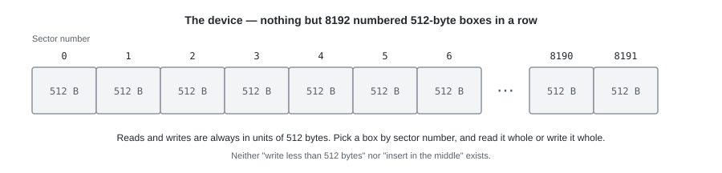
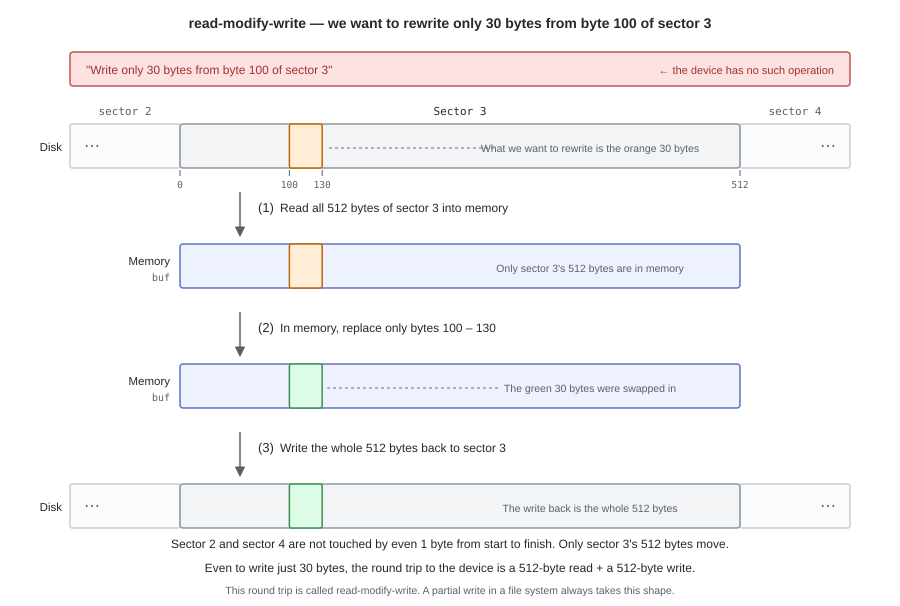
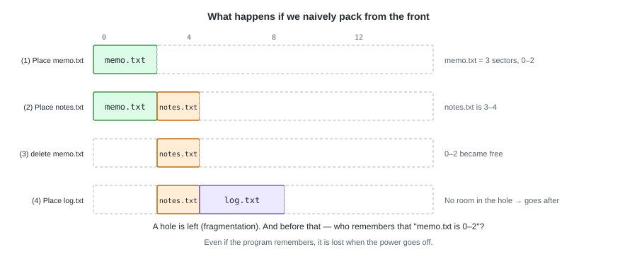
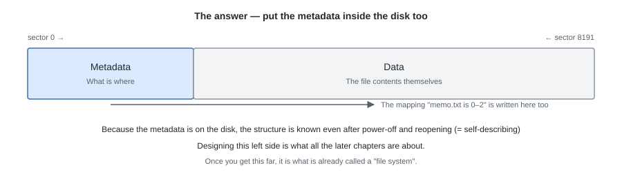
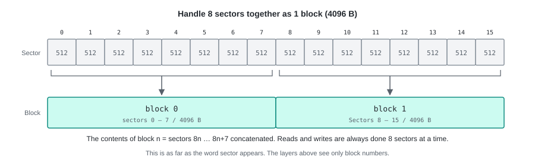

# Part I  From Problems to Concepts

---

# 01. The Disk as a Device


Storage such as an HDD or an SSD is different from memory.
With memory you can ordinarily "read just 1 byte at byte 100" or "write just 1 byte there",
but **storage is not something you access byte by byte**.
Reads and writes can only be done in chunks of a fixed size.

So how do you operate it?

---

## 1. Preparing the device

We treat **a single file named `disk.img` as if it were a disk**.
Its content is just a plain 4 MiB region, and dividing that into 512-byte pieces and numbering them
is what this chapter calls the "device". One of these pieces is a **sector**,
which is the smallest unit the device can handle.
With a real HDD, SSD, or USB stick, the way of thinking below does not change.



This device is equipped with only two functions.

- **Read the 512 bytes of the n-th sector** specified
- **Write 512 bytes to the n-th sector** specified

A request like "write only 30 bytes starting at byte 100" does not exist for this device.
If you want to rewrite 30 bytes, you read 512 bytes of that sector, replace 30 bytes in memory,
and write the 512 bytes back. This is called **read-modify-write**.



This shape comes up again and again later (the partial write in chapter 3, the entry removal in chapter 4).

One more thing: the device **does not manage free space for you**.
Whether sector 7 holds meaningful data, or garbage that nobody is using,
is not something the device can answer.
"All zeros means unused" does not hold either
(zeros can be correct data).

---

## 2. The problem — we want to save some text

We want to save `memo.txt` (1200 bytes) and `notes.txt` (800 bytes).
What happens if we try to do this with nothing but the device?

1200 bytes fits in 3 sectors (1536 bytes). Packing from the front,
we write `memo.txt` into sectors 0–2 and `notes.txt` into sectors 3 and 4.
After that we delete `memo.txt`, and place a third file `log.txt` (4 sectors' worth).



Placing them works. It breaks after that: deleting leaves a hole,
and anything too large to fit in that hole has to go behind. Append to one and it collides with its neighbour.

Before any of that, what remains on the disk is only a byte sequence.
**Neither where `memo.txt` begins and ends, nor the fact that its length is 1200 bytes,
is written anywhere.** What remembers them is a variable in the program, and that disappears when it ends.
The next time you open it, what is there is nothing but 4 MiB of numbers whose meaning is unknown.

---

## 3. The shape of the answer — put the management information on the disk too

"What is where" gets written on the same disk as the data.
Part of the 4 MiB is used not for file contents but for **metadata**.



This is a **file system**, and it fills in the functions the device does not have **with data structures on the disk**.

What we are going to decide comes down to these three.

1. **Free-space management** — which blocks are in use (chapter 2: the bitmap)
2. **Representing a file** — which block is which byte of which file (chapter 3: the i-node)
3. **Names** — the correspondence between file / directory names and i-node numbers (chapter 4: the directory)

And then, "where each of them is placed on the disk" is fixed in chapter 5.

---

## 4. Deciding the unit we work in — from sectors to blocks

Before designing the management information, we settle on a unit.
The file system from here on does not handle 512-byte sectors directly.
**8 sectors = 4096 bytes is one block**, and we always think in units of blocks.



```python
# Going from a block number to a sector number is just a multiplication
first_sector = block_no * SECTORS_PER_BLOCK   # 8
```

4096 bytes is the same as Linux's page size, and it lets us handle a large region
while keeping the management information small. The price is that **allocation happens in units of blocks**.
Even a 1-byte file consumes 4096 bytes, and the amount of unused space grows.

From this chapter on, **the word sector hardly appears**.
The only layer that knows about sectors is the one that wraps the device (`device.py`),
and the layers above it see nothing but block numbers.

---

## 5. Implementation

tiny-fs is built **by stacking layers**. The lower the layer, the closer to the device,
and **each layer calls only the layers below itself**. There are 7 layers in all, and they stack up as the chapters progress.


What we build in this chapter is the bottom two, `device.py` (L0) and `disk.py` (L1).
Since neither of them "knows the layers above", each is done in about 10 lines.

### `device.py` — a model of the device (L0)

```python
class SectorDevice:
    """Show a single image file as an array of 512-byte sectors."""

    def read_sector(self, sector_no: int) -> bytes:
        # Do not quietly return 0 for out-of-range; always fail with an exception.
        # A bug where something "can be read" is extremely hard to trace back later.
        self._check_range(sector_no)
        self._file.seek(sector_no * SECTOR_SIZE)
        return self._file.read(SECTOR_SIZE)

    def write_sector(self, sector_no: int, data: bytes) -> None:
        # Accept nothing but exactly 512 bytes (keep the nature of the device as it is)
        if len(data) != SECTOR_SIZE:
            raise ValueError(...)
        ...
```

### `disk.py` — bundling into blocks (L1)

```python
class BlockDevice:
    """A layer that does nothing but show 8 sectors bundled as one block."""

    def read_block(self, block_no: int) -> bytes:
        first = block_no * SECTORS_PER_BLOCK
        return b"".join(
            self._dev.read_sector(first + i) for i in range(SECTORS_PER_BLOCK)
        )
```

Call `write_block` and `write_sector` is called 8 times, reaching the device just like that.
This layer has neither a cache nor delayed writes.

### Tests

```python
def test_block_roundtrip(tmp_path):
    # What was written can be read back as it is (the most boring, and most effective, test)
    ...

def test_block_is_eight_sectors(tmp_path):
    # Writing to block 1 changes sectors 8-15, and leaves sectors 7 and 16 unchanged
    ...

def test_out_of_range_raises(tmp_path):
    # An out-of-range block number raises an exception
    ...
```

The second test is the effective one. Even if the correspondence between blocks and sectors is off,
a test that only "writes and reads" will pass, so we directly confirm
**whether it is written at the right position as seen from the device side**.

---

## Try it

```bash
pytest -q tests/test_device.py tests/test_disk.py
```

`test_block_is_eight_sectors` confirms that a write to block 1
changes only sectors 8–15.

---

In the next chapter, for these 1024 blocks, we think about
**how to record "which ones are in use"**.
