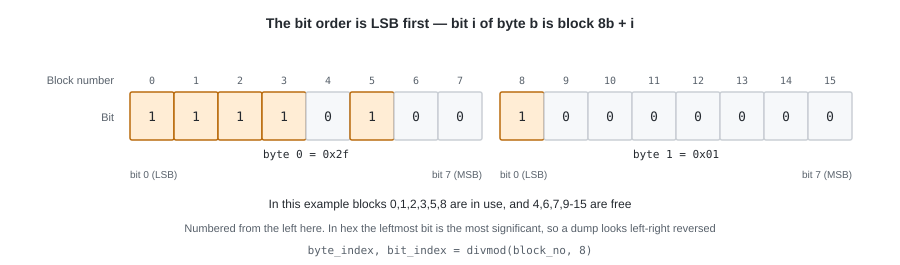
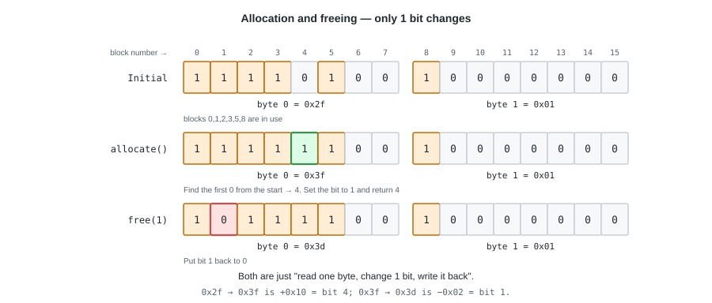

# 02. Which Parts Are Free — the Bitmap


Being able to read and write sectors is not enough to create a file.
From this chapter on, we tackle that problem.

The first thing we need is **free-space management**. Without it, we cannot even decide where to put one file.

---

## 1. The problem — we want to tell "in use" from "unused"

Dividing 4 MiB into 4096-byte pieces, **there are 1024 blocks in total**.
Which of them is in use cannot be learned by asking the device or by reading the contents (chapter 1).
There is no choice but to record it separately.

---

## 2. The bitmap as a method

The standard approach in a case like this is the **bitmap**.

What we want to record is only the two-valued "in use / free" per block,
so **a single bit is enough**. So we put the state of block number `n` into the `n`-th bit.
Because **the position itself represents the block number**, we are spared from writing "which block this is about".

For 1024 blocks that is 1024 bits = **128 bytes**. The whole bitmap fits comfortably into one block.
The meaning of a bit is **0 is free, 1 is in use**.



The bit order is **LSB first**. Bit `i` of byte `b` corresponds to block `8 * b + i`.

```python
# block number -> (which byte, which bit)
byte_index, bit_index = divmod(block_no, 8)
mask = 1 << bit_index

is_used = buf[byte_index] & mask != 0
```

> **Python tips** — `divmod(a, b)` is a built-in function that returns the quotient and the remainder together,
> and is the same as `(a // b, a % b)`. `divmod(11, 8)` is `(1, 3)`, so
> "block 11 is bit 3 of byte 1" is obtained in one line.
> The "offset -> (which block, which byte)" of chapter 3 takes the same shape.

**The order in the figure and the order in the code agree.** It only looks reversed
when you write that one byte as a "number" in hexadecimal or binary.

```python
# The order in the figure (block 0 from the left)
#   block : 0  1  2  3  4  5  6  7
#   bit   : 1  1  1  1  0  1  0  0
#
# Writing this as a one-byte number gives
#   buf[0] == 0x2f == 0b0010_1111
#                        ~~~~ ~~~~ <- a number has its high digits on the left, so left and right look flipped from the figure
#
# Read from the figure or read from the number, the expression for checking block n is the same
buf[0] >> 3 & 1 == 1     # block 3 is in use
buf[0] >> 4 & 1 == 0     # block 4 is free
```

### How much can one block manage?

The bitmap itself uses one block (4096 bytes).
Of the 1024 blocks, one is this bitmap,
and the rest become the **data blocks** where file contents are placed.

Managing 1024 blocks needs only the first 128 bytes, and the rest is left as 0.
Those zeros are not "free blocks", so **we cut the scan off at `capacity`**.
We do not fill the remainder with 1s in order to keep the meaning of a bit to the single "0 = free / 1 = in use".

The upper limit expressible with one block is 4096 × 8 = 32768 blocks = 128 MiB.
tiny-fs is fixed at 1024 blocks, so it never reaches that.

---

## 3. Allocation and freeing



**Allocation** is "search from the front, set the first 0 bit found to 1, and return that number".
This is called **first-fit**.

**Freeing** is "set that bit to 0". That alone, and
**we do not touch the contents of the data block** (it will be overwritten the next time it is allocated).
This is why the contents of a deleted file keep remaining on the disk.

We settle two boundary behaviours.

- When **there is no free space**, `allocate()` does not return `-1` or `None`, but fails with an `ENOSPC` exception
  (`ENOSPC` is the POSIX error number for "no space left on device". There is a list in appendix B).
- Trying to **free a bit that is already 0** raises an exception. If a double free quietly succeeds,
  the same block will later be allocated to two files.

### `free_hint` — so we do not search from the front every time

Searching from the front every time means scanning the front of the disk over and over.
So we **take the position to start searching from next as a hint**.
This value is kept in the superblock and persisted (chapter 5).

Even if the hint is stale or wrong, it does not affect correctness (the search just wraps around once).

---

## 4. Implementation — `bitmap.py` (L2)

This layer does not touch the disk. **It takes a `bytearray` in memory and only manipulates bits.**
Reading a block and handing it over, and writing it back after the change, is the job of the layer above (`fs.py`).

> **Python tips** — `bytearray` is the built-in mutable version of `bytes`,
> and the contents of both are a sequence of integers from 0 to 255. An assignment like `buf[i] |= ...` is not possible on `bytes`,
> so the `bytes` read from the disk is copied with `bytearray(...)` before being handed to this layer (chapter 7).
> `bytearray(4096)`, which takes an integer, becomes "4096 zero bytes".
> In chapter 3 we use it to treat a data block that has just been allocated
> as "all zeros" without reading it from the disk.
> Only 0 to 255 can be assigned to an element; outside that range you get a `ValueError`.

```python
class Bitmap:
    """An array of bits. If bit i is 1, then "number i is in use".

    buf is exactly the one block read from the disk. capacity is
    "how many of them actually exist" (e.g. 1024 blocks / 129 i-nodes).
    """

    def __init__(self, buf: bytearray, capacity: int) -> None:
        self._buf = buf
        self._capacity = capacity

    def is_used(self, index: int) -> bool:
        self._check_range(index)
        byte_index, bit_index = divmod(index, 8)
        return self._buf[byte_index] & (1 << bit_index) != 0

    def mark_used(self, index: int) -> None:
        self._check_range(index)
        byte_index, bit_index = divmod(index, 8)
        self._buf[byte_index] |= 1 << bit_index

    def mark_free(self, index: int) -> None:
        self._check_range(index)
        if not self.is_used(index):
            # A double free. Either a bug in the layer above, or the image is corrupt
            raise CorruptionError(f"index {index} is already free")
        byte_index, bit_index = divmod(index, 8)
        # Python's ~ returns a negative number (~1 == -2), so always bring it back to one byte with & 0xFF.
        # Forget this and the assignment into the bytearray raises ValueError.
        self._buf[byte_index] &= ~(1 << bit_index) & 0xFF
```

Allocation is written as a loop that wraps around once from the hint.

```python
    def allocate(self, hint: int = 0) -> int:
        # Since we cut off at capacity, the leftover part of buf can never be allocated
        order = list(range(hint, self._capacity)) + list(range(0, hint))
        for index in order:
            if not self.is_used(index):
                self.mark_used(index)
                return index
        raise NoSpaceError("no free entry left")

    def count_used(self) -> int:
        # capacity is not necessarily a multiple of 8.
        # For the last byte, mask off everything but the in-range bits before counting.
        full_bytes, extra_bits = divmod(self._capacity, 8)
        used = sum(byte.bit_count() for byte in self._buf[:full_bytes])
        if extra_bits:
            mask = (1 << extra_bits) - 1
            used += (self._buf[full_bytes] & mask).bit_count()
        return used

    def count_free(self) -> int:
        return self._capacity - self.count_used()
```

> **Python tips** — `bit_count()` is a method on `int` from Python 3.10 onwards.
> It is faster than counting by hand, and above all the intent "count the bits that are set" comes out directly.

---

## 5. Tests

```python
def test_alloc_marks_used():
    # After allocating, is_used is True, and the same number is never returned twice

def test_alloc_until_full_raises_nospace():
    # capacity entries can be taken, and the next one is ENOSPC

def test_free_then_alloc_reuses_the_same_index():
    # After freeing, that number comes back again (= the free space really did return)

def test_double_free_raises():
    # A double free is not let through quietly

def test_bit_position_matches_the_spec():
    # After marking index 8 as in use, buf[1] == 0x01.
    # This checks the "bit order convention" directly. With only a roundtrip test
    # you would not notice if it had been implemented MSB first.

def test_capacity_limits_allocation():
    # Even if buf is 4096 bytes, if capacity is 1024 then only 1024 can be taken,
    # and from byte 128 of buf onwards it stays 0
```

**A convention you decided yourself is protected by a test that looks at the convention itself, not by a roundtrip test.**
The fifth one has the same role as the "correspondence between blocks and sectors" test of chapter 1.

---

## Try it

```bash
pytest -q tests/test_bitmap.py
```

---

In the next chapter we take a step forward from the state where blocks can be allocated.
**Where do we write down that an allocated block is "which byte of which file"?**
