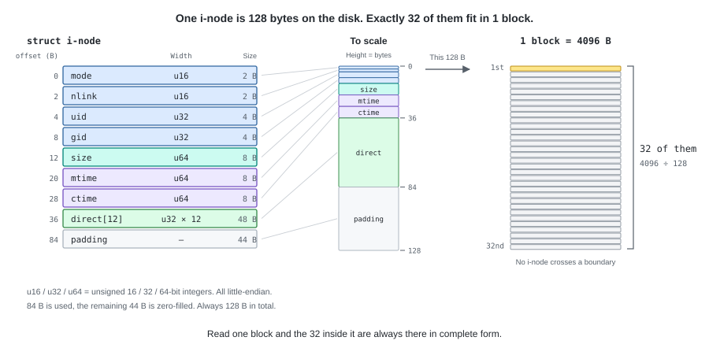
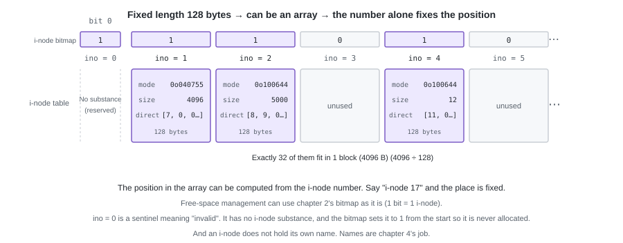
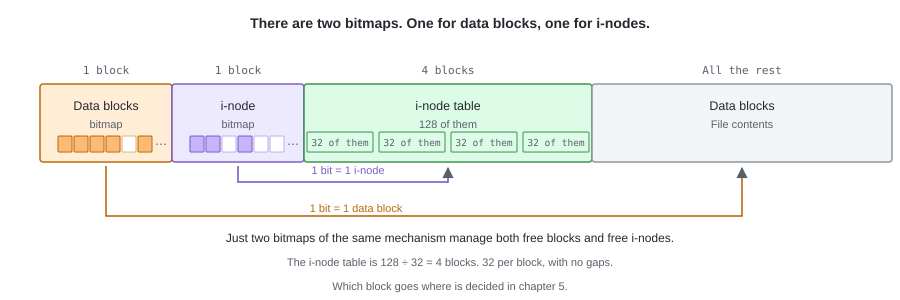
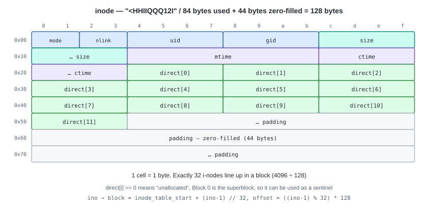

# 03. The Bitmap Alone Is Not Enough — the i-node


With the bitmap, we became able to allocate a free data block.
But the information the bitmap holds is only the single bit "is that block in use or not",
and **which file an allocated block belongs to is not recorded**.

Even after writing 1200 bytes into block 7, all we can tell the next time we open this image
is "number 7 is in use". Which byte of which file it corresponds to,
and how many bytes long that file is, is left nowhere.

---

## 1. The i-node — gathering the information for one file

For each file we prepare one **fixed-length 128-byte** structure,
and put into it the list of block numbers and the metadata.
We call this an **i-node**.

```python
# tiny_fs/constants.py
INODE_SIZE = 128                                # the on-disk size of one i-node
NDIRECT = 12                                    # the length of the list of block numbers
INODES_PER_BLOCK = BLOCK_SIZE // INODE_SIZE     # 4096 / 128 = 32
```

```python
# tiny_fs/inode.py
@dataclass
class Inode:
    """One i-node. On disk it occupies 128 bytes."""

    mode: int           # u16       file type + permissions
    nlink: int          # u16       the number of names pointing at this i-node
    uid: int            # u32       owner
    gid: int            # u32
    size: int           # u64       file size in bytes
    mtime: int          # u64       time the contents were updated
    ctime: int          # u64       time the metadata was updated
    direct: list[int]   # u32 x 12  numbers of the blocks holding the contents. 0 is unallocated
```

**Python's `int` has no width**, so how many bits each field has is authoritatively given by the
`u16` / `u32` / `u64` (unsigned 16 / 32 / 64-bit integers) shown in the comments.
These widths come into play when writing to the disk with `INODE_FMT` in the next section.

The omissions listed at the start of the chapter are filled in by `direct` and `size`.
The only thing pointing at the file contents is `direct`; the rest is metadata.

| Member | Meaning |
|---|---|
| `direct` | A list of the numbers of the blocks holding the file contents, lined up in order from the front. `direct[k]` points at the block starting at byte `4096 × k` of the file. `0` is unallocated. Details below |
| `size` | The length of the file. Not a block count but **in bytes**, so this is also what decides where in the last block the contents end |
| `mode` | The file type (regular file or directory) and the permissions. Both are packed into a single integer |
| `uid` / `gid` | The owner's user ID and group ID |
| `mtime` / `ctime` | The time the contents were updated / the time the metadata was updated. Unix epoch seconds |
| `nlink` | The number of names pointing at this i-node. Names have not appeared yet, so this is handled in chapter 4 |



What is actually used is 84 bytes, and the remaining 44 bytes are filled with zeros to always make 128 bytes
(when adding a field, take it out of this padding).
**Exactly 32 i-nodes line up in one block.** 128 is a divisor of 4096 so it divides evenly,
and no i-node straddles a block boundary.



Because things of the same size line up with no gaps, the whole thing becomes an **array**.
The position inside the array becomes the **i-node number**, so if you say "i-node number 17",
the position is determined without any search.

And **whether that i-node is in use can be managed with the bitmap of chapter 2**.
1 bit = 1 i-node. We just use the `Bitmap` built for blocks for one more, separate purpose.
When creating a new file, the number returned by `allocate()` becomes the new i-node number as it is.



Since we line up bit numbers with i-node numbers, what the bitmap covers is
**the `NUM_INODES + 1` entries from bit 0 to bit `NUM_INODES`** (bit 0 being the reserved one described next).

The count is fixed at 128. = **the i-node table is 4 blocks**.
Being an array it cannot be grown later, and even if capacity is left over,
once i-nodes run out no more files can be created (`ENOSPC`).

### i-node numbers start at 1

i-node numbers **start at 1**, and **0 is reserved as a sentinel meaning "invalid / unused"**.
`ino == 0` means "there is no such thing", and this will come up again and again
(the free slot of a directory in chapter 4 is one such case).
On the bitmap side, if bit 0 is marked in use from the beginning, number 0 will never be allocated.

### And the i-node has no name

It has `mode`, `size`, and timestamps, yet **the file name alone is not in there**.
What points at an i-node is always a number; names are held by the directory of the next chapter.

---

## 2. A concrete example — writing out 128 bytes

Let us look at what byte sequence the `Inode` of §1 actually becomes on disk.

Which member takes how many bytes, and in what order they line up,
is expressed by a single **format string** of the standard library's `struct`.

```python
# tiny_fs/constants.py
INODE_FMT = "<HHIIQQQ12I"   # 84 bytes. Padded with zeros up to 128 bytes
```

It looks like a cipher, but it is nothing more than "types" lined up one character at a time.

| Symbol | Meaning | Corresponding member |
|---|---|---|
| `<` | **Little-endian** (low byte first), and **no padding inserted** | — |
| `H` | Unsigned 2-byte integer (u16) | `mode` |
| `H` | ditto | `nlink` |
| `I` | Unsigned 4-byte integer (u32) | `uid` |
| `I` | ditto | `gid` |
| `Q` | Unsigned 8-byte integer (u64) | `size` |
| `Q` | ditto | `mtime` |
| `Q` | ditto | `ctime` |
| `12I` | 12 of `I` = 48 bytes | `direct[0]` – `direct[11]` |

The total is 2 + 2 + 4 + 4 + 8 + 8 + 8 + 48 = **84 bytes**
(you can confirm it with `struct.calcsize(INODE_FMT)`).

The leading `<` must not be forgotten. Without it, the byte order is left up to the CPU of the runtime environment,
and on top of that the same padding as in C is inserted, turning 84 bytes into 88 bytes.

This single format string is the on-disk specification of the i-node itself.
What makes the round trip between it and `Inode` is `encode` / `decode`.

```python
    def encode(self) -> bytes:
        packed = struct.pack(INODE_FMT, self.mode, self.nlink, self.uid, self.gid,
                             self.size, self.mtime, self.ctime, *self.direct)
        # Stretch 84 bytes to 128 bytes. The padding is always kept at zero
        return packed.ljust(INODE_SIZE, b"\x00")

    @classmethod
    def decode(cls, raw: bytes) -> "Inode":
        if len(raw) != INODE_SIZE:
            raise ValueError(...)
        values = struct.unpack(INODE_FMT, raw[:struct.calcsize(INODE_FMT)])
        return cls(*values[:7], direct=list(values[7:]))
```

> **Python tips** — `encode` is an instance method, `decode` is a `@classmethod`.
> The first argument (`self` / `cls`) is not written by the caller;
> **what you write to the left of the dot goes in there**.
>
> ```python
> class Inode:
>     def encode(self):            # the first argument is self
>         ...
>
>     @classmethod
>     def decode(cls, raw):        # the first argument is cls
>         return cls(mode=..., size=...)
>
> inode.encode()      # to the left of the dot is inode  -> self = that Inode instance
> Inode.decode(raw)   # to the left of the dot is Inode  -> cls  = the Inode class itself
> ```
>
> When you call `decode` as `Inode.decode(raw)`, `cls` becomes `Inode`, so
> the `cls(mode=..., size=...)` inside it means the same as `Inode(mode=..., size=...)`,
> and one new `Inode` comes into being.
>
> The reason `decode` is a `@classmethod` is that at the moment of calling there is only a 128-byte byte sequence,
> and there is not yet an `Inode` instance to put to the left of the dot.
> It is an alternative entrance to the constructor, the same as `datetime.fromtimestamp()` and friends.
> The `Dirent` of chapter 4 takes the same shape.



The actual byte sequence of a 5000-byte file (using blocks 8 and 9).
`size` / `mtime` / `ctime` are 8 bytes, so they straddle the 16-byte-delimited lines.
One line of the figure above corresponds directly to one line (16 bytes) of the dump.

```
00000000  a4 81 01 00 00 00 00 00 00 00 00 00 88 13 00 00  |................|
          ^^^^^ ^^^^^ ^^^^^^^^^^^ ^^^^^^^^^^^ ^^^^^^^^^^^
          mode  nlink uid=0       gid=0       size low half (= 5000)
00000010  00 00 00 00 c0 10 b5 6a 00 00 00 00 c0 10 b5 6a  |.......j.......j|
          ^^^^^^^^^^^ ^^^^^^^^^^^^^^^^^^^^^^^ ^^^^^^^^^^^
          size high  mtime = 0x6ab510c0      ctime low
00000020  00 00 00 00 08 00 00 00 09 00 00 00 00 00 00 00  |................|
          ^^^^^^^^^^^ ^^^^^^^^^^^ ^^^^^^^^^^^ ^^^^^^^^^^^
          ctime high direct[0]=8 direct[1]=9 direct[2]=0
00000030  ... zeros from here on up to byte 128 ...
```

- `mode = 0x81a4 = 0o100644` — the sum of the type `0o100000` (`S_IFREG` = regular file) and
  the permissions `0o644` (`rw-r--r--`).
  **The high 4 bits are the type, and the low 9 bits are the permissions.**
  We write it in octal because one digit (3 bits) corresponds exactly to one `rwx` set.
  The low three digits `6` `4` `4` line up directly as owner, group, and others.
- Even though `size = 5000`, two blocks (8192 bytes) are allocated.
  **From byte 904 of the last block onwards is garbage**, and the only thing that knows that it is not content
  is `size`.

---

## 3. From an offset to a block

![The correspondence between direct[12] and the data blocks](../images/en/03-direct-pointers.svg)

The conversion is just this.

```python
# Which byte of which block is logical offset byte off
index, inner = divmod(off, BLOCK_SIZE)
block_no = inode.direct[index]
```

The order of `direct[]` only represents the logical order of the file, and
**the block numbers do not have to be in ascending order** (the example in the figure is 7 -> 9 -> 8).
Since we just use whatever block was free, they scatter in the order they were written.

`direct[i] == 0` means "not allocated yet".
Block 0 becomes the superblock in chapter 5, so
0 never appears as a data block number, and it can safely be used as a sentinel.

### The upper limit on file size

```
MAX_FILE_SIZE = NDIRECT × BLOCK_SIZE = 12 × 4096 = 49152 bytes = 48 KiB
```

Since we hold only 12 entries in the list, **no file larger than 48 KiB can be created**.
A write beyond that is rejected with `EFBIG`.
How to get past this wall is handled in chapter 14.

### `size` and the allocated blocks

`size` expresses the size of the file in bytes. The allocated blocks are
`ceil(size / 4096)` of them, and if you shrink with `truncate`, the leftover blocks are freed on the spot.

Also, **we do not create holes (sparse files)**.
If you write suddenly at `offset = 20000`, the blocks before it are actually allocated too and filled with zeros.
If `direct[i] == 0` had the two meanings "not allocated" and "an all-zero block",
detecting leaks would become a great deal more troublesome.

---

## 4. Implementation — `inode.py` (L3)

The structure (§1) and the conversion to and from a byte sequence (§2) are already written.
Here we add **allocating and freeing an i-node**, and functions to **read and write the file contents**.
This layer, too, does not know where on the disk it is placed.
It takes the `BlockDevice` of chapter 1, which reads and writes blocks, and the block / i-node allocators,
as arguments. An allocator is an object that has `allocate()` and `mark_free()`,
and the `Bitmap` of chapter 2 satisfies this interface. The type annotation takes them through a
`Protocol` (`Allocator`) that declares only these two, so `inode.py` does not import `bitmap.py`.

### Allocating and freeing an i-node

As in §1, an i-node number is itself the index into the i-node bitmap, so
**the number returned by `allocate()` becomes the new i-node number as it is**.

```python
def allocate_inode(inode_bitmap, mode: int, now: int) -> tuple[int, Inode]:
    """Take one free i-node number and return a brand-new Inode."""
    # bit 0 is filled in by mkfs, so ino = 0 can never be returned
    ino = inode_bitmap.allocate()
    inode = Inode(mode=mode, nlink=0, uid=0, gid=0, size=0,
                  mtime=now, ctime=now, direct=[0] * NDIRECT)
    # nlink is still 0. It becomes 1 the moment one name is attached (chapter 7)
    return ino, inode


def free_inode(inode: Inode, blocks, alloc, inode_bitmap, ino: int) -> None:
    """Free all the data blocks the i-node holds, and return the i-node number to the free pool."""
    # Data blocks first. Reverse the order and, if it dies partway through,
    # "a block that is in use although nothing references it" is left behind
    truncate(inode, blocks, alloc, 0)     # <- written in the section after this
    inode_bitmap.mark_free(ino)
```

The processing that frees the blocks is exactly the same as "shrink to size 0",
so we can just call the `truncate` of the next section.

Neither of them touches the on-disk i-node table. What `allocate_inode` returns is
a number and an in-memory `Inode`, and what decides where to write those 128 bytes is `fs.py` (chapter 5).

### Reading and writing the file contents

What we read and write is **only the data blocks that this i-node points at via `direct[]`**.
The position is specified as a byte count from the start of the file (`offset`), and
decomposing it into which index of `direct[]` and which byte of that block is this function's job.
The caller never passes a block number.

The length to read is clamped so that it does not exceed `size`.

```python
def read(inode: Inode, blocks: BlockDevice, offset: int, length: int) -> bytes:
    # Past size is "outside the file". Even if a block is allocated, do not read it
    length = max(0, min(length, inode.size - offset))
    out = bytearray()
    while length > 0:
        index, inner = divmod(offset, BLOCK_SIZE)
        n = min(length, BLOCK_SIZE - inner)
        block_no = inode.direct[index]
        if block_no == 0:
            # The design does not create holes, so if the inside of size is unallocated it is corrupt
            raise CorruptionError(...)
        out += blocks.read_block(block_no)[inner:inner + n]
        offset += n
        length -= n
    return bytes(out)
```

Writing becomes read-modify-write.
The device of chapter 1 has no partial-write function, so we implement that in this layer.

```python
def write(inode: Inode, blocks: BlockDevice, alloc: Allocator,
          offset: int, data: bytes) -> None:
    if offset + len(data) > MAX_FILE_SIZE:
        raise FileTooBigError(...)          # EFBIG
    if offset > inode.size:
        # Do not create holes. First fill the skipped part in front with zeros in real blocks
        truncate(inode, blocks, alloc, offset)

    pos = 0
    while pos < len(data):
        index, inner = divmod(offset + pos, BLOCK_SIZE)
        n = min(len(data) - pos, BLOCK_SIZE - inner)

        if inode.direct[index] == 0:
            # There is no block for this range yet. Since it was just allocated,
            # treat it as all zeros without reading from the disk
            inode.direct[index] = alloc.allocate()
            buf = bytearray(BLOCK_SIZE)
        else:
            # We rewrite only part of the block, so read it first and then replace
            buf = bytearray(blocks.read_block(inode.direct[index]))

        buf[inner:inner + n] = data[pos:pos + n]
        blocks.write_block(inode.direct[index], buf)
        pos += n

    inode.size = max(inode.size, offset + len(data))
```

`truncate` changes the size of the file to `new_size`.
Not only shrinking but also growing is handled by this function,
and the processing goes in opposite directions: growing fills with zeros, shrinking frees the leftover blocks.

```python
def truncate(inode, blocks, alloc, new_size):
    if new_size > MAX_FILE_SIZE:
        raise FileTooBigError(...)          # EFBIG

    if new_size > inode.size:
        # Growing is the same as "writing zeros". Do not create holes
        # (size is updated by write)
        write(inode, blocks, alloc, inode.size, b"\x00" * (new_size - inode.size))
    else:
        # Shrinking frees the blocks that are no longer needed, on the spot.
        # Forget this and only the bitmap keeps filling up (fsck detects it)
        first_unused = math.ceil(new_size / BLOCK_SIZE)
        for index in range(first_unused, NDIRECT):
            if inode.direct[index] != 0:
                alloc.mark_free(inode.direct[index])
                inode.direct[index] = 0
        inode.size = new_size
```

---

## 5. Tests

```python
def test_encode_decode_roundtrip():
    # It becomes 128 bytes. The same values come back after a round trip

def test_encoded_size_is_exactly_128():
    # The 44 bytes of padding are zero (a check of the convention itself)

def test_write_across_block_boundary():
    # Write 12 bytes from byte 4090 -> it straddles 2 blocks
    # As seen from the device side, both blocks have changed correctly

def test_partial_write_preserves_neighbours():
    # Rewrite only 10 bytes in the middle of a block, and what is before and after is not broken
    # (whether read-modify-write is working)

def test_read_stops_at_size():
    # When size = 5000, trying to read 8192 bytes returns only 5000

def test_write_beyond_max_file_size_raises_efbig():
    # Exactly 49152 can be written, and 49153 is EFBIG

def test_truncate_shrink_frees_blocks():
    # The blocks for the shrunk part have been freed

def test_truncate_grow_fills_zero():
    # The grown part reads as zeros (no garbage is visible)

def test_allocate_inode_never_returns_zero():
    # Take one starting from a state where bit 0 is filled, and 1 or more is returned.
    # The returned Inode has size = 0 and direct all 0

def test_free_inode_returns_blocks_and_number():
    # Freeing an i-node that uses 3 blocks
    # returns 3 to the free block count, and returns that i-node number to the free pool too
```

The important ones are `test_partial_write_preserves_neighbours` and
`test_truncate_shrink_frees_blocks`. A test that only checks that **what was written can be read**
can detect neither a missing read-modify-write nor a leak.

---

## Try it

```bash
pytest -q tests/test_inode.py

# Confirm the byte count of the structure yourself
python -c "import struct; print(struct.calcsize('<HHIIQQQ12I'))"   # 84
python -c "import struct; print(struct.calcsize('HHIIQQQ12I'))"    # 88 (with padding)
```

---

Up to here, file contents and metadata can be represented with the i-node.
But the name `A.txt` is still nowhere, and a file can only be specified by i-node number.
In the next chapter we implement the **directory**, which associates names with i-node numbers.
