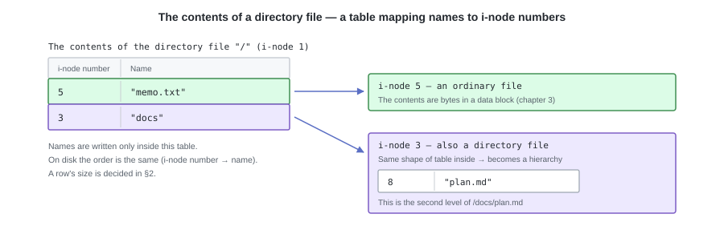
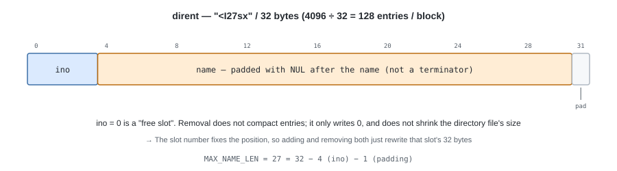
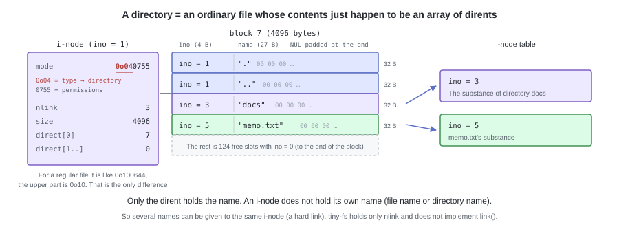
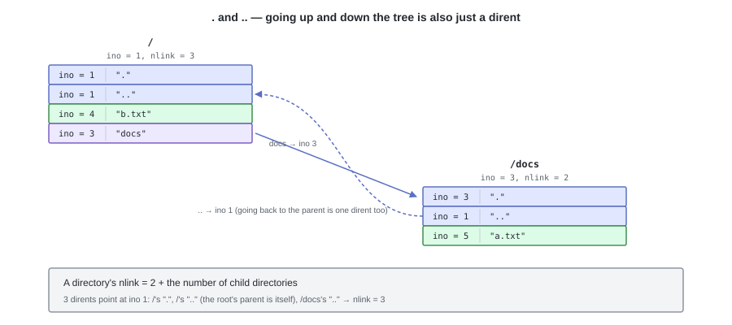
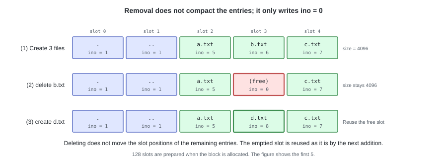

# 04. How to Attach Names — the Directory


Thanks to the i-node, file contents and metadata can now be represented.
However, the only means of specifying an i-node is its number, and **the i-node itself has no name**.
A route from the file name `memo.txt` to the i-node does not yet exist anywhere.

There are two things we prepare in this chapter: **a table that looks up an i-node number from a name**,
and a mechanism to **classify** them when files multiply (the hierarchy of "under `docs/`", "under `src/`").

---

## 1. A directory is, in fact, a file

A directory is a kind of file, called a **directory file**.
It has one i-node, and holds its contents in data blocks.
The only difference from a regular file is that its contents are "a table mapping names to i-node numbers".



Since another directory can be pointed at from within the table, directories nest, and the whole thing becomes a tree.

---

## 2. dirent — one row of the table

One row of the table is called a **dirent** (directory entry).
Like the i-node, it is made a **fixed-length** structure. Its size is 32 bytes.

```python
# tiny_fs/constants.py
DIRENT_SIZE = 32                                # the on-disk size of one dirent
DIRENT_FMT = "<I27sx"                           # ino(4) + name(27) + padding(1)
MAX_NAME_LEN = 27                               # 32 - 4 (ino) - 1 (padding)
DIRENTS_PER_BLOCK = BLOCK_SIZE // DIRENT_SIZE   # 4096 / 32 = 128
```

```python
# tiny_fs/directory.py
@dataclass
class Dirent:
    """One dirent. On disk it occupies 32 bytes."""

    ino: int      # u32   the i-node number pointed at. 0 means "free slot"
    name: bytes   # 27 B  the file name. Written NUL-padded on the right to 27 bytes
```

| Member | Meaning |
|---|---|
| `ino` | The i-node number this name points at. **`0` represents a "free slot"** (reserving 0 as a sentinel in chapter 3 is used here) |
| `name` | The file name. Whatever falls short of 27 bytes is filled with NUL (**NUL padding**). This is not a symbol indicating the end of the name, but a way to align the length to 27 bytes. A name of exactly 27 bytes contains not a single NUL byte |

The `27s` of `DIRENT_FMT` is a fixed-length 27-byte byte string, and the trailing `x` is 1 byte of padding (value 0) to align to 32 bytes.
`27s` automatically pads the right side with NUL on writing, so no processing to align the length is needed on the `encode` side.

```python
    def encode(self) -> bytes:
        return struct.pack(DIRENT_FMT, self.ino, self.name)

    @classmethod
    def decode(cls, raw: bytes) -> "Dirent":
        ino, name = struct.unpack(DIRENT_FMT, raw)
        # Strip the padding NULs to get back the original name
        return cls(ino=ino, name=name.rstrip(b"\x00"))
```



The actual byte sequence of the dirent for `memo.txt` -> i-node 5, and of the free slot that follows it:

```
00000000  05 00 00 00 6d 65 6d 6f 2e 74 78 74 00 00 00 00  |....memo.txt....|
          ^^^^^^^^^^^ ^^^^^^^^^^^^^^^^^^^^^^^ ^^^^^^^^^^^
          ino = 5     "memo.txt" (8 bytes)    after the name it is filled with NUL (0x00)
                                              -> up to 0x1E (27 bytes). Not a terminator, but NUL padding
00000010  00 00 00 00 00 00 00 00 00 00 00 00 00 00 00 00  |................|
                                                       ^^ 0x1F = the padding (x). That makes 32 bytes
00000020  00 00 00 00 00 00 00 00 00 00 00 00 00 00 00 00  |................|
          ^^^^^^^^^^^ ino = 0 -> this slot is free
00000030  00 00 00 00 00 00 00 00 00 00 00 00 00 00 00 00  |................|
```

Since 32 is a divisor of `BLOCK_SIZE`, exactly 128 entries fit in one block, and
**a dirent never straddles a block**.
Furthermore, since the position is determined by calculation as "the n-th entry is at byte `32n`",
both addition and removal are done just by rewriting the 32 bytes of that slot (§5).

Because the `name` field is a fixed length of 27 bytes, it can be recovered without holding the length of the name in a separate field.
`decode` strips the trailing NULs, and **after that a match can be judged with a single `bytes` comparison**.

We also settle what is not accepted as a name.

| Name | Result |
|---|---|
| 28 bytes or more | `ENAMETOOLONG` |
| The empty string | `EINVAL` |
| Contains `/` | `EINVAL` (it is the path separator, so it cannot go into a name) |
| Contains NUL | `EINVAL` (it would become indistinguishable from the NUL padding) |
| A name that already exists | `EEXIST` |

---

## 3. A directory is an ordinary file



A directory also has an i-node. Its data blocks go into `direct[]` (12 elements) in order from `direct[0]`,
and `size` is held in bytes.
**The only difference from an ordinary file is the type bits of `mode`** (whether `S_IFDIR` or `S_IFREG`).

However, the way `size` behaves is different. A directory's `size` is always a multiple of `BLOCK_SIZE`,
and grows by 4096 each time one block is allocated. The 4096 bytes that are added are entirely zeros, so
they become 128 free slots with `ino = 0` just as they are. As long as there are free slots `size` does not change, and
**once it has grown it never shrinks** (removal only writes `ino = 0`. §5).

In other words, a directory's `size` does not express "how many entries there are now", but
**"how much room for entries has been allocated"**. This is why `ls -l` shows a directory's size as
4096, rather than the total of the files inside.
The upper limit is also determined automatically: `MAX_FILE_SIZE` = 48 KiB,
so **one directory holds at most 1536 entries** (12 blocks × 128, including `.` and `..`).

---

## 4. `.` and `..` — tying the tree together



When creating a directory, **we always write `.` and `..` as the first two entries**.

- `.` is one's own i-node number
- `..` is the parent directory's i-node number. **The root's `..` is itself** (ino = 1)

Since going back to the parent also takes nothing more than looking up one dirent,
the path resolution of chapter 6 can be written without treating `..` specially.

### How `nlink` is counted

The `nlink` we put in the i-node in chapter 3 is **the number of dirents pointing at that i-node**.
For a directory it works out like this.

```
a directory's nlink = 2 + the number of child directories
                      |   +- each child's ".." points at us
                      +- our name inside the parent + our own "."
```

It is 2 for an empty directory, and goes up by 1 for each child directory added.
The reason the link count in `ls -l` is not 1 only for directories comes from this way of counting.

An ordinary file has `nlink = 1` (one name).
Releasing the i-node and the data blocks at the point it becomes 0 is the `unlink` of chapter 7.

### What is forbidden

- Removing or renaming `.` and `..` (the tree breaks)
- `rmdir` of a non-empty directory -> `ENOTEMPTY`.
  "Empty" means **there is no valid entry other than `.` and `..`**
- `rename`-ing a directory to below one of its own descendants (chapter 8. A cycle cut off from the tree is created)

---

## 5. Removal does not compact



When removing an entry, **we only write 0 into `ino`**.
We do not move the following entries forward, and we do not shrink `size` either.
The next time an entry is added, we first look for a free slot and reuse it.

Removal is finished with a single 32-byte write, and **entries that already exist keep living at byte `32n`**.

The price is that **a directory that has grown once never shrinks**.
Create 1000 entries and it stretches to 8 blocks (32768 bytes), and even after removing 999, `size` stays as it is.
A search scans that whole size every time. This is fragmentation inside a directory.

---

## 6. Implementation — `directory.py` (L4)

This layer only handles "a directory file with dirents lined up in it".
What each function receives is **one `Inode` for that directory**, and that alone is enough for it to work.
Reading and writing the file contents, that is the sequence of dirents, is left to `inode.read` / `inode.write` of chapter 3,
so there is no need to know where on the disk the directory is either.

Scanning is done by slot number. **Free slots (`ino == 0`) are skipped over.**

```python
def iter_entries(dir_inode, blocks):
    """Return the valid entries as (slot number, Dirent)."""
    # Reading 32 bytes at a time would mean reading one block per entry, so
    # read the directory file all at once and then split it up (at most 48 KiB)
    raw = inode.read(dir_inode, blocks, 0, dir_inode.size)
    for slot in range(len(raw) // DIRENT_SIZE):
        entry = Dirent.decode(raw[slot * DIRENT_SIZE:(slot + 1) * DIRENT_SIZE])
        if entry.ino != 0:          # 0 is a free slot
            yield slot, entry


def find(dir_inode, blocks, name: bytes) -> tuple[int, Dirent] | None:
    for slot, entry in iter_entries(dir_inode, blocks):
        if entry.name == name:
            return slot, entry
    return None


def lookup(dir_inode, blocks, name: bytes) -> int:
    """Look up an i-node number from a name. ENOENT if there is none."""
    found = find(dir_inode, blocks, name)
    if found is None:
        raise NotFoundError(name)
    return found[1].ino
```

Addition is "look for a free slot -> if there is none, append at the end".
Appending at the end means **growing the file** that is the directory.
That is, the `write` of chapter 3 is called just as it is, and if necessary one block is allocated.

```python
def add_entry(dir_inode, blocks, alloc, name: bytes, ino: int) -> None:
    check_name(name)                       # checks for length / '/' / NUL
    if exists(dir_inode, blocks, name):
        raise AlreadyExistsError(name)     # EEXIST

    slot = _find_free_slot(dir_inode, blocks)
    if slot is None:
        if dir_inode.size // DIRENT_SIZE >= MAX_DIRENTS:
            raise NoSpaceError(name)       # ENOSPC. 1536 entries is the limit
        # The free slots have run out. Grow the directory file by one block.
        # Growing with truncate fills with zeros, so the 4096 bytes added
        # become 128 free slots with ino = 0 just as they are
        slot = dir_inode.size // DIRENT_SIZE
        inode.truncate(dir_inode, blocks, alloc, dir_inode.size + BLOCK_SIZE)

    raw = Dirent(ino=ino, name=name).encode()
    inode.write(dir_inode, blocks, alloc, slot * DIRENT_SIZE, raw)
```

This is the only route by which an entry is added. `size` grows only
**when there was not a single free slot and a block is added**.

Removal only writes `ino = 0`. **It changes neither `size` nor the following entries.**

```python
def remove_entry(dir_inode, blocks, alloc, name: bytes) -> int:
    found = find(dir_inode, blocks, name)
    if found is None:
        raise NotFoundError(name)
    slot, entry = found
    if entry.name in (b".", b".."):
        raise InvalidArgumentError("cannot remove . or ..")
    empty = Dirent(ino=0, name=b"").encode()
    inode.write(dir_inode, blocks, alloc, slot * DIRENT_SIZE, empty)
    return entry.ino       # the caller decrements nlink (chapter 7)
```

Initializing a new directory is just writing `.` and `..`.

```python
def init_directory(dir_inode, blocks, alloc, self_ino: int, parent_ino: int) -> None:
    # The first two entries are always in this order. For the root, parent_ino == self_ino
    add_entry(dir_inode, blocks, alloc, b".", self_ino)
    add_entry(dir_inode, blocks, alloc, b"..", parent_ino)
```

---

## 7. Tests

```python
def test_add_then_lookup():
    # A name that was added can be looked up

def test_lookup_missing_raises_enoent():

def test_name_of_exactly_27_bytes_is_ok():
    # Exactly 27 bytes goes through, and 28 bytes is ENAMETOOLONG.
    # A name with no NUL terminator makes the round trip correctly

def test_duplicate_name_raises_eexist():

def test_remove_keeps_following_entries_in_place():
    # Removing one in the middle does not change the slot numbers of the entries behind it
    # (a check of the "do not compact" convention itself)

def test_removed_slot_is_reused():
    # The next entry goes into the vacated spot, and size does not grow

def test_new_directory_is_one_block():
    # Right after creation size = 4096, and the only valid entries are the two . and ..

def test_add_beyond_one_block_grows_the_directory():
    # Up to the 128th, size stays 4096. At the 129th, size becomes 8192,
    # and the entries up to then are unharmed

def test_dot_and_dotdot_cannot_be_removed():

def test_directory_full_raises_enospc():
    # 1536 is the limit (= the restriction of MAX_FILE_SIZE)
```

`test_remove_keeps_following_entries_in_place` is the "test that checks the convention itself",
with the same role as in chapters 2 and 3. With only a roundtrip test, you would not notice
if the implementation were compacting the following entries.

---

## Try it

```bash
pytest -q tests/test_directory.py
```

---

With this the parts are all gathered. Free-space management for blocks, representation of files, names and hierarchy.
What remains is deciding **where on the disk to put each of them**,
so that they can be read back the next time it is opened. In the next chapter we draw the map.
