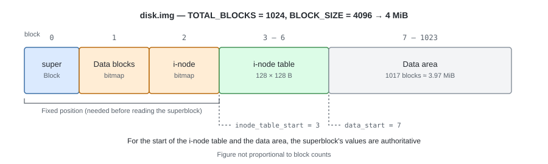
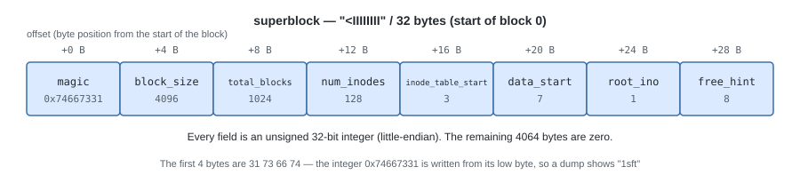
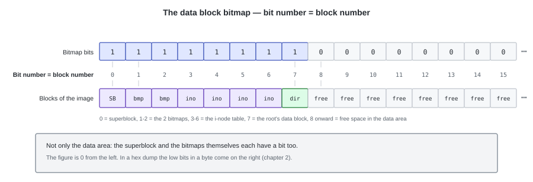
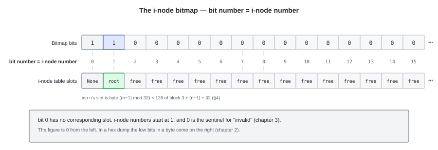

# 05. Drawing the Map — Fixing the Layout


The parts are gathered: the bitmap (chapter 2), the i-node (chapter 3), the directory (chapter 4).

The figures in chapter 3 showed in what order the data block bitmap, the i-node bitmap, and the i-node table
line up, and how many blocks each one uses.
The reason no block numbers were assigned is that what goes at the front had not been decided yet.
In this chapter we decide that, and fix the position of each part.

There are two things to decide.

- How much of the 4 MiB disk to allocate to which part (the layout)
- Where on the disk to record that allocation itself (the superblock)

---

## 1. The overall picture

The block allocation for `TOTAL_BLOCKS = 1024` (= 8192 sectors = 4 MiB).
As in chapter 1, 1 block = 8 sectors, so everything below is written in block numbers.



Block 0, which came first, is the **superblock**. It is a part that has not appeared until now,
and it is the one block that records **the information about the file system itself**.
The block size, the total number of blocks, the number of i-nodes, the starting positions of the i-node table and the data region, and so on —
what structure that image has goes in here.
It is the place that is read first when the image is opened, and from here as a starting point the positions of the remaining parts are known.

The position of the superblock itself cannot be written down anywhere, so **it is fixed at block 0**.
The two bitmaps are also one block each, so they are fixed at blocks 1 and 2,
and their positions are not written in the superblock (`BLOCK_BITMAP_BLOCK` / `INODE_BITMAP_BLOCK` in `constants.py`).
For the starting positions of the i-node table and the data region, what is written in the superblock's
`inode_table_start` / `data_start` is taken as authoritative.

---

## 2. The superblock (block 0)

It uses the whole of block 0, but the meaningful data is only the first **32 bytes**.
The remaining 4064 bytes are filled with zeros.

The contents are 8 unsigned 32-bit integers.

```python
# tiny_fs/constants.py
SUPERBLOCK_FMT = "<IIIIIIII"   # u32 x 8 = 32 bytes
```

```python
# tiny_fs/fs.py
@dataclass
class Superblock:
    """The superblock. On disk it is 32 bytes (the front of block 0)."""

    magic: int              # u32  fixed at 0x74667331
    block_size: int         # u32  4096
    total_blocks: int       # u32  the total number of blocks in this image
    num_inodes: int         # u32  the number of i-nodes
    inode_table_start: int  # u32  the first block number of the i-node table
    data_start: int         # u32  the first block number of the data region
    root_ino: int           # u32  the i-node number of the root directory
    free_hint: int          # u32  the block number to start searching for a free block from next
```

| Member | Meaning |
|---|---|
| `magic` | A fixed value showing that this is a tiny-fs image. If it does not match, the mount is refused |
| `block_size` | The size of a block. This implementation fixes it at 4096 |
| `total_blocks` | The number of blocks in the whole image. It is also the range the data block bitmap manages |
| `num_inodes` | The number of i-nodes. It decides the size of the i-node table and the range of the i-node bitmap |
| `inode_table_start` | The first block number of the i-node table. 3 |
| `data_start` | The first block number of the data region. 7. Before this is metadata |
| `root_ino` | The i-node number of the root directory. Always 1 |
| `free_hint` | A hint for the position to start searching for a free block from next (described below) |



The actual byte sequence right after mkfs:

```
00000000  31 73 66 74 00 10 00 00 00 04 00 00 80 00 00 00  |1sft............|
00000010  03 00 00 00 07 00 00 00 01 00 00 00 08 00 00 00  |................|
           ^^^^^^^^^^^ ^^^^^^^^^^^ ^^^^^^^^^^^ ^^^^^^^^^^^
           table=3      data=7      root=1      hint=8
```

The leading 4 bytes `31 73 66 74` are the `MAGIC`. It is `0x74667331`, which is the ASCII `"tfs1"`
(the trailing 1 being the version of the layout) turned straight into a 32-bit integer, and since it is written little-endian
it lines up from the low byte in the dump and reads as `1sft`. With `hexdump` we use this as a landmark to search for.

### Validation

Every time the image is opened, `fs.py` checks the following, and if it does not match, it fails with a clear exception.

- `magic == MAGIC` — if it differs, either "this is not a tiny-fs image" or "the version is different"
- that `block_size`, `total_blocks`, `num_inodes`, `inode_table_start`, `data_start`, `root_ino`
  match the values in `constants.py`

Since the layout is fixed, validation is done with **a comparison against the constants**.

On the other hand, when actually computing a position, we use **the value read from the superblock**, not the constant
(`fs.py`, chapter 7 §2).

If the layout is changed, we raise `MAGIC` to `"tfs2"` (`0x74667332`).

### `free_hint`

It is **nothing more than a hint** saying "next time, searching for free space from this block number will be fast".
Even if it is broken it does not affect correctness (the search merely starts over).

The i-node side also holds the same kind of hint while it is running.
However, what is recorded in the superblock is only the data block side, so
the i-node hint goes back to the front on every mount.

---

## 3. The bitmaps (blocks 1, 2)

There are two bitmap blocks.

| Block | Name | What 1 bit represents | Number of bits |
|---|---|---|---|
| 1 | The data block bitmap | one block | `TOTAL_BLOCKS` = 1024 |
| 2 | The i-node bitmap | one i-node | `NUM_INODES + 1` = 129 |

Both have the same format: if a bit is 0 it is free, if 1 it is in use. The bit order is LSB first.
So far this is as in chapter 2.

What remains is the agreement about **what number each one starts counting its bits from**.

### The data block bitmap manages "all blocks"

It covers not just the data region but **the whole image**, including the superblock and the bitmaps themselves.
That is, `bit number == block number` holds directly.
mkfs marks the metadata blocks 0–6 as in use from the start.



Right after mkfs (the root directory's data block 7 is also allocated):

```
block bitmap (block 1)
00000000  ff 00 00 00 00 00 00 00 ...   blocks 0-7 are in use, 8 onwards is free
```

### Handling the leftover bits

The bitmap block has room for 32768 bits, but what it manages is `TOTAL_BLOCKS = 1024` of them, so
only the first 128 bytes are used. The rest stays 0, and since the allocator cuts off its scan at
`total_blocks`, they can never be allocated (the `capacity` of chapter 2).

### The i-node bitmap (block 2)



The same format. However, we make **bit number = i-node number** (we do not introduce an off-by-one for the 1-based numbering).
As a result **bit 0 is never used**, so mkfs sets it to 1 (in use).
The convention "i-node 0 is invalid" is expressed directly on the bitmap as well.

By the time mkfs is finished, bit 1 is also set. That is because it creates the i-node for the root directory
(`ROOT_INO` = 1), and an image without a root cannot be mounted (§5).

```python
# mkfs — initializing the i-node bitmap
#
# What we handle is the NUM_INODES + 1 entries from bit 0 to bit NUM_INODES.
# Using NUM_INODES would make the scan range 0..127, and ino 128 would never be allocated.
inode_bitmap = Bitmap(buf, capacity=NUM_INODES + 1)
inode_bitmap.mark_used(0)          # the invalid number. Keep it from being picked as free
```

```
inode bitmap (block 2)
00000000  03 00 00 00 ...   bit0 = reserved (the invalid number), bit1 = the root directory
```

`03` = `0b00000011`, with the low 2 bits set.

---

## 4. The i-node table (blocks 3 - 6)

The contents of one i-node are the 128-byte structure decided in chapter 3.
`NUM_INODES = 128`, fixed. 32 fit in one block, so the table is 4 blocks.
It is placed after the superblock and the two bitmaps, so it **starts at block 3 and ends at 6**.
This starting position becomes the superblock's `inode_table_start`,
and the block after it becomes `data_start`.

Right after mkfs, the only thing filled in here is the single i-node of the root directory.
Its actual byte sequence:

```
00000000  ed 41 02 00 00 00 00 00 00 00 00 00 00 10 00 00  |.A..............|
          ^^^^^ ^^^^^ ^^^^^^^^^^^ ^^^^^^^^^^^ ^^^^^^^^^^^
          mode  nlink uid=0       gid=0       size low half (= 4096)
00000010  00 00 00 00 c0 10 b5 6a 00 00 00 00 c0 10 b5 6a  |.......j.......j|
          ^^^^^^^^^^^ ^^^^^^^^^^^^^^^^^^^^^^^ ^^^^^^^^^^^
          size high  mtime = 0x6ab510c0      ctime low
00000020  00 00 00 00 07 00 00 00 00 00 00 00 00 00 00 00  |................|
          ^^^^^^^^^^^ ^^^^^^^^^^^ ^^^^^^^^^^^^^^^^^^^^^^^
          ctime high direct[0]=7   direct[1..]=0 (unallocated)
00000030  ... zeros from here on up to byte 128 ...
```

- `mode = 0x41ed = 0o040755` — the sum of the type `0o040000` (`S_IFDIR` = directory) and
  the permissions `0o755` (`rwxr-xr-x`) (chapter 3)
- `nlink = 2` — the dirents pointing at the root are `.` and its own `..`. There is no parent, so 2
- `size = 4096` — one data block's worth.
  **128 slots are allocated, of which 2 (`.` and `..`) are filled**

### i-node number -> position

i-node numbers **start at 1**. 0 is reserved as a sentinel meaning "invalid / unused".

```python
# ino starts at 1, so the running index from the front of the table is (ino - 1)
INODES_PER_BLOCK = BLOCK_SIZE // INODE_SIZE          # = 32
block_no = inode_table_start + (ino - 1) // INODES_PER_BLOCK
offset = ((ino - 1) % INODES_PER_BLOCK) * INODE_SIZE
```

| ino | Block | Offset within the block |
|---|---|---|
| 1 (root) | 3 | 0 |
| 32 | 3 | 3968 |
| 33 | 4 | 0 |
| 128 | 6 | 3968 |

Being able to use `direct[i] == 0` as the sentinel for "unallocated" is also thanks to the layout.
Block 0 is the superblock, so 0 never appears as a data block number.

---

## 5. The root directory (the front of the data region)

Directories are created with `mkdir`. **The root directory alone is the exception: mkfs creates it.**

`mkdir` is an operation that adds an entry to the parent directory, so the root, which has no parent, cannot be created by that procedure.
So **mkfs completes the root directory at the moment it initializes the image**.
This creates a state in which, the moment it is mounted, at least one tree is guaranteed to exist.

There are three things mkfs does for the root.

| Step | Result |
|---|---|
| Allocate one i-node | **ino = 1**. The root is always this number (the superblock's `root_ino`) |
| Allocate one data block | It is the front of the data region, so **block 7** |
| Write `.` and `..` into it | Both point at ino 1. Only for the root is `..` itself |

The root's data block (block 7) right after mkfs:

```
00000000  01 00 00 00 2e 00 00 00 00 00 00 00 00 00 00 00  |................|
          ino=1       "."  <- the rest is NUL padding
00000010  00 00 00 00 00 00 00 00 00 00 00 00 00 00 00 00  |................|
00000020  01 00 00 00 2e 2e 00 00 00 00 00 00 00 00 00 00  |................|
          ino=1       ".." <- the root's parent is the root itself
00000030  00 00 00 00 00 00 00 00 00 00 00 00 00 00 00 00  |................|
00000040  ... zeros from here to the end of the block = 126 free slots with ino 0 ...
```

Because the root's `..` points at itself, in tiny-fs's path resolution `/..` becomes `/` (chapter 6).

---

## 6. The full view of the image right after mkfs

| Block | Contents | State |
|---|---|---|
| 0 | The superblock | `magic`, sizes, `root_ino = 1`, `free_hint = 8` |
| 1 | The data block bitmap | `ff 00 00 ...` (0-7 in use) |
| 2 | The i-node bitmap | `03 00 00 ...` (0 reserved, 1 = the root) |
| 3 | The i-node table (1-32) | The root directory at ino 1, the rest zero |
| 4-6 | The i-node table (33-128) | All zero |
| 7 | The root's data block | `.` and `..` |
| 8-1023 | The data region | All zero, unused |

At this point 8 blocks are in use and 1016 blocks are free.
The `dump` of chapter 9 mechanically reconstructs this table from the image and displays it.

---

## 7. The constants

We gather the numbers that have appeared so far into the single file `tiny_fs/constants.py`.
**No numbers are written anywhere else.**

| Constant | Value | Derivation / meaning |
|---|---|---|
| `SECTOR_SIZE` | 512 | The smallest unit the device decided on (chapter 1). The file system does not handle it directly |
| `SECTORS_PER_BLOCK` | 8 | 4096 / 512 |
| `BLOCK_SIZE` | 4096 | The unit the FS handles. Matched to Linux's page size |
| `TOTAL_BLOCKS` | 1024 | 4096 × 1024 = 4 MiB = 8192 sectors. Fixed |
| `INODE_SIZE` | 128 | 4096 / 128 = **32 per block** (dividing evenly is what matters) |
| `NUM_INODES` | 128 | 128 / 32 = **4 blocks** for the i-node table. Fixed |
| `NDIRECT` | 12 | The number of direct pointers an i-node holds |
| `MAX_FILE_SIZE` | 49152 | 12 × 4096 = 48 KiB. **With no indirection, this is the limit** |
| `DIRENT_SIZE` | 32 | 4096 / 32 = **128 entries per block** |
| `MAX_NAME_LEN` | 27 | 32 - 4 (ino) - 1 (padding) |
| `MAGIC` | `0x74667331` | `"tfs1"` in ASCII. The trailing `1` is the version of the layout |

Both `INODE_SIZE` and `DIRENT_SIZE` are made divisors of `BLOCK_SIZE`, so
**no structure ever straddles a block boundary**.

There are three structures written to the disk (the superblock, the i-node, the dirent).
Every one of their format strings begins with `<`.
As in chapter 3, both "little-endian, fixed" and "no padding" are settled by that single character.

```python
SUPERBLOCK_FMT = "<IIIIIIII"    # this chapter
INODE_FMT      = "<HHIIQQQ12I"  # chapter 3
DIRENT_FMT     = "<I27sx"       # chapter 4
```

---

## 8. The arithmetic of capacity

The limits with 1024 blocks / 128 i-nodes. **All of them are determined by the layout.**

| Item | Value | Derivation |
|---|---|---|
| Image size | 4 MiB | 4096 × 1024 |
| Metadata | 28 KiB | 7 blocks |
| Data region | 1017 blocks ≈ 3.97 MiB | 1024 - 7 |
| Maximum size of one file | **48 KiB** | `NDIRECT` × `BLOCK_SIZE` |
| Maximum number of files / directories | **127** | `NUM_INODES` - 1 (the root) |
| Maximum number of entries in one directory | **1536** | 12 blocks × 128 entries (including `.` `..`) |
| Maximum length of a name | 27 bytes | For multibyte characters, within 27 bytes in UTF-8 |

Line up small files and the i-nodes run out first; line up large files and
the data region runs out first. Either way it becomes `ENOSPC`.

---

## Try it

```bash
tiny-fs mkfs disk.img
tiny-fs dump disk.img                      # the same arrangement as the figures in this chapter comes out
tiny-fs dump disk.img --raw 0 --length 32  # the 32 bytes of the superblock
tiny-fs dump disk.img --raw 7 --length 64  # the root's "." and ".."
```

---

With this, Part I is over. From a place where there was nothing but a device,
the parts are all gathered: free-space management, the representation of a file, names, and placement.
In Part II we gather these into the single API of `fs.py`,
so that we can read and write with paths like `/docs/a.txt`.
