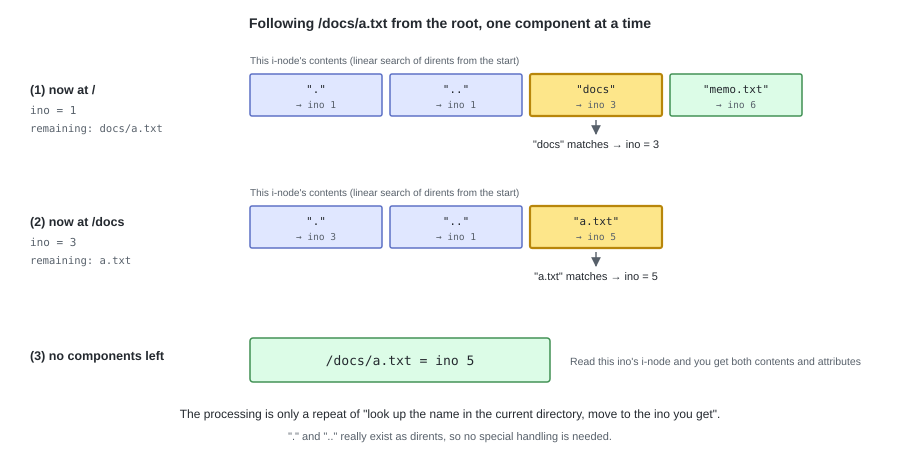

# Part II  Making It Work as a File System

---

# 06. Path Resolution


Up to chapter 5, the parts and their placement have been decided.
However, the only means of specifying an i-node is its number, and there is still no procedure
for obtaining an i-node number from a path like `/docs/a.txt`. In this chapter we settle that procedure.

Path resolution is the job of `fs.py` (L5).
This layer is the only one that **reads the superblock and knows the layout**,
and it is the side that hands positions to the layers below (`bitmap` / `inode` / `directory`).
This chapter deals with deciding the procedure; the code is written in the next chapter.

---

## 1. Descending one component at a time from the root

We split the path at `/` into components, and **starting from the root, look up the name inside the directory, one component at a time**.
The root's i-node number is always 1 (the superblock's `root_ino`), so the starting point is always determined.
Even when this FS is grafted onto the OS's tree, the starting point stays this root (chapter 12).



The processing for one component has two stages.

1. Read the current i-node and **confirm that it is a directory** (if not, `ENOTDIR`)
2. Look up the name in its contents and get the next i-node number (if there is none, `ENOENT`)

The result of repeating this until there are no components left is the i-node number we are after.
This procedure is called, by its traditional UNIX name, **namei** (name to inode).

Since `.` and `..` were created in chapter 4 as dirents with real substance,
**no code to treat them specially is needed**. `/docs/..` goes back to ino 1
by the same procedure, "look up `docs` -> look up `..` within it".
The root's `..` is the root itself, so `/..` also becomes `/`.

---

## 2. The rules about paths

| Input | Handling |
|---|---|
| Does not start with `/` | `EINVAL`. tiny-fs accepts **absolute paths only** |
| `/` | 0 components. Returns the root's ino 1 |
| `//docs///a.txt` | Empty components are ignored. The same as `/docs/a.txt` |
| `/docs/` | A trailing empty component is also ignored. The same as `/docs` |
| A component partway through is not a directory | `ENOTDIR` (e.g. `/memo.txt/x`) |
| A component is not found | `ENOENT` |

We do not hold a current directory.
FUSE hands over absolute paths already resolved on the kernel side, so there is no need to handle relative paths in this layer.

---

## 3. Splitting into the parent directory and the final component

In operations that create, remove, or rename a file,
what is needed is **not the target i-node but "the parent directory's i-node" and "the name of the final component"**.
The name of the final component means the file name to create for `create`, or the directory name for `mkdir`.
At the moment of `create("/docs/a.txt")`, `a.txt` does not exist yet, so
trying to look up the whole path would give `ENOENT`.

```
/docs/a.txt  ->  parent = /docs (ino 3),  name = "a.txt"
```

So we prepare two kinds of path resolution functions.

| Function | What it returns | Callers |
|---|---|---|
| `lookup(path)` | The i-node number the path points at | `open` / `stat` / `readdir` |
| `lookup_parent(path)` | (the parent directory's ino, the name of the final component) | `create` / `mkdir` / `unlink` / `rmdir` / `rename` |

`lookup_parent("/")` has no final component, so it becomes `EINVAL`.
There is no operation that creates or removes the root itself.

---

## Try it

```bash
tiny-fs mkfs disk.img
tiny-fs mkdir disk.img /docs

tiny-fs ls disk.img /docs/..      # the contents of the root come out
tiny-fs ls disk.img /..           # the root's parent is the root itself
tiny-fs ls disk.img //docs///     # empty components are ignored
tiny-fs ls disk.img /nothing      # ENOENT
```

---

That is the procedure for "obtaining an i-node number from a path".
In the next chapter we implement `fs.py` and connect this procedure with the file operations.
