# 07. Implementing `fs.py` — Opening the Image and Operating on Files


So far, the on-disk structure (chapters 1–5) and the procedure for following a path (chapter 6) have been decided.
In this chapter we gather them into the single API sheet of `fs.py`,
and implement everything up to **creating a file, reading and writing it, and removing it**.

`fs.py` has two roles.

- **The only layer that knows the layout.** It reads the superblock and
  computes the actual position from an ino or a block number
- **The layer that assembles the procedures.** It calls the layers below (`bitmap` / `inode` / `directory`) as appropriate
  and makes them hold together as one operation

---

## 1. Opening the image (mounting)

We open `disk.img` and put it into a state where it can be read and written.
Concretely: read the superblock to grasp the structure, validate it, and
load the two bitmaps into memory. That much is the preparation.

This preparation is called **mounting**. What we build here is a single in-memory `FileSystem` instance;
the real mounting that incorporates it into the OS's directory tree is handled in chapters 12 and 13.

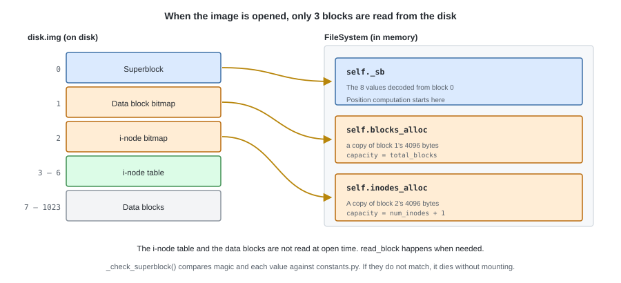

```python
class FileSystem:
    """One open file system."""

    def __init__(self, blocks: BlockDevice) -> None:
        self._blocks = blocks
        self._sb = Superblock.decode(blocks.read_block(SUPERBLOCK_BLOCK))
        self._check_superblock()     # the magic, and whether each value matches constants.py

        # The bitmaps are held in memory block and all (both are 1 block = 4096 bytes)
        self.blocks_alloc = _Allocator(
            bytearray(blocks.read_block(BLOCK_BITMAP_BLOCK)),
            blocks, BLOCK_BITMAP_BLOCK, capacity=self._sb.total_blocks,
            hint=self._sb.free_hint)     # search on from where we left off last time
        self.inodes_alloc = _Allocator(
            bytearray(blocks.read_block(INODE_BITMAP_BLOCK)),
            blocks, INODE_BITMAP_BLOCK, capacity=self._sb.num_inodes + 1)
```

### The rule for writing back

This FS has no cache. As decided in chapter 1,
the moment `write_block` is called, it reaches the disk.
What we hold in memory is only the 2 bitmap blocks, so there is just one thing to decide.

> **When a bitmap is changed, write it back, block and all, on the spot.**

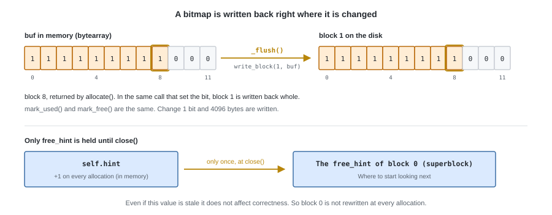

To keep this rule, we wrap `Bitmap` in a thin wrapper.
The method names are the same as `Bitmap`'s, so as seen from the layer above it is nothing more than "a `Bitmap` with write-back attached".

```python
class _Allocator:
    """Wrap one bitmap in a form that writes it back as soon as it is changed."""

    def allocate(self, hint: int | None = None) -> int:
        # The hint is held by this class. The layer below (inode.py) just calls without arguments
        index = self._bitmap.allocate(self.hint if hint is None else hint)
        self.hint = (index + 1) % self._bitmap.capacity
        self._flush()
        return index

    def count_free(self) -> int:
        return self._bitmap.count_free()     # read-only, so no write-back is needed

    def _flush(self) -> None:
        self._blocks.write_block(self._block_no, self._bitmap.buf)
```

`mark_used` / `mark_free` have the same shape: they just delegate to `Bitmap` and call `_flush`.
Both allocators update their hint in memory, but what gets written back to the superblock
by `close()` is only the data block side's `free_hint`
(as in chapter 5, this value does not affect correctness even if it is stale).

---

## 2. Reading and writing the i-node table

**Computing a position from an ino is done only in this layer.** We implement the formula decided in chapter 5 in this layer.

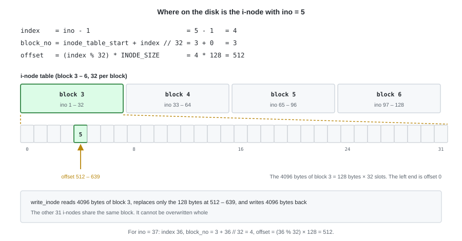

```python
    def _inode_pos(self, ino: int) -> tuple[int, int]:
        # ino starts at 1. 0 and out-of-range mean the image is corrupt
        if not 1 <= ino <= self._sb.num_inodes:
            raise CorruptionError(f"bad inode number: {ino}")
        index = ino - 1
        block_no = self._sb.inode_table_start + index // INODES_PER_BLOCK
        offset = (index % INODES_PER_BLOCK) * INODE_SIZE
        return block_no, offset

    def read_inode(self, ino: int) -> Inode:
        block_no, offset = self._inode_pos(ino)
        raw = self._blocks.read_block(block_no)
        return Inode.decode(raw[offset:offset + INODE_SIZE])

    def write_inode(self, ino: int, inode: Inode) -> None:
        # 32 of them are packed into one block, so this becomes read-modify-write
        block_no, offset = self._inode_pos(ino)
        buf = bytearray(self._blocks.read_block(block_no))
        buf[offset:offset + INODE_SIZE] = inode.encode()
        self._blocks.write_block(block_no, buf)
```

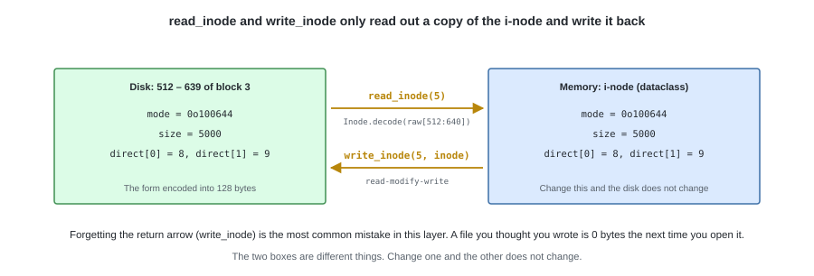

The `Inode` that `read_inode` returns is **an in-memory copy**.
Change `size` or `direct[]` and nothing happens on the disk until `write_inode` is called.

---

## 3. Path resolution

We turn the procedure of chapter 6 into code as it is. First we split the path into components.

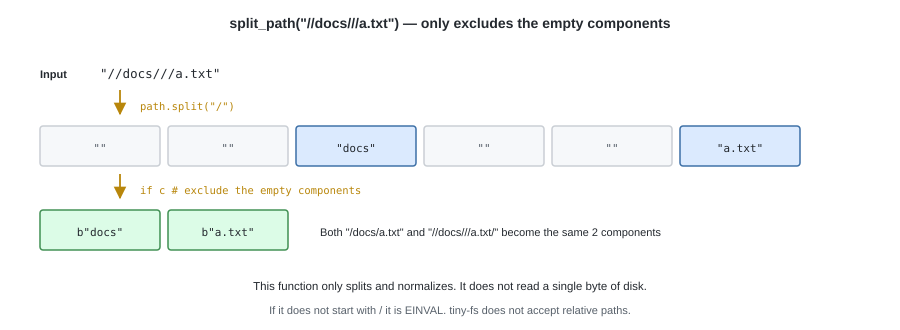

```python
def split_path(path: str) -> list[bytes]:
    """Split a path into components. Empty components are excluded."""
    if not path.startswith("/"):
        raise InvalidArgumentError("path must be absolute")
    # Both "//docs///a.txt" and "/docs/" are normalized by this alone
    return [c.encode() for c in path.split("/") if c]
```

How far do we follow the components we split? There are two functions that serve as the entrance.

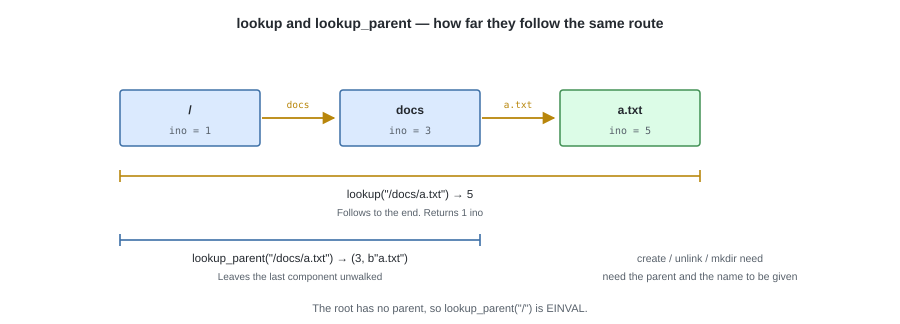

```python
    def _walk(self, components: list[bytes], path: str) -> int:
        ino = self._sb.root_ino                  # the starting point is always the root
        for name in components:
            inode = self.read_inode(ino)
            if not stat.S_ISDIR(inode.mode):
                raise NotADirectoryError(path)   # ENOTDIR
            ino = self._lookup_in(inode, name, path)   # ENOENT if there is none
        return ino

    def lookup(self, path: str) -> int:
        return self._walk(split_path(path), path)

    def lookup_parent(self, path: str) -> tuple[int, bytes]:
        components = split_path(path)
        if not components:
            raise InvalidArgumentError("root has no parent")
        return self._walk(components[:-1], path), components[-1]
```

The layers below know only one component, so throwing their exception as it is
would show only the single component name, like `ENOENT: a.txt`. Which `a.txt` is unclear.
Attaching the path the caller passed in is the job of this layer.

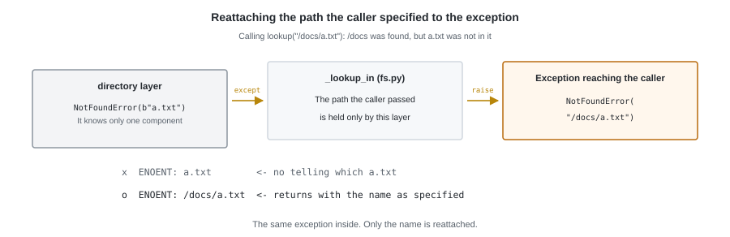

```python
    def _lookup_in(self, dir_inode: Inode, name: bytes, path: str) -> int:
        try:
            return directory.lookup(dir_inode, self._blocks, name)
        except NotFoundError:
            raise NotFoundError(path) from None     # swap the error message for /docs/a.txt
```

---

## 4. Creating a file

`create` divides into 4 steps. Let us first look at where it writes what.

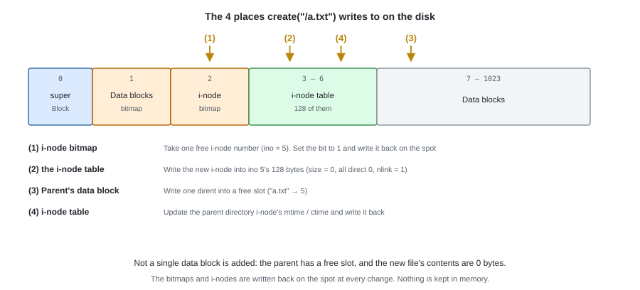

```python
    def create(self, path: str, mode: int = stat.S_IFREG | 0o644) -> int:
        parent_ino, name = self.lookup_parent(path)
        parent = self.read_inode(parent_ino)

        # (1) allocate one i-node, (2) write it into the table
        ino, inode = inode_mod.allocate_inode(self.inodes_alloc, mode, now())
        inode.nlink = 1                      # we are about to attach one name
        self.write_inode(ino, inode)

        try:
            # (3) add the name to the parent. Duplicates are rejected by add_entry with EEXIST
            self._add_entry(parent, name, ino, path)
        except FSError:
            # We could not attach a name, so free the i-node we allocated
            self.write_inode(ino, Inode.empty())
            self.inodes_alloc.mark_free(ino)
            raise

        # (4) update the parent's timestamps. The entry addition may also have grown size
        parent.mtime = parent.ctime = now()
        self.write_inode(parent_ino, parent)
        return ino
```

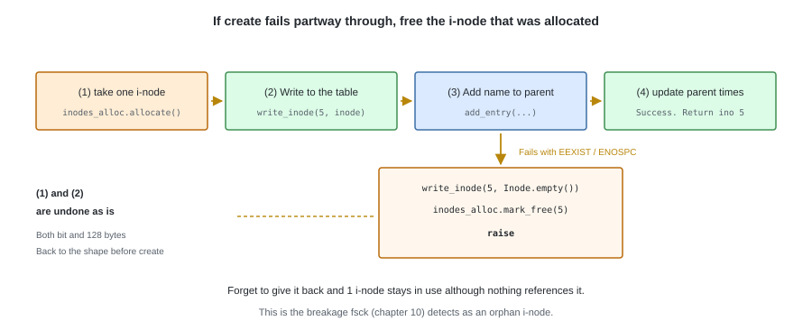

Freeing the i-node when `add_entry` fails is the key point.
Forget to free it and **one i-node that is in use although nothing references it** is left behind.
It is a typical way of breaking that `fsck` (chapter 10) detects.

---

## 5. Reading and writing

Both take the shape "resolve the path -> read the i-node -> hand it to the `inode` layer -> write it back".

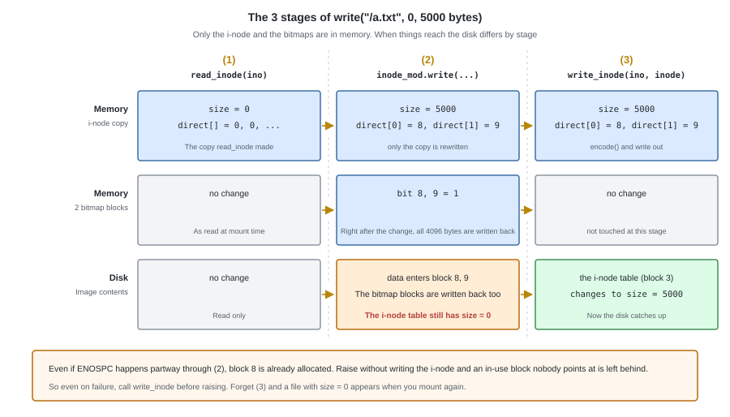

```python
    def read(self, path: str, offset: int, length: int) -> bytes:
        inode = self.read_inode(self.lookup(path))
        if stat.S_ISDIR(inode.mode):
            raise IsADirectoryError(path)    # EISDIR
        return inode_mod.read(inode, self._blocks, offset, length)

    def write(self, path: str, offset: int, data: bytes) -> int:
        ino = self.lookup(path)
        inode = self.read_inode(ino)
        if stat.S_ISDIR(inode.mode):
            raise IsADirectoryError(path)
        # If there are not enough blocks, they are allocated from blocks_alloc, and direct[] and size change
        try:
            inode_mod.write(inode, self._blocks, self.blocks_alloc, offset, data)
        except FSError as e:
            # Even if ENOSPC happens partway through, the blocks allocated up to then
            # are in direct[]. Write the i-node back first, then report the failure
            self.write_inode(ino, inode)
            # inode.py does not know the path, so reattach it here (same as _lookup_in in §2)
            raise type(e)(path) from None
        inode.mtime = inode.ctime = now()
        self.write_inode(ino, inode)         # <- forget this and the write disappears
        return len(data)

    def truncate(self, path: str, new_size: int) -> None:
        ino = self.lookup(path)
        inode = self.read_inode(ino)
        if stat.S_ISDIR(inode.mode):
            raise IsADirectoryError(path)
        try:
            inode_mod.truncate(inode, self._blocks, self.blocks_alloc, new_size)
        except FSError:
            self.write_inode(ino, inode)     # the same reason as write
            raise
        inode.mtime = inode.ctime = now()
        self.write_inode(ino, inode)
```

If the i-node is written before the exception is thrown, then even after a failed write
the image is kept in a consistent state (`fsck` does not report a leak).

`read` does not read beyond `size` (chapter 3).
An attempt to `read` a directory is refused with `EISDIR`. Looking at its contents is `readdir` (chapter 8).

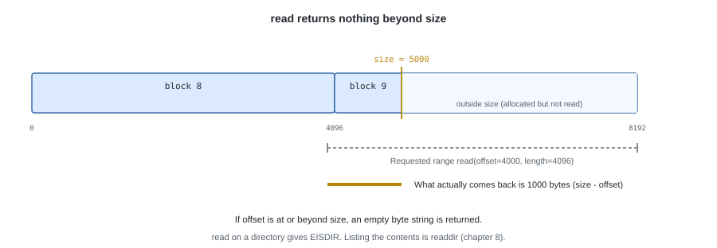

`truncate` changes the size of the file to the specified value. Whether it is a growth or a shrink changes the processing in the layer below.

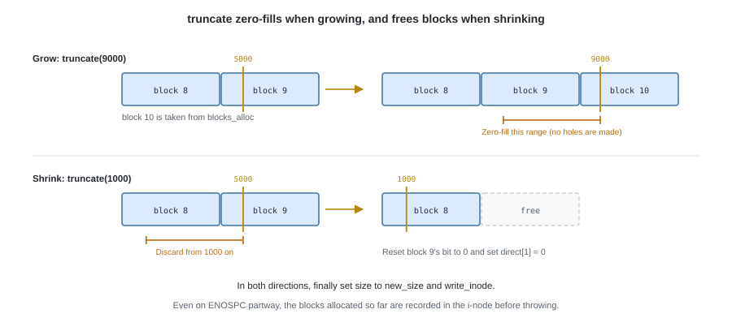

---

## 6. Removing

`unlink` is an operation that removes a name, and not necessarily an operation that removes the substance.
It decrements `nlink` by 1 for the name that disappeared, and **only when it becomes 0** does it free the substance.

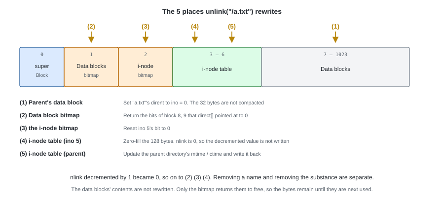

```python
    def unlink(self, path: str) -> None:
        parent_ino, name = self.lookup_parent(path)
        parent = self.read_inode(parent_ino)
        ino = self._lookup_in(parent, name, path)            # ENOENT if there is none

        inode = self.read_inode(ino)
        if stat.S_ISDIR(inode.mode):
            raise IsADirectoryError(path)    # directories go through rmdir (chapter 8)

        directory.remove_entry(parent, self._blocks, self.blocks_alloc, name)
        inode.nlink -= 1

        if inode.nlink == 0:
            # Free the data blocks, and return the i-node number to the free pool too (chapter 3)
            inode_mod.free_inode(inode, self._blocks, self.blocks_alloc,
                                 self.inodes_alloc, ino)
            # Fill the 128 bytes in the table with zeros. In dump's output it can then be told apart as "unused"
            self.write_inode(ino, Inode.empty())
        else:
            self.write_inode(ino, inode)

        parent.mtime = parent.ctime = now()
        self.write_inode(parent_ino, parent)
```

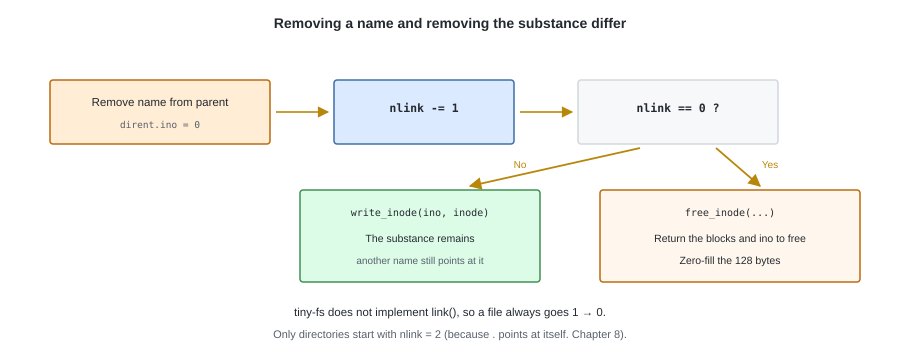

In tiny-fs we do not implement `link()`, so the only things whose `nlink` becomes 2 or more
are directories, but we leave the decision in this shape.
The `rmdir` of chapter 8 uses the same procedure.

---

## 7. Tests

From here on they become **tests that use the whole image**.
We mkfs into `tmp_path`, create a `FileSystem`, operate on it, and finally run `fsck`.

```python
def test_create_then_read_back(tmp_path):
    # Create, write, and read, and the same byte sequence comes back

def test_written_data_survives_remount(tmp_path):
    # After writing, it can still be read even if the FileSystem is rebuilt
    # (a forgotten write_inode is found here for the first time)

def test_create_existing_name_raises_eexist(tmp_path):

def test_create_rollback_on_failure(tmp_path):
    # When add_entry fails, the allocated i-node has been freed
    # (the free i-node count is the same as before the operation)

def test_write_grows_size_and_allocates_blocks(tmp_path):
    # Write 5000 bytes and size = 5000, with 2 more blocks in use

def test_unlink_frees_blocks_and_inode(tmp_path):
    # After removing, the free block count and the free i-node count go back to the originals

def test_unlink_missing_raises_enoent(tmp_path):

def test_read_directory_raises_eisdir(tmp_path):

def test_disk_full_raises_enospc(tmp_path):
    # Writing until the data blocks are used up gives ENOSPC

def test_inodes_exhausted_raises_enospc(tmp_path):
    # 127 can be created, and the 128th is ENOSPC
```

`test_written_data_survives_remount` is the most effective test in Part II.
**As long as we read and write with the same `FileSystem` instance,
we cannot notice a forgotten `write_inode`** (because the in-memory `Inode` is correct).
Only on remounting is the content of the disk put to the question.

---

## Try it

```bash
tiny-fs mkfs disk.img
tiny-fs dump disk.img > before.txt

# A 5000-byte sample file (the same size as in chapters 3 and 5)
python -c "open('sample.txt','w').write('x' * 5000)"
tiny-fs put disk.img ./sample.txt /a.txt
tiny-fs dump disk.img > after.txt

diff before.txt after.txt          # 5 places change (the breakdown is in chapter 9)
tiny-fs fsck disk.img
```

---

Implement `mkdir` / `rmdir` / `rename` / `readdir` in the next chapter
and all the operations are in place without FUSE.
