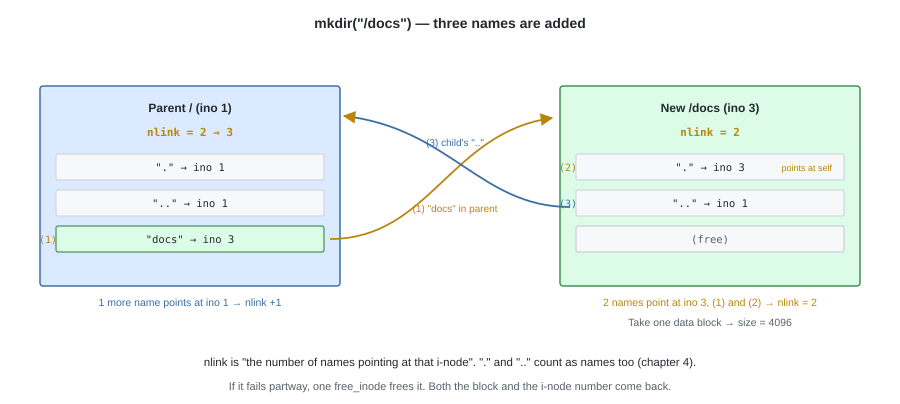
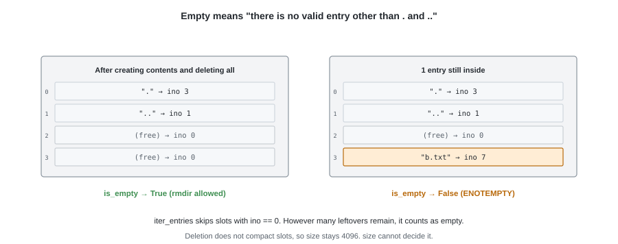
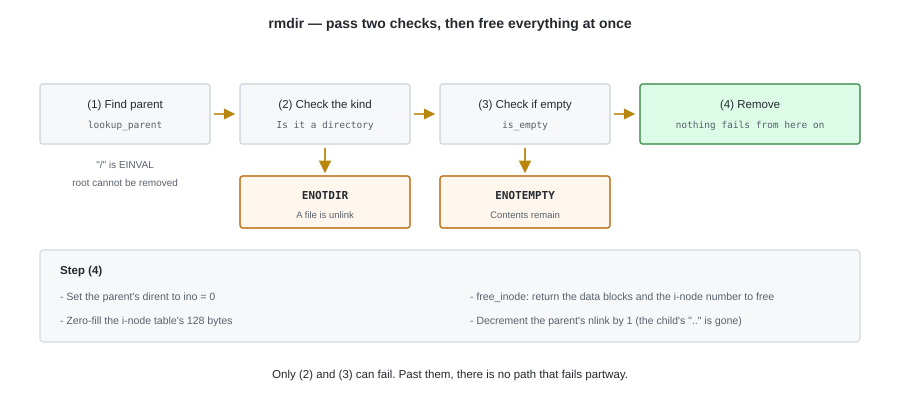
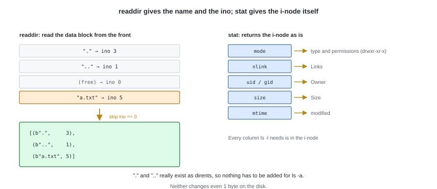
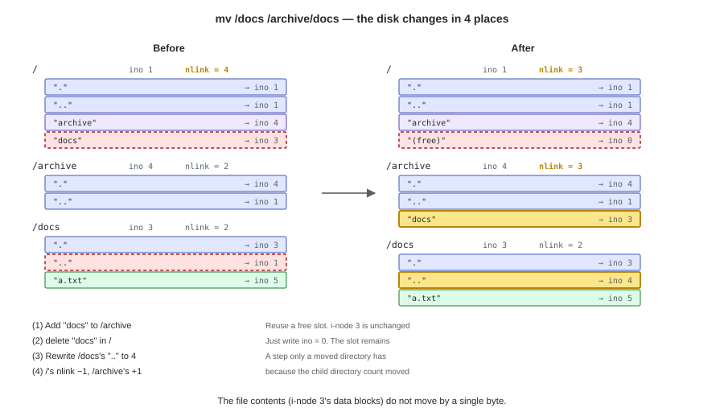
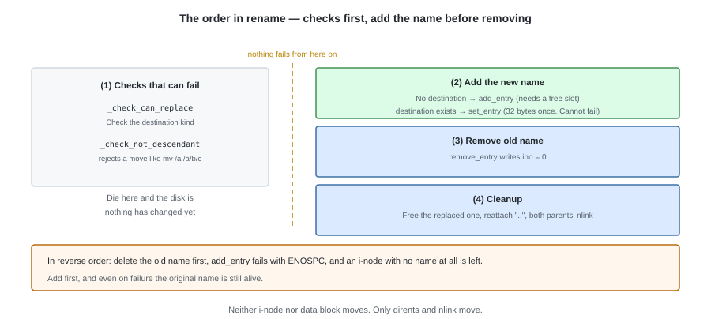
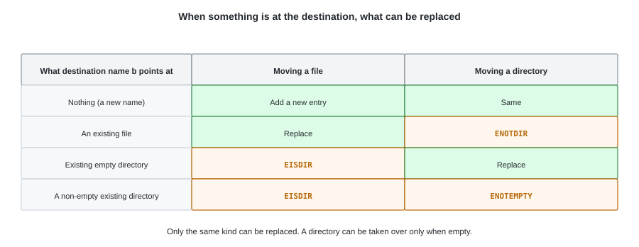
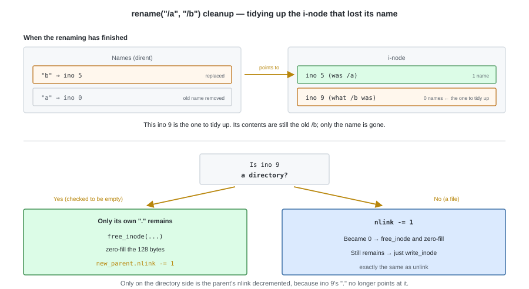
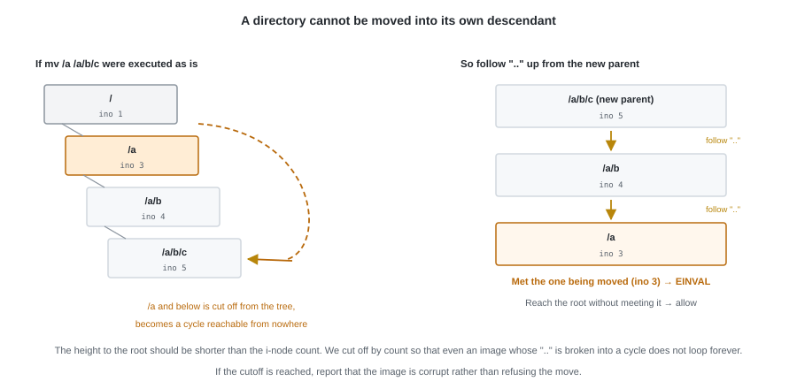
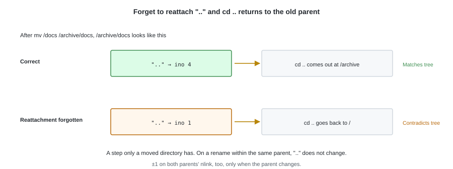

# 08. Directory Operations


In the previous chapter files became creatable. What remains are the operations on the directory side
— creation, removal, obtaining a listing, and changing a name.

All of them are implemented in `fs.py`. The conventions decided in chapter 4
(holding `.` and `..` as the first two entries, `nlink` being "the number of names pointing at oneself")
become concrete code here.

---

## 1. mkdir

The procedure for creating a directory is almost the same as `create`, differing in 2 points:
**writing `.` and `..` into the contents**, and **updating `nlink`**.



```python
    def mkdir(self, path: str, mode: int = stat.S_IFDIR | 0o755) -> int:
        parent_ino, name = self.lookup_parent(path)
        parent = self.read_inode(parent_ino)

        ino, inode = inode_mod.allocate_inode(self.inodes_alloc, mode, now())
        inode.nlink = 2                 # our name inside the parent + our own "."
        try:
            # Here one data block is allocated and size becomes 4096
            directory.init_directory(inode, self._blocks, self.blocks_alloc,
                                     ino, parent_ino)
            self._add_entry(parent, name, ino, path)
        except FSError:
            # Free the half-created i-node. Both the blocks and the i-node number return to the free pool (chapter 3)
            inode_mod.free_inode(inode, self._blocks, self.blocks_alloc,
                                 self.inodes_alloc, ino)
            raise

        self.write_inode(ino, inode)
        parent.nlink += 1               # the child's ".." now points at the parent
        parent.mtime = parent.ctime = now()
        self.write_inode(parent_ino, parent)
        return ino
```

The cleanup on failure is done with `free_inode` alone.
**The processing that frees a half-created directory is the same as the processing that removes one.**

A new directory's `nlink` starts at 2, and the parent's `nlink` goes up by 1.
Chapter 4's "`nlink` = 2 + the number of child directories" comes out directly.

---

## 2. rmdir

Before removing, **we confirm that it is empty**. Empty means
there is not a single valid entry other than `.` and `..`.



This judgement alone is placed in `directory.py`. Because it only looks at dirents and needs neither a path nor the layout.

```python
# tiny_fs/directory.py
def is_empty(dir_inode, blocks) -> bool:
    for _slot, entry in iter_entries(dir_inode, blocks):
        if entry.name not in (b".", b".."):
            return False       # if there is even one valid entry it is not empty
    return True
```

`iter_entries` skips slots with `ino == 0` (chapter 4), so
**however many vacated spots are left, it is judged empty**.



```python
    def rmdir(self, path: str) -> None:
        parent_ino, name = self.lookup_parent(path)   # "/" is EINVAL, so the root cannot be removed
        parent = self.read_inode(parent_ino)
        ino = self._lookup_in(parent, name, path)

        inode = self.read_inode(ino)
        if not stat.S_ISDIR(inode.mode):
            raise NotADirectoryError(path)     # ENOTDIR. Files go through unlink
        if not directory.is_empty(inode, self._blocks):
            raise NotEmptyError(path)          # ENOTEMPTY

        directory.remove_entry(parent, self._blocks, self.blocks_alloc, name)
        # The only name left is our own ".". Free it, data blocks and all
        inode_mod.free_inode(inode, self._blocks, self.blocks_alloc,
                             self.inodes_alloc, ino)
        self.write_inode(ino, Inode.empty())

        parent.nlink -= 1                      # the child's ".." is gone
        parent.mtime = parent.ctime = now()
        self.write_inode(parent_ino, parent)
```

The root cannot be removed, because `lookup_parent("/")` fails with `EINVAL`.

---

## 3. readdir and stat

Neither of them changes the disk.



```python
    def readdir(self, path: str) -> list[tuple[bytes, int]]:
        inode = self.read_inode(self.lookup(path))
        if not stat.S_ISDIR(inode.mode):
            raise NotADirectoryError(path)
        return [(e.name, e.ino)
                for _slot, e in directory.iter_entries(inode, self._blocks)]

    def stat(self, path: str) -> Inode:
        return self.read_inode(self.lookup(path))
```

The listing that comes back **contains `.` and `..` from the start**.
Since we created them in chapter 4 as dirents with real substance, there is no need to add them here
(`ls -a` holds up directly, and it can be used as it is with FUSE in chapter 13).

What `stat` returns is the `Inode` itself. Everything `ls -l` needs
(the type and permissions, `nlink`, the owner, `size`, the timestamps) is in there.

---

## 4. rename

The operation of changing a name is done with nothing more than **removing one dirent and adding one**.
Neither the i-node nor the data blocks move.



```python
    def rename(self, old_path: str, new_path: str) -> None:
        old_parent_ino, old_name = self.lookup_parent(old_path)
        new_parent_ino, new_name = self.lookup_parent(new_path)

        old_parent = self.read_inode(old_parent_ino)
        ino = self._lookup_in(old_parent, old_name, old_path)
        inode = self.read_inode(ino)

        same_parent = old_parent_ino == new_parent_ino
        if same_parent and old_name == new_name:
            return                                 # do nothing
        # If it is the same directory, hold only one copy of the Inode.
        # Read two and a change to one of them is wiped out by the other's write_inode
        new_parent = old_parent if same_parent else self.read_inode(new_parent_ino)

        # If an entry already exists at the destination, replace it. Check for its presence first
        found = directory.find(new_parent, self._blocks, new_name)
        victim_ino = None if found is None else found[1].ino
        if victim_ino is not None:
            self._check_can_replace(inode, victim_ino, new_path)
        if stat.S_ISDIR(inode.mode):
            self._check_not_descendant(ino, new_parent_ino)

        # The checks that can fail end here. From here on nothing fails partway through
        if victim_ino is None:
            # Add the new name first. Even if this fails, the original name is still unharmed
            self._add_entry(new_parent, new_name, ino, new_path)
        else:
            # Swap the ino of the entry that is already there. One 32-byte write,
            # and since it does not need a free slot it cannot fail
            directory.set_entry(new_parent, self._blocks, self.blocks_alloc,
                                new_name, ino)
        directory.remove_entry(old_parent, self._blocks, self.blocks_alloc,
                               old_name)

        stamp = now()
        if victim_ino is not None:
            self._drop_replaced(victim_ino, new_parent)
        # If the parent changed, fix the directory's ".." and both parents' nlink
        if not same_parent and stat.S_ISDIR(inode.mode):
            directory.set_entry(inode, self._blocks, self.blocks_alloc,
                                b"..", new_parent_ino)
            inode.ctime = stamp
            self.write_inode(ino, inode)
            new_parent.nlink += 1
            old_parent.nlink -= 1

        old_parent.mtime = old_parent.ctime = stamp
        self.write_inode(old_parent_ino, old_parent)
        if not same_parent:
            new_parent.mtime = new_parent.ctime = stamp
            self.write_inode(new_parent_ino, new_parent)
```



There are 3 things decided as the specification.

**If the destination already exists, it is replaced.** With `rename("/a", "/b")`, if `/b` exists,
`/b` disappears and `/a` inherits that name. That is what `rename(2)` stipulates.
Only things of the same type can be replaced, and the errno returned changes with the combination.



```python
    def _check_can_replace(self, inode, victim_ino: int, new_path: str) -> None:
        victim = self.read_inode(victim_ino)
        if stat.S_ISDIR(inode.mode):
            if not stat.S_ISDIR(victim.mode):
                raise NotADirectoryError(new_path)    # ENOTDIR
            if not directory.is_empty(victim, self._blocks):
                raise NotEmptyError(new_path)         # ENOTEMPTY
        elif stat.S_ISDIR(victim.mode):
            raise IsADirectoryError(new_path)         # EISDIR
```

The side that was replaced, that is, **the i-node that the original `/b` pointed at**,
loses the name `b`. After that the cleanup is the same as `unlink`.



```python
    def _drop_replaced(self, victim_ino: int, new_parent: Inode) -> None:
        victim = self.read_inode(victim_ino)
        if stat.S_ISDIR(victim.mode):
            # It is an empty directory, so the only name left is its own ".". Free it whole,
            # and the parent loses one ".." that was pointing at it
            new_parent.nlink -= 1
            inode_mod.free_inode(victim, self._blocks, self.blocks_alloc,
                                 self.inodes_alloc, victim_ino)
            self.write_inode(victim_ino, Inode.empty())
            return

        victim.nlink -= 1
        if victim.nlink == 0:
            inode_mod.free_inode(victim, self._blocks, self.blocks_alloc,
                                 self.inodes_alloc, victim_ino)
            self.write_inode(victim_ino, Inode.empty())
        else:
            self.write_inode(victim_ino, victim)
```

**Add the new name, and then remove the old name.** Reverse the order and,
when `add_entry` fails with `ENOSPC`,
**an i-node with not a single name** is left behind.

**A directory cannot be moved into its own descendant.** Move `/a` under `/a/b/c` and
everything below `/a` is cut off from the tree, becoming a ring reachable from nowhere.
We follow `..` up from the new parent to the root, and if the target appears on the way, refuse with `EINVAL`.



```python
    def _check_not_descendant(self, ino: int, new_parent_ino: int) -> None:
        cur = new_parent_ino
        # Cut off by a count, so that even an image whose ".." is broken into a ring does not loop forever
        for _step in range(self._sb.num_inodes + 1):
            if cur == ino:
                raise InvalidArgumentError("cannot move a directory into itself")
            if cur == self._sb.root_ino:
                return
            cur = directory.lookup(self.read_inode(cur), self._blocks, b"..")
        raise CorruptionError("'..' chain does not reach the root")
```

---

## 5. Tests

```python
def test_mkdir_has_dot_and_dotdot(tmp_path):
    # Right after creation the contents are the two . and .., size = 4096

def test_mkdir_updates_nlink(tmp_path):
    # The new directory is 2, and the parent is +1

def test_rmdir_restores_nlink_and_frees(tmp_path):
    # After removal the parent's nlink goes back, and the free blocks and free i-nodes go back too

def test_rmdir_non_empty_raises_enotempty(tmp_path):

def test_rmdir_after_emptying_succeeds(tmp_path):
    # A directory whose contents were created and then all removed can be removed, even with vacated spots left

def test_rmdir_on_file_raises_enotdir(tmp_path):
def test_unlink_on_directory_raises_eisdir(tmp_path):

def test_rename_within_same_directory(tmp_path):
    # The ino does not change. The contents do not change either

def test_rename_across_directories_fixes_dotdot(tmp_path):
    # After the move, ".." points at the new parent, and both parents' nlink are +-1

def test_rename_into_descendant_raises_einval(tmp_path):
    # /a cannot be moved under /a/b

def test_rename_replaces_an_existing_file(tmp_path):
    # The file at the destination is gone, and its i-node and blocks have been returned

def test_rename_replaces_an_empty_directory(tmp_path):
    # The parent's nlink goes down by 1, and the moved directory's ".." is correct

def test_rename_over_a_non_empty_directory_raises_enotempty(tmp_path):
def test_rename_a_file_over_a_directory_raises_eisdir(tmp_path):
def test_rename_a_directory_over_a_file_raises_enotdir(tmp_path):

def test_a_refused_rename_changes_nothing(tmp_path):
    # When refused, the free block count, the free i-node count, and both names are as they were
```

`test_rmdir_after_emptying_succeeds` is the counterpart to chapter 4's "removal does not compact".
Since `size` does not shrink, **even a directory that looks empty still has `size` = 4096**.
That `is_empty` judges by the presence of valid entries rather than by `size` is confirmed here.



`test_rename_across_directories_fixes_dotdot` catches this mistake.

The 5 tests concerning replacement are what directly support the save procedure of `sed -i` and of many editors
(write to a temporary file, then cover the original name with a `rename`).

---

## Try it

```bash
tiny-fs mkfs disk.img
tiny-fs mkdir disk.img /docs
tiny-fs mkdir disk.img /archive

tiny-fs ls -l disk.img /           # the root's nlink is 4 (2 + 2 children)
tiny-fs mv disk.img /docs /archive/docs
tiny-fs ls -l disk.img /           # back to 3
tiny-fs ls disk.img /archive/docs/..   # the contents of archive come out (".." was reattached)
```

---

## What Part II reached

With this it is all in place.

| Operation | Chapter implemented in |
|---|---|
| `mkfs` | chapter 5 |
| `lookup` / `lookup_parent` | chapter 7 |
| `create` / `read` / `write` / `truncate` / `unlink` | chapter 7 |
| `mkdir` / `rmdir` / `readdir` / `stat` / `rename` | this chapter |

We have reached **a state where every operation a file system needs can be done without using FUSE at all**.
In the next part, Part III, we build the tools to confirm this state from the outside
— `dump`, which shows the image in a form humans can read, and `fsck`, which checks that nothing is broken.
