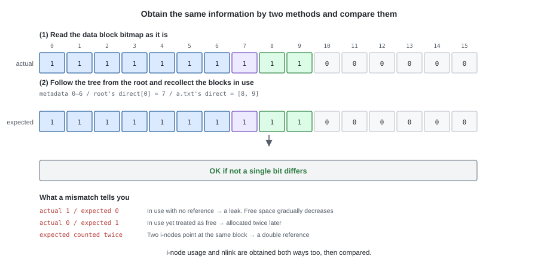
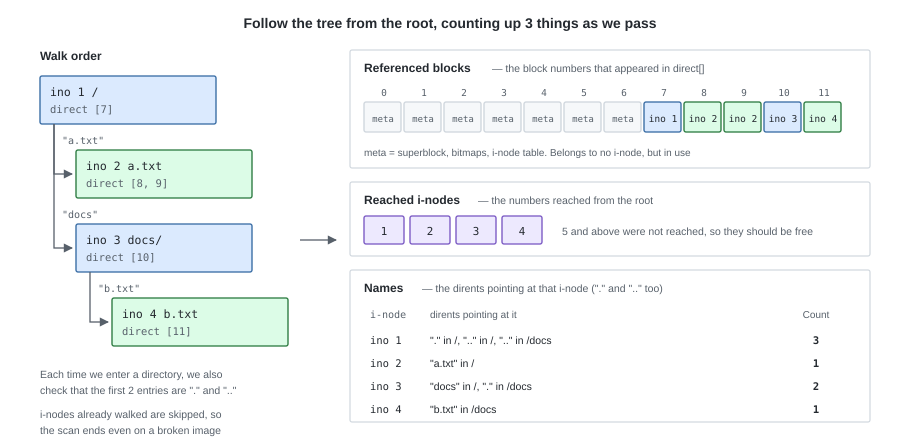

# 10. Making Sure Nothing Is Broken — fsck


`dump` was a tool for showing "what is written on the disk right now".
What we build in this chapter is a tool that judges **whether that is a state that adds up**.

---

## 1. What do we check?

Checking is possible **because the same information is recorded in two places on the disk**.
If the contents recorded in the two places do not agree, that file system is broken.

| Information | Record (1) | Record (2) |
|---|---|---|
| Which blocks are in use | The data block bitmap | Each i-node's `direct[]` |
| Which i-nodes are in use | The i-node bitmap | The directories' dirents |
| The number of names (file names / directory names) pointing at a given i-node | The i-node's `nlink` | The number of dirents pointing at that ino (`.` and `..` are counted too) |

There is only one piece of processing in `fsck`: **read (1) as it is, recompute from (2), and compare them.**



---

## 2. Building the expected values

For the (2) side, we **follow the tree from the root and count things up**.
Starting from the root's i-node, if it is a directory we read the dirents inside it and descend to the i-nodes beyond.
As we go, we collect the 3 things that become the counterparts to compare with (1).



The figure is a state where the root has `a.txt` and `docs/`, and inside `docs/` there is `b.txt`.

`.` and `..` are dirents too, so we **include** them in the counting of names.
Chapter 4's "`nlink` = 2 + the number of child directories" comes out as the result of this way of counting
(`ino 1` is 3 because `/`'s `.` and `..`, plus `/docs`'s `..`, point at it).
However, we do not descend beyond them. Follow `.` and `..` and you keep going around the same place.

---

## 3. Comparing

The 3 rows of the table in §1 become 3 comparisons, just as they are.

| What is compared | What a discrepancy means |
|---|---|
| The block bitmap <-> the references in `direct[]` | In use with no reference = a **leak** (free space gradually decreases), referenced but free = **use of an unallocated block** (it will eventually be allocated twice), referenced from two or more = **a double reference** (remove one and the other breaks) |
| The i-node bitmap <-> the i-nodes reachable from the root | In use yet unreachable = an **orphan**. An i-node left half-created (the shape where chapter 7's `create` has not finished its cleanup) |
| `inode.nlink` <-> the counted number of names | Never reaching 0 and never being freed, or being freed too early |

Besides these, we also look at whether block numbers are at or above `data_start` and below `total_blocks`,
whether a directory's first two entries are `.` and `..`, whether the leftover bits of the bitmaps are still 0
(chapter 5), and whether the numbers in the superblock are mutually consistent.
None of these are comparisons; they are confirmations that a value itself holds up.
If the last one is broken, the position calculation for i-nodes does not hold up, so we report only that and stop.

---

## 4. Reporting

**`fsck` does not fix things. It only detects and reports.**

```
$ tiny-fs fsck disk.img
fsck: 3 problems found

  block 9 is referenced by inode 2 but marked free in the block bitmap
  block 12 is marked used but referenced by nothing (leak)
  inode 5 has nlink=2 but 1 name points to it

$ echo $?
1
```

If there are no problems, it prints just one line and exits with 0.

```
$ tiny-fs fsck disk.img
fsck: clean (10 blocks used, 2 inodes used)
$ echo $?
0
```

Separating the exit status makes it easier to use from tests.
It allows the practice of **running `fsck` at the end of every test** (the tests from chapter 7 onwards take this shape).

---

## 5. Implementation — `fsck.py`

Like `dump`, it reads directly from `BlockDevice` and does not use `FileSystem`.
Because we cannot very well read the thing being checked through the API of the side being checked.

The counting of §2 becomes a tree traversal, just as it is.

```python
def _collect(blocks, sb):
    """Follow the tree from the root and build the expected values."""
    block_refs = {}            # block number -> the list of i-nodes referencing it
    seen_inodes = set()
    nlink_count = Counter()    # i-node number -> the number of dirents pointing at it

    # The metadata blocks belong to nobody's i-node, yet are in use
    for block_no in range(sb.data_start):
        block_refs.setdefault(block_no, []).append(METADATA)

    stack = [sb.root_ino]
    while stack:
        ino = stack.pop()
        if ino in seen_inodes:
            continue                       # skip the second time. It terminates even with a cycle
        seen_inodes.add(ino)

        inode = read_inode(blocks, sb, ino)
        for block_no in inode.direct:
            if block_no != 0:
                block_refs.setdefault(block_no, []).append(ino)

        if stat.S_ISDIR(inode.mode):
            for _slot, entry in _entries(blocks, sb, inode):
                nlink_count[entry.ino] += 1          # "." and ".." are one name too
                if entry.name not in (DOT, DOTDOT):
                    stack.append(entry.ino)          # do not descend beyond them
    return block_refs, seen_inodes, nlink_count
```

> **Python tips** — `block_refs` takes the shape of **a dict whose values are lists**,
> and represents "block number -> the list of i-node numbers referencing that block".
> Making the value a list means that when one block is referenced from two places, two of them line up, so
> **a double reference becomes visible directly** (the first line of §3).
>
> `setdefault(k, [])` means "if key `k` exists return its value, and if not, insert `[]` and then return it".
> We `.append(...)` to the list that comes back, so the following 3 lines can be written in one.
>
> ```python
> if block_no not in block_refs:
>     block_refs[block_no] = []
> block_refs[block_no].append(METADATA)
> ```
>
> The `nlink_count` in the same code is a `collections.Counter`,
> which treats a missing key as 0, so `nlink_count[ino] += 1` can be written without initialization.

The real thing additionally performs the check of the first two entries, and the check for dirents pointing at
out-of-range i-node numbers, within the same traversal, and returns the problems it found along with the rest.

`fsck(blocks)` returns a list of problems (an empty list means healthy).
It reads (1) from the bitmap, builds (2) from this counting, and compares them block number by block number.

```python
    for block_no in range(sb.total_blocks):
        refs = block_refs.get(block_no, [])        # (2): the i-nodes referencing it
        used = block_bitmap.is_used(block_no)      # (1): the bitmap
        if len(refs) > 1:
            problems.append(f"block {block_no} is referenced by "
                            f"{_refs_str(refs)} (double use)")
        elif refs and not used:
            problems.append(f"block {block_no} is referenced by inode {refs[0]} "
                            f"but marked free in the block bitmap")
        elif not refs and used:
            problems.append(f"block {block_no} is marked used but referenced "
                            f"by nothing (leak)")
```

The i-node side has the same shape: it compares the bitmap's bit with "was it reachable from the root",
and compares `nlink` with the counted number of names.
Every check takes the shape of "build two sets and compare them".

---

## 6. Tests

A test of `fsck` hinges on **whether you can prepare a deliberately broken image**.
Use `BlockDevice` directly and any byte can be rewritten.

```python
def test_fsck_clean_after_mkfs(tmp_path):
def test_fsck_clean_after_many_operations(tmp_path):
    # It is healthy even after running create, write, and remove all round

def test_detects_leaked_block(tmp_path):
    # Just setting a bit in the bitmap produces a block with no reference

def test_detects_double_reference(tmp_path):
    # Make two i-nodes' direct[0] the same block number

def test_detects_orphan_inode(tmp_path):
    # Just setting a bit in the i-node bitmap creates an unreachable i-node

def test_detects_wrong_nlink(tmp_path):
    # Increment an i-node's nlink by 1

def test_survives_a_cycle_in_dotdot(tmp_path):
    # Even pointing ".." at the child itself, fsck does not fall into an infinite loop and reports it

def test_create_and_delete_returns_to_clean(tmp_path):
    # Even creating and removing 100 times, the free block count and free i-node count go back to the originals
```

`test_create_and_delete_returns_to_clean` is the most important one in Part III.
**A leak cannot be detected from a single operation.** Only by repeating the operation does the decrease in the free block count show up.

---

## Try it

```bash
tiny-fs mkfs disk.img
tiny-fs fsck disk.img && echo clean

# Break one byte of the bitmap (make block 16 look as if it is in use)
python - <<'PY'
from tiny_fs.device import SectorDevice
from tiny_fs.disk import BlockDevice
blocks = BlockDevice(SectorDevice("disk.img"))
buf = bytearray(blocks.read_block(1))
buf[2] |= 0x01
blocks.write_block(1, buf)
PY

tiny-fs fsck disk.img; echo "exit=$?"     # it is detected as a leak, and exits with 1
```

---

The rest of Part III is the work of bundling the functionality up to here as commands.
Build the `tiny-fs` command in the next chapter and it becomes usable as a file system in the ordinary way.
