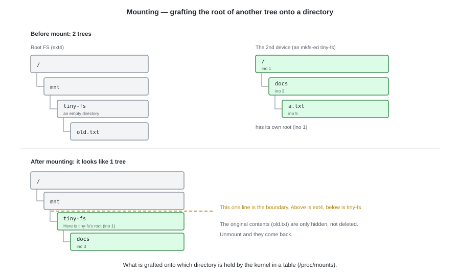
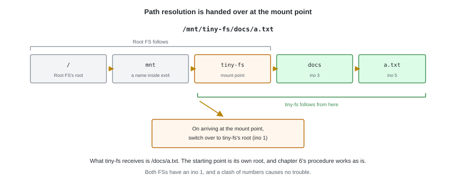
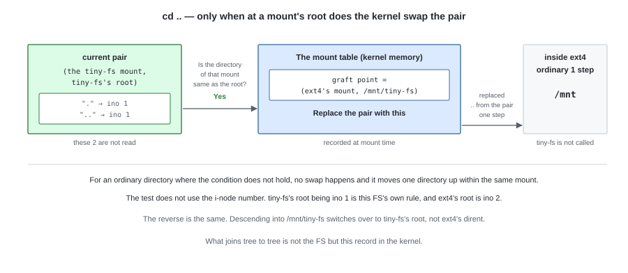

# Part IV  Connecting to the Kernel

---

# 12. Mounting


Up to chapter 11, the only thing that touched a tiny-fs image was the `tiny-fs` command.
The tree inside the image was something specified by the command's arguments (`tiny-fs ls disk.img /docs`),
and it sat somewhere separate from the OS's directory tree.

In the next chapter we connect this to the OS. Before that, in this chapter we decide **what connecting means**.
Where does a path like `/mnt/tiny-fs/docs/a.txt` turn from a story about ext4 into a story about tiny-fs?

---

## 1. Each device has its own tree

An mkfs-ed tiny-fs image has a tree complete in itself.
The root is ino 1, and below it hang `docs` and `a.txt`.
The root FS (ext4 in this example) likewise has a tree beginning at its own root.

**An i-node number has meaning only inside that FS.** Both FSs have an ino 1,
and both have an ino 3. Given only a number, which device it is about is not determined.

---

## 2. Mounting is grafting the root of another tree onto a directory



Mounting is the operation of **picking one existing directory and associating another FS's root with it**.
The directory you pick is called the **mount point**.

```bash
mount /dev/sdb1 /mnt/tiny-fs
```

With this, `/mnt/tiny-fs` becomes a place that, while being a directory inside ext4,
comes out at the root of the second FS when you follow it.
The files that were originally in there are merely hidden, not gone. Unmount and they come back.

What is grafted onto which directory is not written in either FS.
**The kernel holds it in a table in memory** (it is visible in `/proc/mounts`).
The image side runs without knowing where it has been grafted.

---

## 3. Path resolution is handed over at the mount point



When opening `/mnt/tiny-fs/docs/a.txt`, the kernel follows it
**one component at a time**, the same as in chapter 6. The difference is only that each time it advances one component,
it checks the table for "is the directory I have just arrived at a mount point?".

1. From `/` through `mnt` to `tiny-fs` is followed by ext4
2. `tiny-fs` was a mount point, so **there it switches over to the second FS's root (ino 1)**
3. The remaining `docs` and `a.txt` are followed by the second FS

After the switch, the procedure of chapter 6 runs just as it is.
Seen from the tiny-fs side, **the path it receives is `/docs/a.txt`**, and the starting point is always its own root.
It neither knows, nor needs to know, anything above the mount point.

### How does it know that it is a mount point?

What the kernel holds during path resolution is **the pair (which mount am I in now, which directory am I at now)**.
The directory part is represented by a `dentry` (the kernel's record for one directory), and
**a mark saying "another tree is grafted here" is set on it**. Setting the mark is the job of
the `mount` command, and clearing it is `umount`.

So there is no need to search the table for each component. **Just looking at the mark of the `dentry` you arrived at**
lets you pass straight through most directories. Only when the mark is set do we consult the mount table and
take out **(the FS grafted there, the `dentry` of its root)** and replace the pair we are holding with it.
This is the substance of the "switch".

After replacing it, the processing that looks up names is also the one belonging to that FS.
For ext4 it is the processing that reads the directory on the disk; for tiny-fs,
the `readdir` of `fuse_ops.py` is called across `/dev/fuse` (chapter 13).

---

## 4. `..` at the root is answered by the kernel

`cd ..` at `/mnt/tiny-fs` comes out at `/mnt`.
And yet, the `..` that tiny-fs's root holds **points at itself (ino 1)**.
`mkfs` wrote it that way (chapter 5).



The key lies in the fact that the mount record **also remembers "where it was grafted"**.
While you are at the root, `..` is answered from this record alone, without asking tiny-fs.

The one that actually looks up the `..` written on the disk is tiny-fs itself,
namely the path resolution of chapter 6 and the counting of chapter 10.

---

## 5. A number is unique only inside an FS

So long as ino 1 exists in both FSs, pinning down a single file requires
**attaching which FS it is**. This is why `stat` returns `st_dev` (the device) and `st_ino` (the i-node number)
side by side; only the two together are finally unique.

From this, restrictions appear on operations that cross FSs.

- **A hard link cannot cross an FS.** A dirent holds only an i-node number, and
  writing another FS's number into it would be meaningless
- **`rename` cannot cross an FS either.** When `mv` has another FS as its counterpart,
  it switches to the behaviour of copying the contents and then removing the original (`rename(2)` returns `EXDEV`)

The reason the `rename` of chapter 8 got away with "just remove one dirent and add one" was
that its counterpart was inside the same FS.

---

## Try it

The mount table, and the fact that numbers are per-FS, can be seen directly on your own machine.

```bash
findmnt                                  # what is grafted where
stat -c '%d %i %n' / /dev/shm            # the device numbers differ, and the i-node numbers are assigned separately
stat -c '%d %i %n' /dev/shm /dev/shm/..  # the parent of a mount point is already another device
```

The third line is §4. One step from `/dev/shm`'s root to `..`, and the device number changes.

---

In the next chapter we actually mount tiny-fs.
The switch we decided on here is taken over by FUSE, between it and the kernel.
