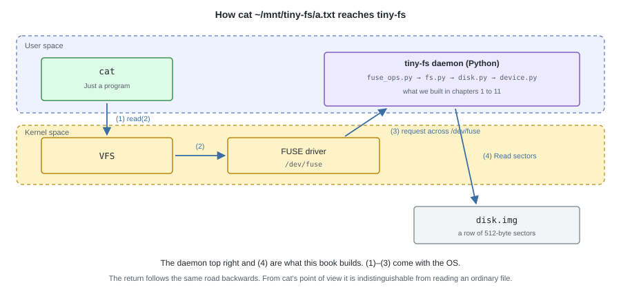
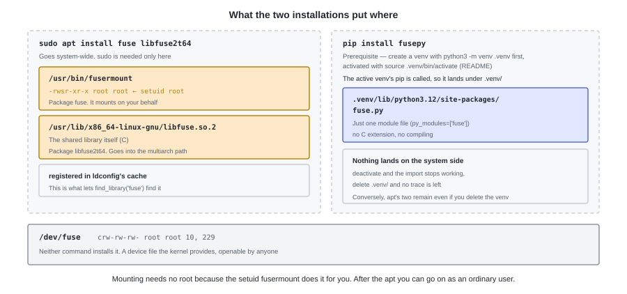
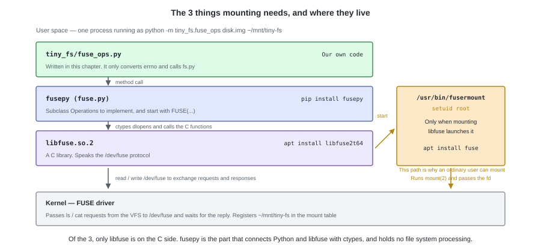

# 13. Mounting with FUSE


In chapter 11, tiny-fs became complete as a file system.
However, it can only be touched from the `tiny-fs` command, and
as far as the OS is concerned `disk.img` is still **just a file**.

The last single step is connecting this to the OS.
We pick an empty directory called `~/mnt/tiny-fs`, and **mount** tiny-fs there.
Make the far side of the switch we saw in chapter 12 be this FS, and
it becomes touchable from the real `ls`, `cat`, and editors.

---

## 1. What is FUSE?

A file system is normally inside the kernel.
**FUSE** (Filesystem in Userspace) is a mechanism that **entrusts that processing to a user-space process**.
The kernel's FUSE driver, via `/dev/fuse`,
hands requests like "I want to read this path" to our process, and waits for a response.



From `cat`'s side, it is indistinguishable from reading an ordinary file.
Without writing a kernel module, **a single Python process can become a file system**.

Here, "mounting" becomes real for the first time. Creating the `FileSystem` of chapter 7
only built state in the process's memory, and the OS was not involved.
With FUSE it is incorporated into the OS's directory tree.

---

## 2. Preparing

On Linux, neither a container nor privileges are needed. It can be mounted **as an ordinary user**.

```bash
sudo apt install fuse libfuse2t64

source .venv/bin/activate      # activate the venv created in the README's "Setting up"
pip install fusepy             # pip install -e ".[fuse]" also installs it
```

`apt` installs system-wide, and `pip` installs only inside the venv you activated.
`fusepy` is pure Python, and it loads `libfuse.so.2` dynamically at the time of `import fuse`.
Neither a C compiler nor development packages are needed.



Looking at what was placed in terms of the chain of calls, it connects up like this.



Mounting (`mount(2)`) is properly a root operation, and an ordinary user cannot perform it.
So libfuse does not call `mount(2)` itself, but **launches `fusermount` and has it act on its behalf**.
This command is setuid root (`-rwsr-xr-x root root`), so even when an ordinary user launches it
it runs with root privileges, finishes the mount, and returns the fd of `/dev/fuse` to the caller.
**That is why sudo is not needed.** If `fusermount` is absent, it fails with `Permission denied`.
The `/dev/fuse` used for reading and writing after the mount is `crw-rw-rw-` so anyone can open it, and no privileges are needed here either.

The package names are those of Ubuntu 24.04. On 22.04, `libfuse2t64` becomes `libfuse2`.

---

## 3. The conventions to keep

There are 3 things to do. **Define the methods -> return in the prescribed form -> hand it to `FUSE()`.**

### (1) Define the methods the kernel calls

Create one class inheriting from `Operations`, and inside it write **methods with the same names as the operations**.

```python
from fuse import FUSE, FuseOSError, Operations

class TinyFSOperations(Operations):
    def getattr(self, path, fh=None): ...
    def readdir(self, path, fh): ...
    # below, line up only the operations you need
```

The correspondence is done **by name**. A method written as `get_attr` instead of `getattr` will not be called.

The first argument is, in every method, **the path being operated on**. What is handed over is
**an absolute path as seen from tiny-fs's root**, with the mount point part stripped off.
An operation on `~/mnt/tiny-fs/docs/a.txt` arrives as `/docs/a.txt`.
The kernel resolves it before handing it over, so neither relative paths nor a current directory show up (chapter 6).

Methods you did not define are answered by the defaults of the base class `Operations`, and the write-side ones return `EROFS`.
**Even with nothing defined the mount succeeds, giving "an FS that has only a root and cannot be written to".**
From there we replace the operations we need, one at a time.

### (2) Match the shapes of the arguments and return values

| Method | What it returns |
|---|---|
| `getattr(path, fh=None)` | A dict holding `st_mode` / `st_nlink` / `st_size` / `st_uid` / `st_gid` / `st_mtime` and so on |
| `readdir(path, fh)` | A list of name strings (including `.` and `..`) |
| `read(path, size, offset, fh)` | `bytes`. It must not return more than `size` bytes |
| `write(path, data, offset, fh)` | The number of bytes actually written |
| `statfs(path)` | A dict holding `f_bsize` / `f_blocks` / `f_bfree` and so on (`df` reads it) |
| `unlink(path)` / `mkdir(path, mode)` and so on | `None` (= success) |

**Failures are conveyed by throwing `FuseOSError(errno)`.** Return without throwing an exception and it is taken as success.
Throwing your own exception as it is crashes inside fusepy, so we convert to an errno at the boundary (§5).

### (3) Hand it to `FUSE()` and mount

```python
def mount(image: str, mountpoint: str, foreground: bool = True) -> None:
    FUSE(TinyFSOperations(image), mountpoint, foreground=foreground,
         nothreads=True, fsname="tiny-fs")
```

| Argument | Example value | Meaning |
|---|---|---|
| `image` | `"disk.img"` | **The path of the image file**. `TinyFSOperations` opens an already-mkfs-ed one |
| `mountpoint` | `"/home/dev/mnt/tiny-fs"` | **The mount point**. An already existing empty directory, which becomes tiny-fs's root. If you write `~/mnt/tiny-fs`, the value the shell expanded is what gets passed |
| `foreground` | `True` | **Whether to run in the foreground**. It stays in the terminal and ends with Ctrl-C. Set it to `False` and it goes into the background |

What we run in §6 is `python -m tiny_fs.fuse_ops disk.img ~/mnt/tiny-fs -f`,
which passes the 2 arguments it received straight to `mount()`.
The `-f` is discarded, and this command runs in the foreground whether you attach it or not.

This `FUSE(...)` serves as both the registration and the mount.
**The first argument is the instance that receives the operations from the kernel.**
`FUSE()` creates one instance of itself, and holds the one it received (the first argument) in the `operations` attribute
(in fusepy's code it is `self.operations`. We look at that call in §5).
After that it enters libfuse's loop, looks at the operation name that arrived, and calls the same-named method of that instance.
It comes back when it is unmounted.

`nothreads=True` cannot be omitted. By default requests from the kernel arrive concurrently, but
`fs.py` holds no locks, so if two operations run at the same time the image breaks.
`fsname` is the name that shows up in the output of `df` and `mount`.

---

## 4. The correspondence of the calls

The operations coming from FUSE correspond almost one-to-one with the API of `fs.py`.

| FUSE | `fs.py` | Notes |
|---|---|---|
| `getattr` | `stat` | Repacked into a dict of `st_*` |
| `readdir` | `readdir` | `.` and `..` have real substance so they come back as they are |
| `read` | `read` | |
| `write` | `write` | |
| `create` | `create` | |
| `truncate` | `truncate` | |
| `unlink` / `mkdir` / `rmdir` / `rename` | the same names | |
| `statfs` | the bitmaps' free counts | `df` reads it |
| `chmod` / `chown` / `utimens` | the same names | `cp` and editors call them at the end of a save. Without implementing them, they fail there |
| `destroy` | `close` | On unmount. `free_hint` is written back here |
| `flush` / `fsync` | **define a function with the same name that only does `return 0`** | There is nothing piling up on the tiny-fs side, so there is nothing to send here (beyond the host is appendix C) |
| `open` / `release` | **define a function with the same name that only does `return 0`** | Operations work with just a path, so we hold no open state |

The correspondence being one-to-one is because both deal with POSIX file operations.
The operation names FUSE calls with, and the names and units of the `fs.py` API decided in Part II, are aligned.

On top of that, the reason **`open` / `release` and `flush` / `fsync` get away with only `return 0`,
and the handling of failures can be written in one line**, is that `fs.py` satisfies the following 3 things.

- **Operations work with just a path.** It holds no open state (file handles), so
  the path that came from FUSE can be passed straight through. There is nothing to write in `open` / `release`
- **It finishes the write-back within a single call** (chapter 7 §1, "The rule for writing back").
  So there is nothing to write in `flush` / `fsync`
- **It expresses failures as exceptions carrying an errno.** They convert to `FuseOSError(e.errno)` in one line (§5)

None of them were decided to suit FUSE; they are the result of writing things straightforwardly in Part II.
What we add in this chapter is **only the conversion**.

---

## 5. Implementation — `fuse_ops.py`

```python
class TinyFSOperations(Operations):
    def __init__(self, image: str) -> None:
        self._fs = FileSystem(BlockDevice(SectorDevice(image)))

    def __call__(self, op: str, *args):
        # The place that turns exceptions into errnos is only this one spot
        try:
            return super().__call__(op, *args)
        except FSError as e:
            raise FuseOSError(e.errno)

    def getattr(self, path, fh=None):
        inode = self._fs.stat(path)
        return {
            "st_mode":  inode.mode,
            "st_nlink": inode.nlink,
            "st_size":  inode.size,
            "st_uid":   inode.uid,
            "st_gid":   inode.gid,
            "st_mtime": inode.mtime,
            "st_ctime": inode.ctime,
            "st_atime": inode.mtime,   # we do not hold atime, so return mtime
        }

    def readdir(self, path, fh):
        return [name.decode() for name, _ino in self._fs.readdir(path)]

    def read(self, path, size, offset, fh):
        return self._fs.read(path, offset, size)

    def write(self, path, data, offset, fh):
        return self._fs.write(path, offset, data)

    def create(self, path, mode, fi=None):
        self._fs.create(path, S_IFREG | (mode & 0o777))
        self._set_owner(path)     # make the person who created it the owner (§6)
        return 0

    def unlink(self, path):
        self._fs.unlink(path)

    def mkdir(self, path, mode):
        self._fs.mkdir(path, S_IFDIR | (mode & 0o777))
        self._set_owner(path)     # directories too are owned by the person who created them

    def destroy(self, path):
        self._fs.close()          # unmount. free_hint is written back here
```

Overriding `__call__` is the key point.
This is not a mechanism peculiar to tiny-fs, but **a hook that fusepy provides**, and
the base class `Operations` side looks like this.

```python
# from fusepy (fuse.py)
class Operations(object):
    def __call__(self, op, *args):
        if not hasattr(self, op):
            raise FuseOSError(errno.EFAULT)
        return getattr(self, op)(*args)
```

> **Python tips** — `getattr(obj, "mkdir")` returns the same thing as `obj.mkdir`.
> The only difference is that **the name can be specified as a string**. `hasattr` checks whether that name exists.
>
> ```python
> op = "mkdir"
> getattr(self, op)                # the same as self.mkdir (a bound method is returned)
> getattr(self, op)("/docs", 0o755)  # the same as self.mkdir("/docs", 0o755)
> ```
>
> `self` is already bound (the tips in chapter 3), so what you pass is only the remaining arguments.
> What goes into `op` is an operation name like `"mkdir"` or `"unlink"`, so
> this single line is directly "operation name -> call the method of the same name".
>
> Here the names look like they collide. The `getattr` of `getattr(self, op)` is **the built-in function**, and
> the `getattr` written in `TinyFSOperations` is **a FUSE operation name** (the equivalent of `stat`).
> They are different things, and they do not hide each other either. A method cannot be reached without a `self.` prefix, so
> a bare `getattr(...)` remains the built-in.
> When `op` is `"getattr"`, the built-in `getattr` looks up FUSE's `getattr`.

It is a dispatcher that merely receives an operation name, finds the method of the same name, and calls it.
The implementation of the `FUSE` class that receives the calls from the kernel takes this shape throughout.
The `self` here is an instance of `FUSE`, and **`self.operations` is the instance of
`TinyFSOperations` handed to `FUSE()`** (§3 (3)). It is calling that as if it were a function.

```python
# from fusepy's FUSE class
return self.operations('mkdir', path.decode(self.encoding), mode)
return self.operations('unlink', path.decode(self.encoding))
```

> **Python tips** — Define `__call__` and instances of that class
> **can be called like functions**.
>
> ```python
> class Greeter:
>     def __call__(self, name):
>         return f"hello {name}"
>
> g = Greeter()
> g("world")                    # 'hello world' — calling an instance as a function
> Greeter.__call__(g, "world")  # the line above expands into this
> callable(g)                   # True. Without __call__, calling it is a TypeError
> ```
>
> That fusepy can write `self.operations('mkdir', path, mode)` is due to this mechanism.
>
> Call `super().__call__(...)` inside an overridden `__call__` and
> the base class's dispatching is performed as usual, so your own code only has to be added before and after it.
> `TinyFSOperations.__call__` adds only the exception conversion, and leaves the dispatching to the base.
>
> ```python
> class Loud(Greeter):
>     def __call__(self, *args):
>         print("called")                 # insert processing before
>         return super().__call__(*args)  # leave the dispatching to the base
> ```

There is not a single place that calls `self.operations.mkdir(...)` directly, and
**every operation goes through `__call__`**. So when you want to insert processing common to all operations,
overriding `__call__` is the standard form in fusepy.
fusepy itself writes `LoggingMixIn`, which logs all operations, this way.

tiny-fs put exception conversion, rather than logging, in `__call__`. As a result,
**the conversion from the custom exceptions to `FuseOSError` is gathered in one place**.
There is no need to write a `try` in each method.

The bodies of the methods are all 1 or 2 lines. What this layer holds is
**only the conversion to errno and the calls into `fs.py`**, and not a single line of file system processing is written.
The layer structure shown in chapter 1, "each layer calls only the layers below itself", is maintained even at the topmost L6.

Mounting is the one line of `FUSE(...)` from §3 (3), and `fuse_ops.py` does nothing more than this.

---

## 6. Mount it and touch it

**This is the command that mounts it.**

```bash
python -m tiny_fs.fuse_ops disk.img ~/mnt/tiny-fs -f
```

The `tiny-fs` command has no subcommand for mounting (chapter 11).
There is an `if __name__ == "__main__": sys.exit(main())` at the end of `fuse_ops.py`, so
running it with `python -m` calls `main()`, and the 2 arguments it received
are passed to the `mount()` of §3 (3). It does not return until it is unmounted, so
to finish, use Ctrl-C, or `fusermount -u ~/mnt/tiny-fs` from another terminal.

```
$ tiny-fs mkfs disk.img
created disk.img: 1024 blocks (4 MiB), 128 inodes

$ mkdir -p ~/mnt/tiny-fs
$ python -m tiny_fs.fuse_ops disk.img ~/mnt/tiny-fs -f &

$ ls -la ~/mnt/tiny-fs
total 4
drwxr-xr-x 2 root root 4096 Sep 30 06:46 .
drwxrwxr-x 3 dev  dev  4096 Sep 30 06:46 ..

$ echo hello > ~/mnt/tiny-fs/a.txt
$ cat ~/mnt/tiny-fs/a.txt
hello

$ mkdir ~/mnt/tiny-fs/docs
$ cp /etc/hostname ~/mnt/tiny-fs/docs/
$ ls -l ~/mnt/tiny-fs/docs
total 0
-rw-r--r-- 1 dev dev 13 Sep 30 06:46 hostname

$ df -h ~/mnt/tiny-fs
Filesystem      Size  Used Avail Use% Mounted on
tiny-fs         4.0M   44K  4.0M   2% /home/dev/mnt/tiny-fs

$ fusermount -u ~/mnt/tiny-fs
```

**`echo`, `cat`, `cp`, and `ls` know nothing whatsoever about tiny-fs.**
They are merely calling ordinary system calls,
and have no idea that beyond them is Python in user space.

The owner of `hostname` being `dev` is because, inside `create`,
the uid / gid returned by `fuse_get_context()` are written into the i-node.
`.` (the root directory), on the other hand, is `root` because what created it was `mkfs`,
which writes uid 0 as it is (as in the dump of chapter 5).

After unmounting, we read the same image with the CLI.

```
$ tiny-fs ls disk.img /
.
..
a.txt
docs

$ tiny-fs cat disk.img /a.txt
hello

$ tiny-fs fsck disk.img
fsck: clean (11 blocks used, 4 inodes used)
```

What was written via FUSE can be read straight from the CLI.
Both go through the same `fs.py`, so naturally it works out that way.
The way the layers were divided, **all the functionality is usable even with FUSE removed**, is proven here.

---

## 7. Points where things easily go wrong

| Symptom | Cause |
|---|---|
| `import fuse` dies with `EnvironmentError: Unable to find libfuse` | `libfuse2t64` is not installed |
| Cannot mount (Permission denied) | `fuse` is not installed (there is no `fusermount`) |
| The owner of a created file becomes root | The uid from `fuse_get_context()` is not written in `create` |
| `cp` of a large file fails partway through | The 48 KiB limit (`EFBIG`). As specified |
| `ls -l` is slow | `getattr` is called for each entry. The path is resolved anew each time |
| Removing a file that is still open breaks things | It is freed the moment `nlink` reaches 0. The open count is not being counted |
| The results are occasionally broken | `nothreads=True` was forgotten |

We do not hold `atime`, so `mtime` is returned.
`ls -lu` gives the same result as `ls -l`.

### Tests

Actually mount it, write via the shell, unmount, and then confirm the contents
with the CLI and `fsck`. Since we have kept the layers separate from chapter 1,
only this test needs FUSE.

In an environment without `fusepy` or `/dev/fuse`, only this test skips itself.
It has `pytest.mark.fuse` attached, so you can run just this one with `pytest -m fuse`,
or exclude it with `pytest -m "not fuse"`.

---

With this we have reached the original goal.
Starting from a device that can only read and write 512-byte sectors,
the real `ls` and `cat` are running on top of a byte layout we designed ourselves.

In the next chapter we organize what we built, its limits, and the next step.
