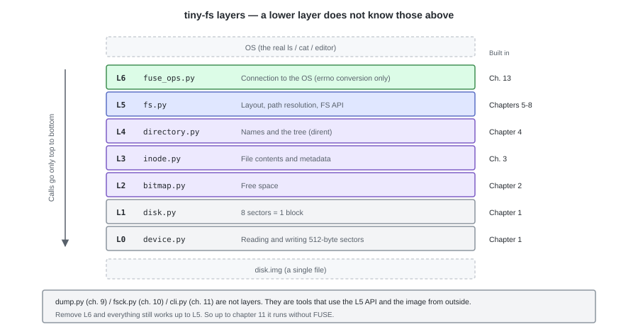
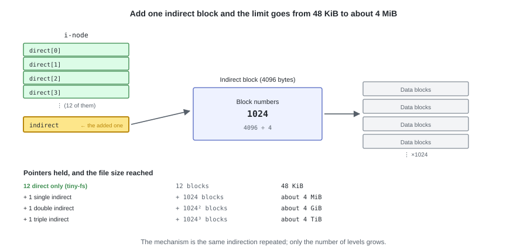

# 14. Summary, and the Next Step

Starting from a device that can only read and write 512-byte sectors,
we reached the point where the real `ls` and `cat` are running.

---

## 1. What we built

The layers shown in chapter 1 have all been filled in, just as they were.



Because we kept the rule that **a lower layer does not know the layers above it**,
even with `fuse_ops.py` removed, the functionality up to chapter 11 works just as it is.

---

## 2. The limits we know about

Things accepted as part of the specification. Every one of them is the result of "we decided it that way", not a bug.

| Limit | Value | Origin |
|---|---|---|
| The size of one file | 48 KiB | `direct[]` has only 12 entries |
| The number of files | 127 | We fixed the i-nodes at 128 |
| The size of the image | 4 MiB (structurally up to 128 MiB) | One bitmap each |
| A crash | A half-finished state is left behind | Operations spanning multiple writes are not atomic |
| Concurrent access | A single process only | It holds no locks |

Only the "crash" row needs a little explanation.
As we saw in chapter 7, `create` rewrites 4 places on the disk, so
if the power goes out partway through, **an i-node with no name** can be left behind.
The `fsck` of chapter 10 can detect it, but does not fix it.

---

## 3. If you were to add more

Earlier ones become the foundation of later ones, so we add them in this order.

| Order | What to add | What it solves | Layers changed |
|---|---|---|---|
| 1 | A single indirect block | 48 KiB -> about 4 MiB | `inode.py` and `constants.py` (`INODE_FMT`), the traversals in `fsck.py` / `dump.py`, `MAGIC` |
| 2 | `link()` / symbolic links | `ln` becomes usable | `fs.py` (`nlink` is already there) |
| 3 | Managing the open count | A file that is still open can be removed | `fs.py` + `fuse_ops.py` |
| 4 | `fsck --repair` | A broken image can be fixed | `fsck.py` |
| 5 | Block groups | The 128 MiB ceiling comes off | The whole layout (raise `MAGIC`) |
| 6 | Journaling | It does not break even on a crash | All layers (the mechanism is in appendix D) |

The single indirect block is the easiest, and the effect is large too.
Add one `indirect` to the i-node, and line up 1024 block numbers in the block it points to.
The 4 MiB limit is the amount the i-node can point at; the image's data region
has only 1017 blocks (about 3.97 MiB).



What changes is only the conversion from `offset` to a block number.

```python
if index < NDIRECT:
    block_no = inode.direct[index]
else:
    table = blocks.read_block(inode.indirect)       # read one more block
    block_no = struct.unpack_from("<I", table, (index - NDIRECT) * 4)[0]
```

---

## 4. From here onwards

Manage the free blocks, represent file contents with i-nodes, put names in directories,
and place them at fixed positions on the disk.
For a practical file system too, the skeleton of the processing is no different from here.
Mechanisms for handling large files, for enduring crashes, and for running fast are merely piled on top,
and what is at the foundation is the same way of thinking.

Of the parts that are piled on top, the ones outside tiny-fs are gathered in the appendices.
How the kernel hides the slowness of the device (appendix C), and
the preparations against crashes (appendix D). The difference from a practical file system lies almost entirely in these two.

Since you are now in a state where you have implemented that foundation yourself, from here on you can
read actual file systems as they are.
