# C. What Is Happening Below tiny-fs (Reference)


In chapter 1 we wrote the device as something that returns 512 bytes on the spot when you tell it to "read".
`read_sector` returns a value when called, and `write_sector` has finished writing by the time it comes back.
In reality, most of these reads and writes never reach the device.

This appendix descends in order from just below tiny-fs and follows what is happening.
The order is: the cache in memory, its management, and the exchange with the device when it was not in the cache.
It is not necessary for understanding the main text. Nor does it talk about modifying tiny-fs
(all of it is the kernel's job, and tiny-fs merely rides on top).
It is put together not as an accurate specification, but **just enough that what is happening falls into place**.

---

## 1. The kernel holds a block-granular cache

tiny-fs has no cache. Call `write_block` and it writes out on the spot, and
`read_block` goes to the OS to read every time. The main text is written on this premise.
`device.py` opens the image with `open(path, "r+b", buffering=0)`, so
one `read_sector` becomes one read to the OS as it is
(it `seek`s and then `read`s, so as syscalls it is 2).
tiny-fs makes no effort to reduce this count.

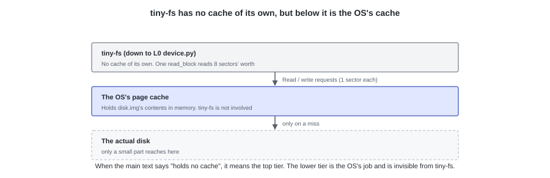

**Even so, most of these reads and writes do not reach the disk device.**
`disk.img` is an ordinary file on the host, so the counterpart of the reads and writes is
the cache the OS holds in memory (the **page cache**).
The unit is the 4096-byte **page**, which happens to be exactly the same size as a tiny-fs block.

This cache can be treated as **the contents of the device's blocks being visible in memory as they are**.
So tiny-fs, and `cat` or `cp` above it, can all be written with the feeling of reading and writing memory,
without being conscious of the device's slowness.

From here on we follow, in order, **how this cache is created, when it is written back to the device, and when it is released**.

---

## 2. Reading — reading does not necessarily mean reading from the device

Run `tiny-fs dump disk.img` twice in a row and the second time is faster.
tiny-fs remembers nothing. It issues the same reads the same number of times; the destination has changed.

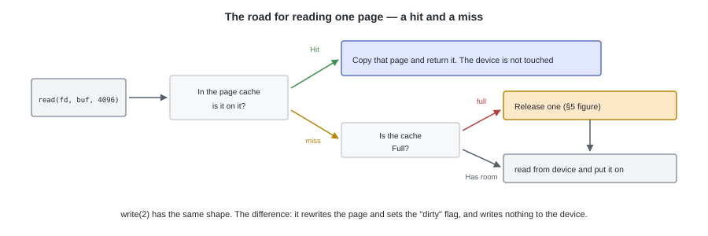

The first time it is not in the cache (a **miss**). The kernel reads 4096 bytes from the device, and
**while leaving it in memory**, copies it to the caller.
The second time it is in the cache (a **hit**), so it finishes with just the copy, without touching the device.

There is no operation to "put" something in the cache. **What was read simply stays there.**
So even if tiny-fs reads block 3 over and over, that does not mean the device moves over and over.

---

## 3. Read-ahead — sequential reads are anticipated

Another thing that works on speed is **read-ahead**.
The kernel looks at the positions that were read, and when it judges them to be sequential reads,
it reads ahead to pages that have not been requested yet.

In processing that reads from beginning to end, like `cat` or `cp`, this makes almost all the waiting disappear.
Conversely, with random access it does not hit, and the pages that were read go to waste.

tiny-fs's `dump` reads the image in order from the front, so it is on the side where read-ahead works.

---

## 4. Writing — writing does not necessarily mean it was written to the device

Writes hit the same cache. The kernel rewrites the page in memory, and
**merely attaches a mark saying "this page differs from the device's contents", then returns to the caller.**
A page with this mark attached is called **dirty**.

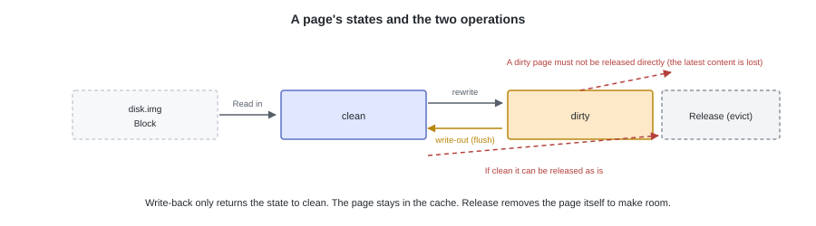

A page without the mark is **clean**, and since it has the same contents as the device, there is nothing to lose by releasing it.
A dirty page needs to be written back to the device before it is released.

As **a separate axis** from this, there is "is somebody referencing it right now". While it is being referenced (pinned),
it is not made a target for release, whether clean or dirty. A page that is **dirty and pinned** is perfectly ordinary.

Both marks are held somewhere other than the page's contents. **There is a management structure for each page,
and it is decided by whether a flag there is set.**

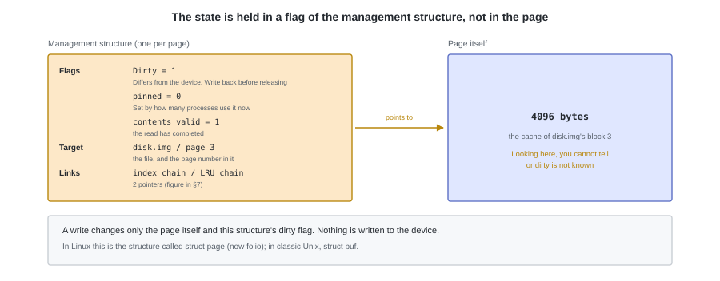

**Writing is fast because it is not waiting for the device.**
Even if `tiny-fs put` finishes and `tiny-fs cat` can read it, that is only reading the cache,
and it does not necessarily mean it has reached the device.

---

## 5. When is it written back to the device?

There are 3 triggers for writing back. All of them are the kernel's judgement, and the file system is not involved.

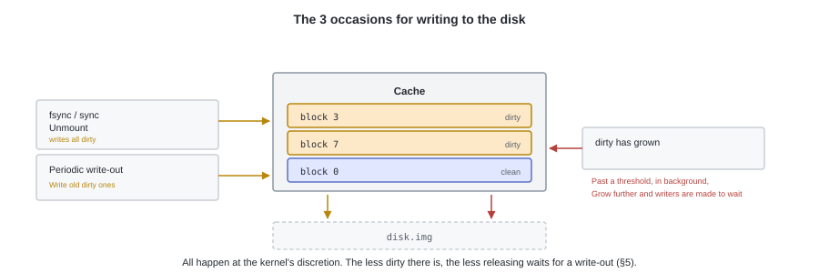

| Trigger | Content |
|---|---|
| Dirty pages increased | Past a certain proportion, it starts writing in the background. Increase further and it makes the writing process itself wait |
| Time passed | Dirty pages that have grown old are written to the device. The default is roughly 30 seconds |
| It was explicitly told to | `fsync` does not return until it has finished writing that file's dirty pages. `sync` does the same thing for everything. An unmount also writes |

tiny-fs does not call `fsync`. That is, **part of the image can be lost in a power failure**.
Even if `tiny-fs put` succeeds, it is not necessarily on the device.
This question of "how to guarantee ordering and arrival" becomes the story of appendix D (journaling).

A program that holds its own cache (a database, say) avoids this mechanism and
opens with `O_DIRECT`. However, this only bypasses the page cache, and
it does not guarantee arrival at the device either (that needs `fsync`).

---

## 6. Capacity is limited — when is it released?

The cache can only be placed in memory, so the whole device does not fit.
Sooner or later it comes down to deciding **which to keep and which to throw away**.

The page cache **merely uses the memory that is left over**, and does not set aside an upper limit.
Even if `buff/cache` is large in `free -h`, that is not "being used" but
a state of "not letting the free space idle, and putting the cache there".
If a program asks for memory, the kernel releases the cache and hands it over.

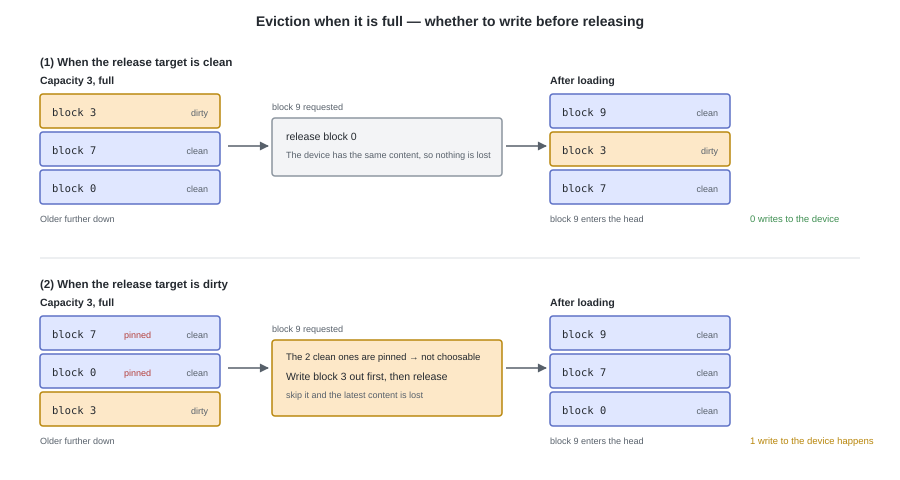

The ones to release are chosen from the pages that have not been used for a long time. The procedure branches by state.

- If **clean**, release it as it is. The same contents are on the device, so there is nothing to lose
- If **dirty**, **write it back to the device first** and then release it
- **Pinned** pages are not chosen. Pages that are in the middle of a read or write-back I/O,
  that are fixed as the destination the device writes to directly (DMA),
  or that are in use by a process via `mmap`, are such pages.

If the write-out of §5 has been working, by the time of release they are usually clean.

### The difference from paging (swapping)

A file's cache and a process's anonymous memory are managed by the same mechanism in Linux, and are chosen
by the same reclaim processing. So they look very similar, but the difference is **where the original data is**.
A file's cache has its original on the device, so if it is clean it can be released as it is.
Anonymous memory has its original nowhere, so **it cannot be released until it has been written to the swap area**.


---

## 7. Where is it registered (supplementary)

Rather than looking up the whole cache in a single index, it holds **one index per file (per its i-node)**.
A page is registered in that file's index.
Since there is only one index for one file, even if another process opens the same file
it ends up looking up the same index, and a page one of them read is effective for the other as it is.
The index's key is the page number counted from the start of the file, so for `read_block(3)`
it ends up looking up "offset 12288 / 4096 = page 3".

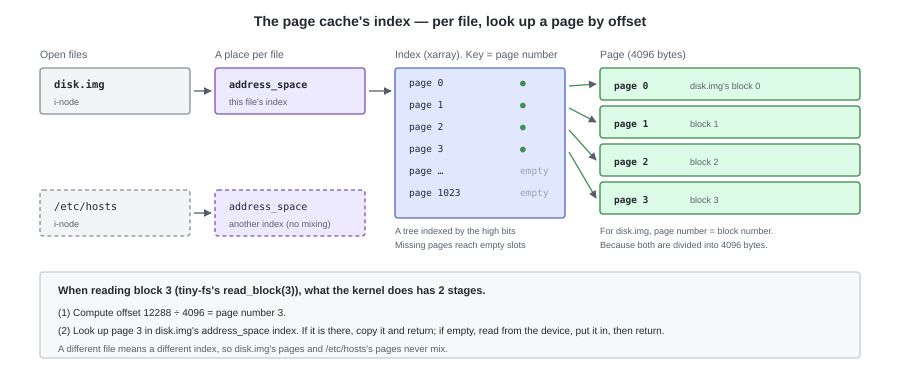

Open `disk.img` or open `/dev/sda`, and both ride on the same mechanism.

In Linux this place is called the `address_space`, and the index an xarray (formerly a radix tree).
The "buffer cache" and "page cache" found in old literature have been unified, and
these days they ride on a single mechanism.

### The implementation of the index and the ordering (further supplementary)

Hundreds of thousands of pages are on it, so we cannot very well scan all of them on every request.
A practical implementation **holds separate indexes with different roles**.

| What you want to do | What is used |
|---|---|
| Check whether that page is on it | The per-file index (an xarray. In the classic implementation, a hash table) |
| Get a place to put a new page | Free page management |
| Choose the one to release | A list ordered by least recently used |

The next 2 figures are the shape of **the classic implementation** (a hash table looked up by the device's block number, and an LRU chain).
Today's Linux, as we saw above, has its index split per file and its key being a page number, but
the shape of **holding things separated by role** has not changed.

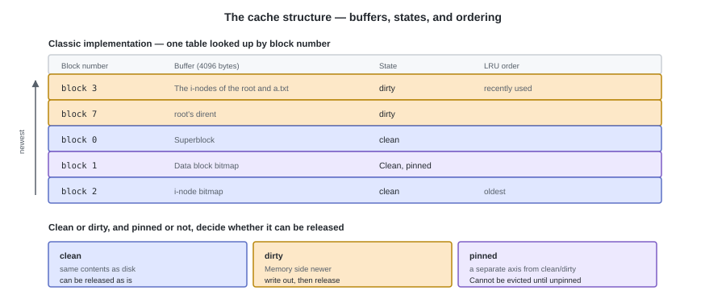

As a result, **one buffer is linked into several chains at the same time.** The index's chain, and the ordering's chain.

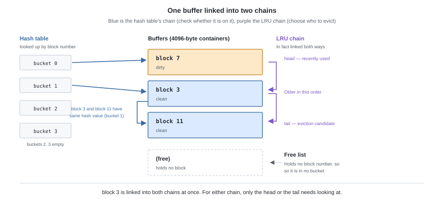

---

## 8. What is not in the cache can only be fetched from the device

An evicted page, a block that has never been read yet, and when writing back a dirty page.
Only at these times does the device move. And the device is **orders of magnitude apart** from memory.

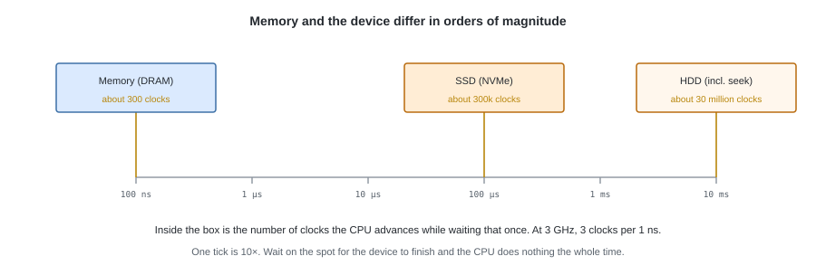

The device is 3 to 5 orders of magnitude slower than memory. A 3 GHz CPU advances 3 clocks in 1 ns, so
while waiting for a single read from an HDD, 30 million clocks go by.

If we made the CPU wait for this completion on the spot, it would do nothing at all for that whole time.
**A request to the device cannot be made in a form where the result comes back when you call it.**

---

## 9. Issue the request, and receive the completion via an interrupt

A single read that was not in the cache proceeds like this.

1. A process calls a read, and the kernel looks up the cache. **It is not there**
2. The kernel allocates a buffer of one page's worth, and
   builds **a request saying "which block, into which buffer"** and puts it in a queue
3. That process is **linked into this page's wait queue and goes to sleep**. The CPU moves to another process
4. The driver takes one request out of the queue and conveys it to the device in that device's manner (§10).
   It does not wait for a reply
5. When the device has finished reading, an **interrupt** is raised. The CPU stops at the break between instructions it is executing
   and jumps to the handler registered in advance. The handler records the completion,
   sets "the contents are valid" on the page, and **wakes the process sleeping in the wait queue**
6. The woken process copies from that page into its own buffer and returns

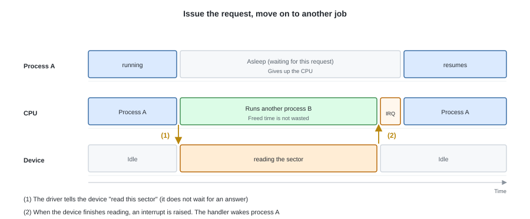

**What is waiting is the process, not the CPU.**
Because 2 and 4 are separated, the CPU after the request has been issued can be used for another job.
From the process's point of view `read_sector` merely returned, but behind it these 6 stages happened.

---

## 10. This is all the device driver does

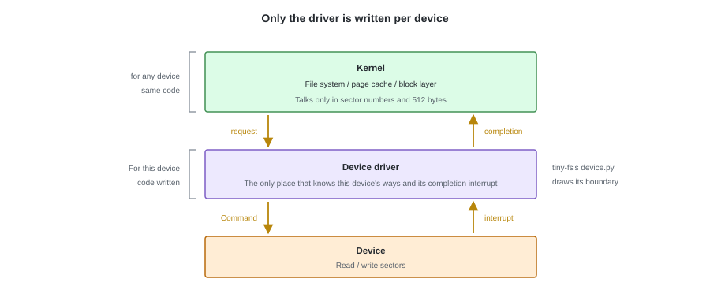

The one in charge of this handover is the **device driver**, and there are only 2 things it does.

- Convey the sector number and the buffer it received from the kernel to the device, in that device's manner
- Receive the completion interrupt, and notify the kernel that it is finished

What differs per device is only the "manner" part. For NVMe it piles the request onto a submission queue and
hits the doorbell register; for ATA it writes the LBA and the sector count into registers and issues a command.

This is **the boundary between generic code and device-specific code**.
The file system, the block layer, and the cache we saw in §1
all run without knowing the kind of device.

That tiny-fs's `device.py` has nothing but `read_sector` / `write_sector` is
aligned to this boundary.

---

## 11. Confirming it on your own machine

On Ubuntu, the amount of cache and the amount of dirty pages are directly visible.

```bash
free -h                       # the buff/cache column is the amount of cache
grep -E 'Cached|Dirty|Writeback' /proc/meminfo
vmstat 1                      # bi / bo are the actual I/O with the device. They do not increase on a cache hit
```

Throw away the cache and then run it twice, and the difference of §2 and the interrupts of §9 are visible at the same time.

```bash
sync; echo 3 | sudo tee /proc/sys/vm/drop_caches   # discard the cache (root is required)
grep -iE 'nvme|ahci|virtio' /proc/interrupts       # note down the interrupt counts

time tiny-fs dump disk.img > /dev/null             # 1st time: reads from the device
grep -iE 'nvme|ahci|virtio' /proc/interrupts       # they have increased

time tiny-fs dump disk.img > /dev/null             # 2nd time: hits the cache
grep -iE 'nvme|ahci|virtio' /proc/interrupts       # they hardly increase
```

The second time the device did not move, so no completion to be notified of happened either.

---

## 12. What it means for tiny-fs

tiny-fs has no cache, and issues a read or write to the OS every time `read_block` / `write_block` is called.
When `write_block` comes back it proceeds on the assumption that it was written. **What tiny-fs can see ends here**,
and whether it hit the cache or went all the way to the device, and when it reached the device, is unknown.

Below that, everything we have seen so far is running just as it is. `disk.img` is an ordinary file on the host, so
the counterpart of the reads and writes is the page cache, and the device moves only on a miss and on a write-back.
Only there do the driver and the interrupts come out.

From this invisibility, 2 things can be said.

- **There is no point in adding a cache of our own.** The OS of the host bears that role
- **The number of block I/Os is not the number of times the device moved.** It is nothing more than the number issued to the OS, so
  it cannot be used as a yardstick for speed

There is one real harm as well. **Since `fsync` is not called, even if `tiny-fs put` succeeds,
the image has not necessarily reached the device.** What happens in a power failure becomes the story of appendix D.

Holding a cache is the kernel's job, and tiny-fs rides on top of it so it gets away with doing nothing.
**A file system inside the kernel does not build its own cache either.**
It is written in a form that connects to the page cache.
