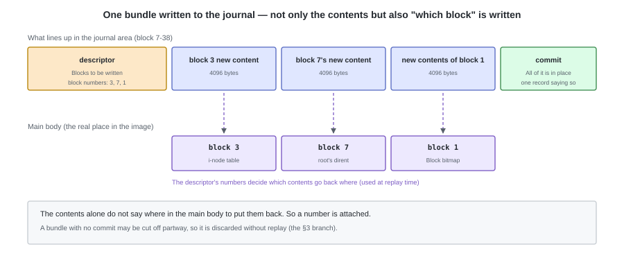
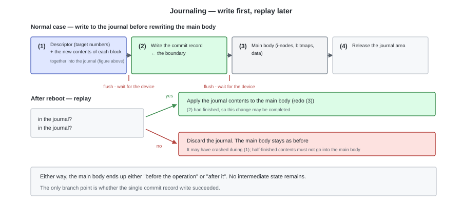
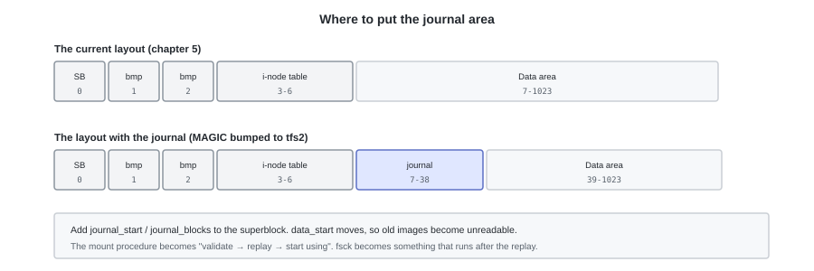

# D. Journaling (Reference)


tiny-fs does not consider the system suddenly crashing. The main text is written on the premise that `write_block`
reaches the disk in the order it was called, and that if it stops partway through, the writes up to that point remain.

This appendix is a record of what happens if that premise is removed.
It is not necessary for understanding the main text. It is the counterpart to appendix C (What is happening below tiny-fs).

---

## 1. What happens when the system suddenly crashes

As an example, we look at the operation of **creating `/a.txt` and writing 5000 bytes into it**
(the same as what `tiny-fs put` does in one go). Even though it is one operation for the user,
`write_block` is divided into 9 calls. 4 for `create("/a.txt")`, and 5 for the write.
**If the crash happens before the i-node has finished being written, the file system's consistency breaks.**

You can actually try it. Make 9 different images, for N = 1 to 9, in which
**of the 9 calls, only the first N reached the device and the rest did not**, and run `fsck` on each.
In 6 of these, an inconsistency is reported
(here we take it that **they reach the device in the order they were written**. This premise is removed in §2).
However, **there are only 2 kinds of breakage.**

| Kind of breakage | Position of the crash | What is left behind |
|---|---|---|
| **orphan** | After allocating the i-node, before writing the name into the parent directory | An i-node that is in use, yet has no path reaching it from the root |
| **leak** | After allocating a data block, before recording it in the i-node's `direct[]` | A block that is in use, yet is referenced by no i-node |

Both are "left-over resources" that the `fsck` of chapter 10 can find, not lost data.

That **whatever point it dies at** it stays within these 2 kinds is the result of choosing the write order that way.
In other words, **what can be achieved by arranging the order goes only as far as "choosing the kind of breakage", not "not breaking".**

---

## 2. Order alone is not enough

Further, **what tiny-fs can decide is only the order in which `write_block` is called,
not the order in which the blocks reach the device.**
What `write_block` reaches is the OS's page cache (appendix C), and
the order and the time at which they are written back to the device from there is decided by the kernel.
Unless `fsync` is called, the order you thought you called in, "data block -> i-node",
is not being observed on the device.

If the order of arrival collapses, the kinds of breakage no longer stay within the 2 of §1 either.

This is the problem journaling solves. Rather than arranging the order,
**it makes sure that the intermediate state of an operation does not remain on the disk.**

---

## 3. The mechanism — write first, replay later

Before rewriting the main body (the i-nodes, the bitmaps, the data), **we write down the changes we are about to make into the journal area**.
This is called write-ahead.

What is written is not only the contents. Replay is impossible without knowing **which main-body block to put it back into**,
so we place a piece of metadata (a descriptor) listing the target block numbers first.
We line up all the blocks changed by one operation, and write a commit at the end.





The branch point is only **the single write of the commit record**. If that is there,
we can say "all the change contents are gathered in the journal", so writing to the main body
can be redone any number of times. If it is not there, we discard the journal, and the main body stays as it was before the operation.

| Position of the crash | After reboot |
|---|---|
| Partway through (1) | There is no commit -> discard the journal. The operation **becomes as if it never happened** |
| Right after (2) | There is a commit -> replay, and the operation **becomes as if it completed** |
| Partway through (3) | Same as above. It only overwrites with the same contents, so applying it twice gives the same result |

That (3) gives the same result however many times it is applied (idempotence) is the premise of replay.
It is satisfied if it is recorded in the form "the contents of block 8 are this".
Record it as something like "increment a counter by 1" and it will keep incrementing with every replay.

There is one more thing needed. **(2) must not arrive before (1) has reached the disk.**
The disk itself also reorders writes, so here we use instructions that enforce ordering
(a cache flush, waiting for a write to complete).
Journaling can be said to be a mechanism for "strictly observing the order of writes in exactly one place".

---

## 4. What to protect

What you record in the journal changes the range you can protect and the amount written.

| What is recorded | What can be protected | The price |
|---|---|---|
| Metadata only | The file system's structure is always consistent. Neither leaks nor orphans remain | The **contents** of files are not guaranteed. Old content can remain in the blocks an i-node points at |
| Metadata + data | Including the contents, it ends up as either before the operation or after it | All data is written twice. The amount written doubles |

As an intermediate policy, one can also take the form "before committing the metadata, finish writing just the data blocks
that metadata points at into the main body". It avoids the problem of §2 without writing the data twice,
so the default of a practical file system is often placed here.

---

## 5. Where it would go if added to tiny-fs

First the layout changes. The journal area needs a fixed place.



We add `journal_start` and `journal_blocks` to the superblock, and move `data_start` further back.
The on-disk format changes, so following the rule of chapter 5 we raise `MAGIC` to `"tfs2"`.

Next, we need to decide **the boundaries of an operation**. Each method of the current `fs.py`
merely "writes blocks a number of times", and does not declare where one operation starts and ends.

```python
def create(self, path, mode=stat.S_IFREG | 0o644):
    with self._journal.transaction():     # from here
        ...                               # the body is the same as the current create
    # by the time we leave the with, the commit record has finished being written
```

Call `write_block` inside `transaction()` and it accumulates in the journal rather than in the main body.
On leaving, it performs the write of the commit record -> the writes to the main body -> the release of the journal ((2)(3)(4) in the figure).
**The layers below L5 do not change**, which is the advantage of this form:
`inode.py` and `directory.py` do not know that they are inside a transaction.

If we put in a journal, **processing that waits for arrival** is also needed. Merely entrusting things to the page cache
does not guarantee ordering (appendix C), so after the writes of (1) and after the commit of (2) we
call `fsync`, confirm that they reached the device, and then proceed to the next step.
These 2 waits are journaling's price in terms of speed.

Finally, `fsck`'s role changes. The mount procedure becomes "validate -> **replay** -> start using", and
`fsck` becomes a check that runs after the replay. There is no longer any need for `fsck` to fix what replay fixes.

---

## 6. The price

| What is lost | Content |
|---|---|
| Amount written | Metadata is always written twice. If data is protected too, the whole thing is written twice |
| Readability of the image | The `dump` of chapter 9 has to read 2 places, the main body and the journal. "What this byte represents right now" gains the condition "before or after replay" |
| The axis of the explanation | The 3 concepts of transaction boundaries, idempotence, and enforcing order get mixed into the explanation of the file system's structure |

The main text does not have journaling because this third one is heavy.
The `fsck` of chapter 10 is a chapter that shows "obtaining the same information by two methods and comparing them", but
with a journal, a replay comes in before the comparison.
