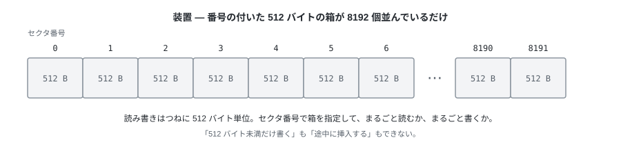
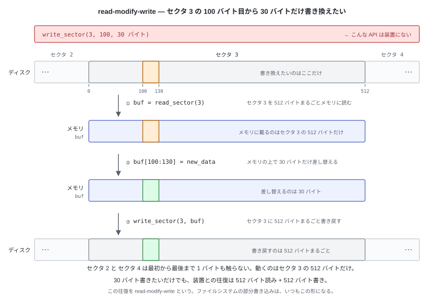
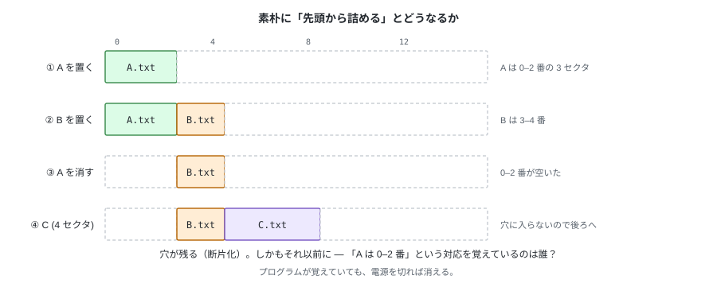
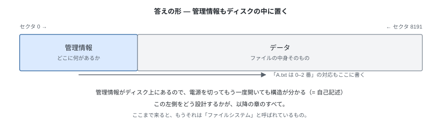
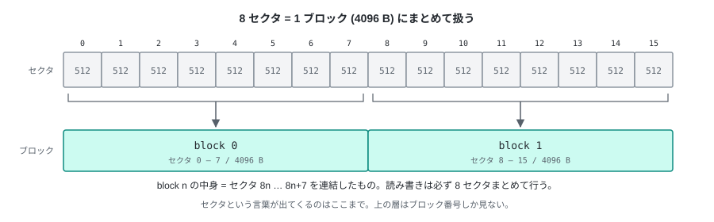

# 01. ディスクという装置


HDD や SSD のようなストレージは、メモリとは違う。
メモリなら「100 バイト目を 1 バイトだけ読む」「そこに 1 バイトだけ書く」が普通にできるが、
**ストレージはバイト単位でアクセスするものではない**。
読み書きは、決まった大きさの塊単位でしか行えない。

では、どうやって操作するのか。

---

## 1. 装置を用意する

`disk.img` という **1 個のファイルをディスクと見立てて**扱う。
中身は 4 MiB のただの領域で、これを 512 バイトずつに区切って番号を振ったものが、
この章でいう「装置」になる。この 1 区切りが**セクタ**で、装置が扱える最小単位になる。
本物の HDD や SSD、USB メモリでも、以下の考え方は変わらない。



この装置に備わっている機能は 2 つしかない。

- 指定された **n 番目のセクタの 512 バイトを読む**
- 指定された **n 番目のセクタに 512 バイトを書く**

この装置に対して「100 バイト目から 30 バイトだけ書く」という要求は存在しない。
30 バイト書き換えたければ、そのセクタを 512 バイト読み、メモリ上で 30 バイト差し替え、
512 バイト書き戻すことになる。これを **read-modify-write** という。



この形はこのあと何度も出てくる（第 3 章の部分書き込み、第 4 章のエントリ削除）。

もう一つ、装置は**空き領域の管理をしてくれない**。
セクタ 7 に意味のあるデータが入っているのか、誰も使っていないゴミなのか、
装置に聞いても答えはない。「全部ゼロなら未使用」も成り立たない
（ゼロが正しいデータであることもある）。

---

## 2. 問題 — テキストを保存したい

`memo.txt`（1200 バイト）と `notes.txt`（800 バイト）を保存したい。
装置しかない状態で、これをやろうとすると何が起きるか。

1200 バイトはセクタ 3 個分（1536 バイト）に収まる。先頭から詰めて、
`memo.txt` をセクタ 0–2 に、`notes.txt` をセクタ 3, 4 に書く。
そのあと `memo.txt` を消し、3 つ目として `log.txt`（4 セクタぶん）を置いてみる。



置くところまでは動く。壊れるのはそのあとで、消すと穴があき、
その穴に入らない大きさのものは後ろへ回すしかない。追記すれば隣にぶつかる。

それ以前に、ディスクに残るのはバイト列だけになる。
**どこからどこまでが `memo.txt` なのかも、長さが 1200 バイトだということも、
どこにも書かれていない。** 覚えているのはプログラムの変数で、終われば消える。
次に開いたとき、そこにあるのは意味の分からない 4 MiB の数字の列でしかない。

---

## 3. 答えの形 — 管理情報もディスクに置く

「どこに何があるか」も、データと同じディスクの上に書く。
4 MiB のうち一部を、ファイルの中身ではなく**管理情報 (metadata)** のために使う。



これが**ファイルシステム**で、装置が持っていない機能を**ディスク上のデータ構造で**埋めている。

これから決めるのは、結局この 3 つ。

1. **空き管理** — どのブロックが使用中か（第 2 章：ビットマップ）
2. **ファイルの表現** — どのブロックがどのファイルの何バイト目か（第 3 章：i-node）
3. **名前** — ファイル名・ディレクトリ名と i-node 番号の対応（第 4 章：ディレクトリ）

そして「それぞれがディスクのどこに置かれているか」を第 5 章で確定させる。

---

## 4. 扱う単位を決める — セクタからブロックへ

管理情報を設計する前に、単位を決めておく。
以降のファイルシステムは、512 バイトのセクタを直接は扱わない。
**8 セクタ = 4096 バイトを 1 ブロック**として、常にブロック単位で考える。



```python
# ブロック番号 → セクタ番号は掛け算するだけ
first_sector = block_no * SECTORS_PER_BLOCK   # 8
```

4096 バイトは Linux のページサイズと同じで、管理情報を小さく保ったまま
大きな領域を扱える。代償として、**確保はブロック単位になる**。
1 バイトのファイルでも 4096 バイトを消費し、使わない領域が増える。

この章以降、**セクタという言葉はほとんど出てこない**。
セクタを知っているのは装置を包む層 (`device.py`) だけで、
その上の層はブロック番号しか見ない。

---

## 5. 実装

tiny-fs は**層を積み上げる形**で作る。下の層ほど装置に近く、
各層は**自分より下の層だけを呼ぶ**。全体は 7 層で、章が進むごとに 1 枚ずつ増える。


この章で作るのは一番下の 2 枚、`device.py` (L0) と `disk.py` (L1)。
どちらも「上の層を知らない」ので、10 行ずつで終わる。

### `device.py` — 装置のモデル (L0)

```python
class SectorDevice:
    """1 個のイメージファイルを、512 バイトのセクタの配列として見せる。"""

    def read_sector(self, sector_no: int) -> bytes:
        # 範囲外は静かに 0 を返さず、必ず例外で落とす。
        # 「読めてしまう」バグは、後から原因をたどるのが非常に難しい。
        self._check_range(sector_no)
        self._file.seek(sector_no * SECTOR_SIZE)
        return self._file.read(SECTOR_SIZE)

    def write_sector(self, sector_no: int, data: bytes) -> None:
        # 512 バイトちょうどでなければ受け付けない（装置の性質をそのまま守る）
        if len(data) != SECTOR_SIZE:
            raise ValueError(...)
        ...
```

### `disk.py` — ブロックに束ねる (L1)

```python
class BlockDevice:
    """8 セクタを 1 ブロックに束ねて見せるだけの層。"""

    def read_block(self, block_no: int) -> bytes:
        first = block_no * SECTORS_PER_BLOCK
        return b"".join(
            self._dev.read_sector(first + i) for i in range(SECTORS_PER_BLOCK)
        )
```

`write_block` を呼べば 8 回 `write_sector` が呼ばれ、そのまま装置に届く。
この層はキャッシュも遅延書き込みも持たない。

### テスト

```python
def test_block_roundtrip(tmp_path):
    # 書いたものがそのまま読めること（一番退屈で、一番効くテスト）
    ...

def test_block_is_eight_sectors(tmp_path):
    # ブロック 1 に書いたら、セクタ 8-15 が変わり、セクタ 7 と 16 は変わらないこと
    ...

def test_out_of_range_raises(tmp_path):
    # 範囲外のブロック番号は例外
    ...
```

2 つ目のテストが効く。ブロックとセクタの対応がずれていても
「書いて読む」だけのテストは通ってしまうので、
**装置側から見て正しい位置に書かれているか**を直接確かめる。

---

## 試す

```bash
pytest -q tests/test_device.py tests/test_disk.py
```

`test_block_is_eight_sectors` が、ブロック 1 への書き込みが
セクタ 8–15 だけを変えることを確かめている。

---

次章では、この 1024 個のブロックについて
**「どれが使用中か」をどうやって記録するか**を考える。
