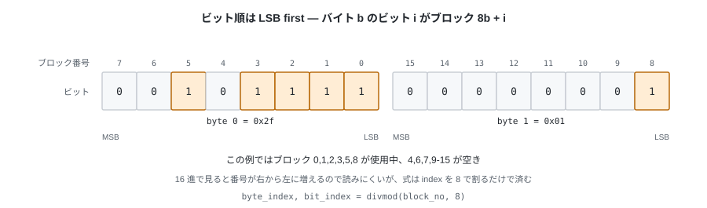
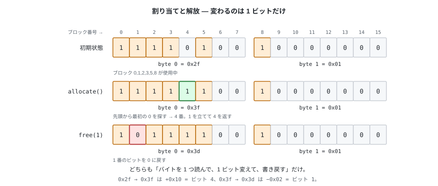

# 02. どこが空いているか — ビットマップ

前章で、装置にできるのは「番号を指定してセクタを読み書きする」ことだけで、
足りない機能はディスク上のデータ構造で自分で作る、と決めた。
最初に作るのは**空き管理**。これがないと、2 個目のファイルを置く場所すら決められない。

---

## 1. 問題 — 「空いている」を誰も知らない

1024 個のブロックがある。ファイルを 1 個置きたい。どのブロックを使えばいいか。

装置に聞いても答えはない。では中身を読んで判断できるか。
**できない。** ブロックが全部ゼロでも、それは

- まだ誰も使っていないブロックかもしれないし、
- ゼロが 4096 個並んだ正しいファイルの中身かもしれないし、
- 消したファイルの残骸（消したつもりでも、装置は上書きしない限り何も消えない）かもしれない。

バイト列を見ても「使用中かどうか」は分からない。
だから**使用中かどうかは、別に記録しておくしかない**。

必要な操作は 4 つ。

| 操作 | いつ使うか |
|---|---|
| 空いているブロックを 1 個見つけて、使用中にする | ファイルを作る / 伸ばす |
| 指定したブロックを空きに戻す | ファイルを消す / 縮める |
| 指定したブロックが使用中か調べる | `fsck` の照合 |
| 空きがいくつあるか数える | `df` 相当、テストの検証 |

---

## 2. ビットマップという方法

こういうときの定番が**ビットマップ**。

記録したいのは 1 ブロックにつき「使用中か / 空きか」の 2 値だけなので、
**1 ビットあれば足りる**。そこで、ブロック番号 `n` の状態を `n` 番目のビットに入れる。
**位置そのものがブロック番号を表す**ので、「どのブロックの話か」を書かずに済む。

1024 ブロックなら 1024 ビット = **128 バイト**。ビットマップ全体が 1 ブロックに楽に収まる。
ビットの意味は **0 が空き、1 が使用中**とする。



ビット順は **LSB first**。バイト `b` のビット `i` がブロック `8 * b + i` に対応する。

```python
# ブロック番号 → (何バイト目の, 何ビット目か)
byte_index, bit_index = divmod(block_no, 8)
mask = 1 << bit_index

is_used = buf[byte_index] & mask != 0
```

16 進ダンプで見ると、1 バイトの中では番号が右から左に増えるので読みにくい。
それでも LSB first を選ぶのは、式が `1 << i` で済むから。
MSB first にすると毎回 `1 << (7 - i)` と反転が入り、
ビットマップを触る全部の場所にこの反転が散らばる。

### 1 ブロックでどこまで管理できるか

ビットマップ自身も 1 ブロック (4096 バイト) に置く。
つまり **4096 × 8 = 32768 ビット**まで使える。

| | |
|---|---|
| 既定の 1024 ブロックを管理するのに使う量 | 128 バイト |
| ビットマップ 1 ブロックで管理できる上限 | **32768 ブロック = 128 MiB** |

既定値では 4096 バイトのうち 128 バイトしか意味を持たない。
残りは 0 のまま置いておく。「存在しないブロックを割り当ててしまう」事故は、
余りビットを 1 で埋めて防ぐのではなく、
**走査を `capacity` で打ち切る**ことで防ぐ。
ビットの意味を「0 = 空き / 1 = 使用中」の 1 つに保ちたいので、
1 に「そんなブロックは存在しない」という 2 つ目の意味を持たせない。

なお `mkfs --blocks` がこの 32768 を超える値を拒否するのは、この制限のため。
ディスク全体をもっと大きくしたければ、ビットマップを複数枚に分けることになる。

### この部品は 2 回使う

同じ仕組みを、データブロック用と **i-node 用**（第 3 章）の 2 枚使う。
そこで `bitmap.py` は「ブロック」という言葉を知らない部品として書く。
扱うのは**インデックス**だけ。

そして、このビットマップ自身が**ディスクのどこに置かれるか**も、この層は知らない。
それを決めるのは第 5 章の仕事になる。

---

## 3. 割り当てと解放



**割り当て**は「先頭から探して、最初に見つかった 0 のビットを 1 にして、その番号を返す」。
これを **first-fit** という。

**解放**は「そのビットを 0 にする」。それだけ。ブロックの中身は消さない
（消す必要がない。次に割り当てられたときに上書きされる。
ただし「消したファイルの中身がディスクに残る」という性質はここから来る）。

境界の扱いを 2 つ決めておく。

- **空きがない**とき、`allocate()` は `-1` や `None` を返さず、`ENOSPC` の例外で落とす。
  戻り値で失敗を表すと、呼び出し側が確認を忘れたときに
  「ブロック -1 に書き込む」という最悪の形で壊れる。
- **すでに 0 のビットを解放**しようとしたら例外にする。
  二重解放は、必ず上の層のバグか、イメージが壊れている証拠。
  黙って成功させると、あとで同じブロックが 2 つのファイルに割り当てられる。

### `free_hint` — 毎回先頭から探さないために

first-fit は素直だが、ディスクが埋まってくると毎回先頭から走査することになる。
そこで「次はこの辺から探すといい」という**ヒント**を受け取れるようにしておく。

```python
def allocate(self, hint: int = 0) -> int:
    # hint から末尾まで探し、見つからなければ先頭に戻って hint の手前まで探す
    ...
```

ヒントが古くても間違っていても、**正しさには影響しない**（探索が一周するだけ）。
この値をスーパーブロックに持たせて永続化するのは第 5 章。

---

## 4. 実装 — `bitmap.py` (L2)

この層はディスクを触らない。**メモリ上の `bytearray` を受け取って、ビットを操作するだけ。**
ブロックを読んで渡し、変更後に書き戻すのは上の層 (`fs.py`) の仕事。

```python
class Bitmap:
    """ビットの配列。ビット i が 1 なら「i 番は使用中」。

    buf はディスクから読んだ 1 ブロック分そのもの。capacity は
    「そのうち何個までが実在するか」（例: 1024 ブロック / 128 i-node）。
    """

    def __init__(self, buf: bytearray, capacity: int) -> None:
        self._buf = buf
        self._capacity = capacity

    def is_used(self, index: int) -> bool:
        self._check_range(index)
        byte_index, bit_index = divmod(index, 8)
        return self._buf[byte_index] & (1 << bit_index) != 0

    def mark_used(self, index: int) -> None:
        self._check_range(index)
        byte_index, bit_index = divmod(index, 8)
        self._buf[byte_index] |= 1 << bit_index

    def mark_free(self, index: int) -> None:
        self._check_range(index)
        if not self.is_used(index):
            # 二重解放。上の層のバグか、イメージが壊れている
            raise CorruptionError(f"index {index} is already free")
        byte_index, bit_index = divmod(index, 8)
        # Python の ~ は負の数を返す（~1 == -2）ので、必ず & 0xFF で 1 バイトに戻す。
        # ここを忘れると bytearray への代入で ValueError になる。
        self._buf[byte_index] &= ~(1 << bit_index) & 0xFF
```

割り当ては、ヒントから一周する素直なループにする。

```python
    def allocate(self, hint: int = 0) -> int:
        # capacity で打ち切るので、buf の余っている部分は決して割り当てられない
        order = list(range(hint, self._capacity)) + list(range(0, hint))
        for index in order:
            if not self.is_used(index):
                self.mark_used(index)
                return index
        raise NoSpaceError("no free entry left")

    def count_free(self) -> int:
        used = sum(byte.bit_count() for byte in self._buf[: self._capacity // 8])
        return self._capacity - used
```

1 ビットずつ見るので、1024 個なら最大 1024 回。
「`0xFF` のバイトは中を見ずに飛ばす」という定石はあるが、ここでは入れない。
4 MiB のイメージでは効果がなく、意図を読む邪魔になるほうが高くつく。

> `bit_count()` は Python 3.10 以降の `int` のメソッド。
> 自前で数えるより速く、何より「立っているビットを数える」という意図がそのまま出る。

---

## 5. テスト

```python
def test_alloc_marks_used():
    # 割り当てたら is_used が True、同じ番号は二度と返らない

def test_alloc_until_full_raises_nospace():
    # capacity 個取れて、次で ENOSPC

def test_free_then_alloc_reuses_the_same_index():
    # 解放したらその番号がまた返ってくる（= 空きが本当に戻っている）

def test_double_free_raises():
    # 二重解放は黙って通さない

def test_bit_position_matches_the_spec():
    # index 8 を使用中にしたら、buf[1] == 0x01 になること。
    # 「ビット順の規約」を直接確かめる。往復テストだけでは
    # MSB first で実装してしまっても気づけない。

def test_capacity_limits_allocation():
    # buf は 4096 バイトでも capacity が 1024 なら 1024 個しか取れず、
    # buf の 128 バイト目以降は 0 のまま
```

5 つ目が第 1 章の「ブロックとセクタの対応」テストと同じ役割を持つ。
**自分で決めた規約は、往復テストではなく規約そのものを見るテストで守る。**

---

次章では、ブロックを確保できるようになった状態から一歩進める。
**確保したブロックが「どのファイルの何バイト目なのか」を、どこに書いておくか。**
