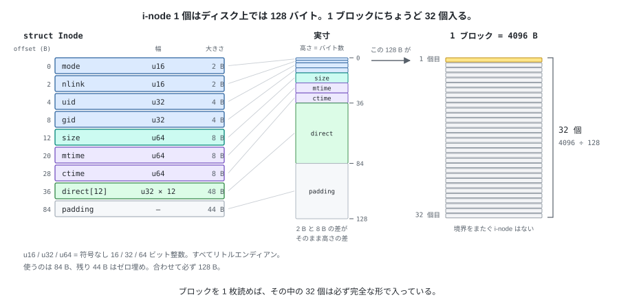
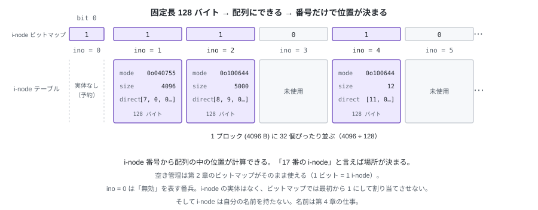
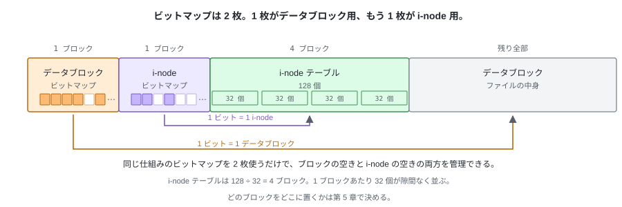
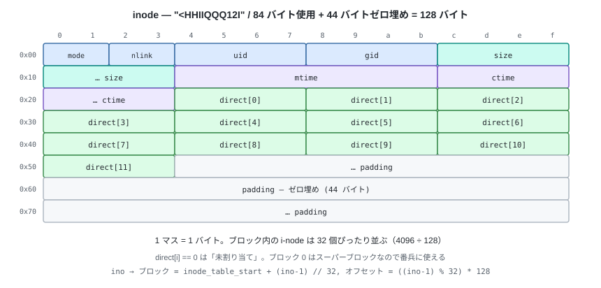

# 03. ビットマップだけでは足りない — i-node


ビットマップで、空いているデータブロックを確保できるようになった。
しかしビットマップが保持する情報は「そのブロックが使用中か否か」の 1 ビットだけで、
**確保したブロックがどのファイルに属するのかは記録されない**。

ブロック 7 に 1200 バイト書き込んでも、次にこのイメージを開いた時点で分かるのは
「7 番は使用中」までとなる。どのファイルの何バイト目にあたるのか、
そのファイルの長さが何バイトなのかは、どこにも残っていない。

---

## 1. i-node — ファイル 1 個ぶんの情報をまとめる

ファイル 1 個につき 1 個、
**固定長 128 バイト**の構造体を用意し、そこにブロック番号の一覧とメタデータを入れる。
これを **i-node** と呼ぶ。

```python
# tiny_fs/constants.py
INODE_SIZE = 128                                # i-node 1 個のディスク上の大きさ
NDIRECT = 12                                    # ブロック番号の一覧の長さ
INODES_PER_BLOCK = BLOCK_SIZE // INODE_SIZE     # 4096 ÷ 128 = 32
```

```python
# tiny_fs/inode.py
@dataclass
class Inode:
    """i-node 1 個。ディスク上では 128 バイトの大きさを占める。"""

    mode: int           # u16       ファイル種別 + パーミッション
    nlink: int          # u16       この i-node を指す名前の数
    uid: int            # u32       所有者
    gid: int            # u32
    size: int           # u64       バイト単位のファイルサイズ
    mtime: int          # u64       内容の更新時刻
    ctime: int          # u64       メタデータの更新時刻
    direct: list[int]   # u32 × 12  中身が入っているブロックの番号。0 は未割り当て
```

**Python の `int` には幅がない**ので、各フィールドが何ビットかはコメントで示した
`u16` / `u32` / `u64`（符号なし 16 / 32 / 64 ビット整数）が正になる。
この幅は次節の `INODE_FMT` でディスクに書くときに効いてくる。

冒頭で挙げた欠落は、`direct` と `size` で埋まる。
ファイルの中身を指しているのは `direct` だけで、残りはメタデータになる。

| メンバー | 意味 |
|---|---|
| `direct` | ファイルの中身が入っているブロックの番号を、先頭から順に並べた一覧。`direct[k]` がファイルの `4096 × k` バイト目から始まるブロックを指す。`0` は未割り当て。詳しくは後述 |
| `size` | ファイルの長さ。ブロック数ではなく**バイト単位**なので、最後のブロックのどこで中身が終わるかもこれで決まる |
| `mode` | ファイル種別（通常ファイルか、ディレクトリか）とパーミッション。1 個の整数に両方を詰める |
| `uid` / `gid` | 所有者のユーザ ID とグループ ID |
| `mtime` / `ctime` | 内容を更新した時刻 / メタデータを更新した時刻。Unix epoch 秒 |
| `nlink` | この i-node を指す名前の数。名前はまだ登場しないので、第 4 章で扱う |



実際に使うのは 84 バイトで、残り 44 バイトはゼロで埋めて必ず 128 バイトにする。
将来フィールドを足すときは、**この余白から削る**。末尾に付け足すのではなく
余白を削る形にしておけば、既存フィールドのオフセットが動かない。
**1 ブロックに i-node がちょうど 32 個並ぶ。** 128 は 4096 の約数なので割り切れ、
ブロックの境界をまたぐ i-node は存在しない。



同じ大きさのものが隙間なく並ぶので、全体は**配列**になる。
配列の中の位置が **i-node 番号**で決まるので、番号から場所が計算できる。
「17 番の i-node」と言えば、探索なしで位置が決まる。

そして、**その i-node が使用中かどうかは第 2 章のビットマップで管理できる**。
1 ビット = 1 i-node。ブロック用に作った `Bitmap` を、もう 1 枚別の用途で使うだけで済む。
新しくファイルを作るときは、`allocate()` が返した番号がそのまま新しい i-node 番号になる。



ビット番号を i-node 番号に合わせるので、ビットマップが扱うのは
**bit 0 から bit `NUM_INODES` までの `NUM_INODES + 1` 個**になる（bit 0 は次で述べる予約ぶん）。

個数は 128 個で固定する。= **i-node テーブルは 4 ブロック**。
配列なので後から増やせず、容量が余っていても i-node が尽きれば
ファイルは作れなくなる（`ENOSPC`）。

### i-node 番号は 1 から

i-node 番号は **1 始まり**にして、**0 は「無効 / 未使用」を表す番兵**として予約する。
`ino == 0` は「そんなものはない」を意味し、これから何度も出てくる
（第 4 章のディレクトリの空きスロットがそれ）。
ビットマップの側では、ビット 0 を最初から使用中にしておけば 0 番が割り当てられることはない。

### そして、i-node は名前を持たない

`mode` も `size` も時刻も持つのに、**ファイル名だけは入っていない**。
i-node を指すのは常に番号で、名前は次章のディレクトリが持つ。

---

## 2. 具体例 — 128 バイトを書き出す

§1 の `Inode` が、ディスク上で実際にどんなバイト列になるかを見る。

どのメンバーを何バイトで、どの順に並べるかは、
標準ライブラリ `struct` の**フォーマット文字列**1 本で表す。

```python
# tiny_fs/constants.py
INODE_FMT = "<HHIIQQQ12I"   # 84 バイト。128 バイトまでゼロで埋める
```

暗号のように見えるが、1 文字ずつ「型」を並べただけのもの。

| 記号 | 意味 | 対応するメンバー |
|---|---|---|
| `<` | **リトルエンディアン**（下位バイトが先）で、かつ**詰め物 (padding) を入れない** | — |
| `H` | 符号なし 2 バイト整数 (u16) | `mode` |
| `H` | 〃 | `nlink` |
| `I` | 符号なし 4 バイト整数 (u32) | `uid` |
| `I` | 〃 | `gid` |
| `Q` | 符号なし 8 バイト整数 (u64) | `size` |
| `Q` | 〃 | `mtime` |
| `Q` | 〃 | `ctime` |
| `12I` | `I` が 12 個 = 48 バイト | `direct[0]` 〜 `direct[11]` |

合計は 2 + 2 + 4 + 4 + 8 + 8 + 8 + 48 = **84 バイト**
（`struct.calcsize(INODE_FMT)` で確かめられる）。

先頭の `<` を忘れてはいけない。これには 2 つの意味がある。

- **バイトの並び順を固定する。** 付けないと実行環境の CPU まかせになり、
  同じイメージが機械によって違う意味になる。
- **詰め物を入れない。** C の構造体と同じ規則で並べると、`gid`（4 バイト）の次に
  `size`（8 バイト）を置くところで、8 の倍数の境界に揃えるための隙間が 4 バイト入り、
  全体が 88 バイトになる（`struct.calcsize("HHIIQQQ12I")` で確認できる）。
  `<` を付けるとこの詰め物が入らず、手計算どおりの 84 バイトになる。

このフォーマット文字列 1 本が、i-node のディスク上の仕様そのものになる。
これと `Inode` を往復させるのが `encode` / `decode`。

```python
    def encode(self) -> bytes:
        packed = struct.pack(INODE_FMT, self.mode, self.nlink, self.uid, self.gid,
                             self.size, self.mtime, self.ctime, *self.direct)
        # 84 バイトを 128 バイトに伸ばす。余白は常にゼロに保つ
        return packed.ljust(INODE_SIZE, b"\x00")

    @classmethod
    def decode(cls, raw: bytes) -> "Inode":
        if len(raw) != INODE_SIZE:
            raise ValueError(...)
        values = struct.unpack(INODE_FMT, raw[:struct.calcsize(INODE_FMT)])
        return cls(*values[:7], direct=list(values[7:]))
```



5000 バイトのファイル（ブロック 8 と 9 を使っている）の実バイト列。
上の図の 1 行が、ダンプの 1 行 (16 バイト) にそのまま対応する。

```
00000000  a4 81 01 00 00 00 00 00 00 00 00 00 88 13 00 00  |................|
          ^^^^^ ^^^^^ ^^^^^^^^^^^ ^^^^^^^^^^^ ^^^^^^^^^^^
          mode  nlink uid=0       gid=0       size=0x1388 = 5000
00000010  00 00 00 00 c0 10 b5 6a 00 00 00 00 c0 10 b5 6a  |.......j.......j|
          +----------  mtime = 0x6ab510c0  ----  ctime
00000020  00 00 00 00 08 00 00 00 09 00 00 00 00 00 00 00  |................|
          +----------  direct[0]=8, direct[1]=9, direct[2..]=0
00000030  ... 以降 128 バイトまでゼロ ...
```

- `mode = 0x81a4 = 0o100644` — 上位が種別 `S_IFREG`（通常ファイル）、下位が `rw-r--r--`。
  この 2 つを 1 個の整数に詰めるのは POSIX の流儀をそのまま借りている。
  `0o` は **8 進数**を表す Python の接頭辞（`0x` が 16 進、`0b` が 2 進）。
  パーミッションは 3 ビットずつ「所有者・グループ・その他」に対応するので、
  8 進で書くと 1 桁が 1 グループにちょうど収まり、`0o644` のように読める。
- `size = 5000` なのにブロックは 2 個（8192 バイト）確保されている。
  **最後のブロックの 904 バイト目から先はゴミ**で、そこが中身でないことを知っているのは
  `size` だけ。

---

## 3. オフセットからブロックへ

![direct[12] とデータブロックの対応](../images/03-direct-pointers.svg)

変換はこれだけ。分岐も探索もない。

```python
# 論理オフセット off バイト目が、どのブロックの何バイト目か
index, inner = divmod(off, BLOCK_SIZE)
block_no = inode.direct[index]
```

`direct[]` の並び順はファイルの論理的な順序を表すだけで、
**ブロック番号が昇順である必要はない**（図の例は 7 → 9 → 8）。
空いていたブロックを使うだけなので、書いた順に散らばる。

`direct[i] == 0` は「まだ割り当てていない」。
ブロック 0 は第 5 章でスーパーブロックになるので、
データブロック番号として 0 が現れることはなく、番兵として安全に使える。

### ファイルサイズの上限

```
MAX_FILE_SIZE = NDIRECT × BLOCK_SIZE = 12 × 4096 = 49152 バイト = 48 KiB
```

一覧を 12 本しか持たないので、**48 KiB を超えるファイルは作れない**。
これを超える書き込みは `EFBIG` で拒否する。
この壁をどう越えるかは第 13 章で扱う。

### `size` と確保済みブロック

`size` はファイルの大きさをバイト単位で表す。確保済みのブロックは
`ceil(size / 4096)` 個で、`truncate` で縮めたら余ったブロックはその場で解放する。

また、**穴 (sparse file) は作らない**。
`offset = 20000` にいきなり書いたら、手前のブロックも実際に確保してゼロで埋める。
`direct[i] == 0` が「未割り当て」と「全部ゼロのブロック」の 2 つの意味を持つと、
解放漏れの検出が一気に面倒になるため。

---

## 4. 実装 — `inode.py` (L3)

構造体 (§1) とバイト列との変換 (§2) はもう書いた。
ここでは **i-node の割り当てと解放**、そして **ファイルの中身を読み書きする** 関数を足す。
この層も、自分がディスクのどこに置かれるかは知らない。
ブロックを読み書きする第 1 章の `BlockDevice` と、
ブロック / i-node の割り当て係は、引数として受け取る。

### i-node の割り当てと解放

§1 のとおり、i-node 番号は i-node ビットマップの添字そのものなので、
**`allocate()` が返した番号がそのまま新しい i-node 番号**になる。

```python
def allocate_inode(inode_bitmap, mode: int, now: int) -> tuple[int, Inode]:
    """空いている i-node 番号を 1 個取り、まっさらな Inode を返す。"""
    # bit 0 は mkfs で埋めてあるので、ino = 0 が返ることはない
    ino = inode_bitmap.allocate()
    inode = Inode(mode=mode, nlink=0, uid=0, gid=0, size=0,
                  mtime=now, ctime=now, direct=[0] * NDIRECT)
    # nlink はまだ 0。名前を 1 つ付けた時点で 1 になる（第 7 章）
    return ino, inode


def free_inode(inode: Inode, blocks, alloc, inode_bitmap, ino: int) -> None:
    """i-node が持っているデータブロックを全部解放し、i-node 番号も空きに戻す。"""
    # 先にデータブロック。順番を逆にすると、途中で落ちたときに
    # 「誰からも参照されていないのに使用中のブロック」が残る
    truncate(inode, blocks, alloc, 0)     # ← この後の節で書く
    inode_bitmap.mark_free(ino)
```

ブロックを解放する処理は「サイズ 0 に縮める」とまったく同じなので、
次の節の `truncate` をそのまま呼べばよい。解放専用のループは要らない。

どちらも、ディスク上の i-node テーブルには触らない。
`allocate_inode` の戻り値は番号とメモリ上の `Inode` で、
**その 128 バイトをディスクのどこに書くか**はこの層の担当ではない。
i-node テーブルの位置を知っているのは `fs.py`（第 5 章）で、
`ino` から「何番ブロックの何バイト目か」を計算して `encode()` の結果を書き込む。

### ファイルの中身を読み書きする

読み書きする相手は、**この i-node が `direct[]` で指しているデータブロックだけ**。
位置はファイルの先頭から数えたバイト数 (`offset`) で指定し、
`direct[]` の何番目か / そのブロックの何バイト目かに分解するのがこの関数の仕事になる。
呼び出し側がブロック番号を渡すことはない。

読み出す長さは、`size` を超えないように切り詰める。

```python
def read(inode: Inode, blocks: BlockDevice, offset: int, length: int) -> bytes:
    # size より先は「ファイルの外」。ブロックが確保されていても読まない
    length = max(0, min(length, inode.size - offset))
    out = bytearray()
    while length > 0:
        index, inner = divmod(offset, BLOCK_SIZE)
        n = min(length, BLOCK_SIZE - inner)
        block_no = inode.direct[index]
        if block_no == 0:
            # 穴は作らない設計なので、size の内側が未割り当てなら壊れている
            raise CorruptionError(...)
        out += blocks.read_block(block_no)[inner:inner + n]
        offset += n
        length -= n
    return bytes(out)
```

書き込みは read-modify-write になる。
第 1 章の装置には部分書き込みがないので、それをこの層で実装する。

```python
def write(inode: Inode, blocks: BlockDevice, alloc: Allocator,
          offset: int, data: bytes) -> None:
    if offset + len(data) > MAX_FILE_SIZE:
        raise FileTooBigError(...)          # EFBIG
    if offset > inode.size:
        # 穴は作らない。飛ばした手前の部分を、実ブロックのゼロで先に埋める
        truncate(inode, blocks, alloc, offset)

    pos = 0
    while pos < len(data):
        index, inner = divmod(offset + pos, BLOCK_SIZE)
        n = min(len(data) - pos, BLOCK_SIZE - inner)

        if inode.direct[index] == 0:
            # 必要になった時点で初めて確保する。新品は全部ゼロとして扱う
            inode.direct[index] = alloc.allocate()
            buf = bytearray(BLOCK_SIZE)
        else:
            # ブロックの一部だけ書き換えるので、まず読んでから差し替える
            buf = bytearray(blocks.read_block(inode.direct[index]))

        buf[inner:inner + n] = data[pos:pos + n]
        blocks.write_block(inode.direct[index], buf)
        pos += n

    inode.size = max(inode.size, offset + len(data))
```

`truncate` は伸ばす側と縮める側で別のことをする。

```python
def truncate(inode, blocks, alloc, new_size):
    if new_size > MAX_FILE_SIZE:
        raise FileTooBigError(...)          # EFBIG

    if new_size > inode.size:
        # 伸長は「ゼロを書き込む」のと同じ。穴は作らない
        # （size は write が更新する）
        write(inode, blocks, alloc, inode.size, b"\x00" * (new_size - inode.size))
    else:
        # 縮小は、要らなくなったブロックをその場で解放する。
        # ここを忘れるとビットマップだけが埋まり続ける（fsck が検出する）
        first_unused = math.ceil(new_size / BLOCK_SIZE)
        for index in range(first_unused, NDIRECT):
            if inode.direct[index] != 0:
                alloc.mark_free(inode.direct[index])
                inode.direct[index] = 0
        inode.size = new_size
```

`inode.py` は `bitmap.py` を import しない。`alloc` や `inode_bitmap` として
「`allocate()` と `mark_free()` を持つ何か」を受け取るだけにしておく
（第 2 章の `Bitmap` がその形をしている）。型はこの 2 メソッドだけを書いた
`Protocol` (`Allocator`) を `inode.py` 側に置いて表す。
こうするとテストで偽物の割り当て係を渡せるし、
「i-node がビットマップの置き場所を知っている」という層の逆転も起きない。

---

## 5. テスト

```python
def test_encode_decode_roundtrip():
    # 128 バイトになること。往復して同じ値が戻ること

def test_encoded_size_is_exactly_128():
    # 余白 44 バイトがゼロであること（規約そのものの検査）

def test_write_across_block_boundary():
    # 4090 バイト目から 12 バイト書く → 2 ブロックにまたがる
    # 装置側から見て、両方のブロックが正しく変わっていること

def test_partial_write_preserves_neighbours():
    # ブロックの真ん中 10 バイトだけ書き換えて、前後が壊れていないこと
    # （read-modify-write ができているか）

def test_read_stops_at_size():
    # size = 5000 のとき、8192 バイト読もうとしても 5000 しか返らない

def test_write_beyond_max_file_size_raises_efbig():
    # 49152 ちょうどは書けて、49153 は EFBIG

def test_truncate_shrink_frees_blocks():
    # 縮めたぶんのブロックが割り当て係に返っていること

def test_truncate_grow_fills_zero():
    # 伸ばしたぶんがゼロで読めること（ゴミが見えない）

def test_allocate_inode_never_returns_zero():
    # bit 0 が埋まっている状態から取り、1 以上が返ること。
    # 返ってくる Inode は size = 0、direct が全部 0 であること

def test_free_inode_returns_blocks_and_number():
    # 3 ブロック使っている i-node を解放すると、
    # 空きブロック数が 3 戻り、その i-node 番号も空きに戻ること
```

4 つ目と 7 つ目が要。**書いたものが読める**だけのテストは、
read-modify-write の欠落も解放漏れも見逃す。
「隣が壊れていないこと」「返したはずのブロックが本当に返っていること」を
別々に確かめる。

---

## 試す

```bash
pytest -q tests/test_inode.py

# 構造体のバイト数を自分で確かめる
python -c "import struct; print(struct.calcsize('<HHIIQQQ12I'))"   # 84
python -c "import struct; print(struct.calcsize('HHIIQQQ12I'))"    # 88（詰め物あり）
```

---

ここまでで、ファイルの中身は完全に表せるようになった。
しかし `A.txt` という名前はまだどこにもない。
i-node は番号でしか呼べず、人間はその番号を知らない。
次章で**名前**を作る。
