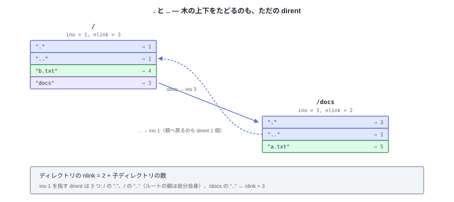

# 04. 名前をどう付けるか — ディレクトリ


i-node によって、ファイルの中身とメタデータは表せるようになった。
ただし i-node を指定する手段は番号しかなく、**i-node 自身は名前を持たない**。
`memo.txt` というファイル名から i-node にたどり着く経路は、まだどこにも存在しない。

この章で用意するものは 2 つある。**名前から i-node 番号を引く対応表**と、
ファイルが増えたときにそれを**分類する仕組み**（`docs/` の下、`src/` の下、という階層）。

---

## 1. ディレクトリは、実はファイル

ディレクトリは **ディレクトリファイル** と呼ばれる、ファイルの一種である。
i-node を 1 個持ち、データブロックに中身を持つ。
通常のファイルと違うのは、その中身が「名前と i-node 番号の対応表」になっていることだけ。


表の中から別のディレクトリを指せるので、ディレクトリは入れ子になり、全体が木構造になる。

---

## 2. dirent — 対応表の 1 行

表の 1 行を **dirent** (directory entry) と呼ぶ。
i-node と同じく**固定長**の構造体にする。大きさは 32 バイト。

```python
# tiny_fs/constants.py
DIRENT_SIZE = 32                                # dirent 1 個のディスク上の大きさ
DIRENT_FMT = "<I27sx"                           # ino(4) + name(27) + 詰め物(1)
MAX_NAME_LEN = 27                               # 32 − 4 (ino) − 1 (詰め物)
DIRENTS_PER_BLOCK = BLOCK_SIZE // DIRENT_SIZE   # 4096 ÷ 32 = 128
```

```python
# tiny_fs/directory.py
@dataclass
class Dirent:
    """dirent 1 個。ディスク上では 32 バイトの大きさを占める。"""

    ino: int      # u32   指し先の i-node 番号。0 なら「空きスロット」
    name: bytes   # 27 B  ファイル名。27 バイトに右 NUL 埋めして書く
```

| メンバー | 意味 |
|---|---|
| `ino` | この名前が指す i-node 番号。**`0` は「空きスロット」**を表す（第 3 章で 0 を番兵に予約したことが、ここで使われる） |
| `name` | ファイル名。27 バイトに満たないぶんは NUL で埋める。**NUL 終端ではない**ので、27 バイトちょうどの名前は終端バイトを持たない |

`DIRENT_FMT` の `27s` が 27 バイトの固定長バイト列、末尾の `x` が 1 バイトの詰め物。
`27s` は書き込み時に右側を NUL で自動的に埋めるので、往復はこれだけで書ける。

```python
    def encode(self) -> bytes:
        return struct.pack(DIRENT_FMT, self.ino, self.name)

    @classmethod
    def decode(cls, raw: bytes) -> "Dirent":
        ino, name = struct.unpack(DIRENT_FMT, raw)
        # 埋めた NUL を除去して、本来の名前に戻す
        return cls(ino=ino, name=name.rstrip(b"\x00"))
```


`memo.txt` → i-node 5 の dirent と、その次の空きスロットの実バイト列:

```
00000000  05 00 00 00 6d 65 6d 6f 2e 74 78 74 00 00 00 00  |....memo.txt....|
          ^^^^^^^^^^^ ^^^^^^^^^^^^^^^^^^^^^^^ ^^^^^^^^^^^
          ino = 5     "memo.txt" (8 バイト)   名前の後ろは NUL (0x00) で埋める
                                              → 27 バイトまで。終端記号ではなく詰め物
00000010  00 00 00 00 00 00 00 00 00 00 00 00 00 00 00 00  |................|
00000020  00 00 00 00 00 00 00 00 00 00 00 00 00 00 00 00  |................|
          ^^^^^^^^^^^ ino = 0 → このスロットは空き
00000030  00 00 00 00 00 00 00 00 00 00 00 00 00 00 00 00  |................|
```

32 が `BLOCK_SIZE` の約数なので、1 ブロックにちょうど 128 エントリが収まり、
**dirent がブロックをまたぐことはない**。
さらに「n 番目のエントリは `32n` バイト目」と位置が計算で決まる。
これが後で `readdir` のオフセットとして利用される（§5）。

固定長なので、長さを別に持たなくても名前が復元できる。
`decode` が末尾の NUL を除去し、**あとは `bytes` の比較 1 回で一致を判定できる**。
これが成り立つのは「名前に NUL を含めない」ことを登録時に確かめているからで、
それがなければ詰め物と中身の区別がつかなくなる。

名前として受け付けないものも決めておく。

| 名前 | 結果 |
|---|---|
| 28 バイト以上 | `ENAMETOOLONG` |
| 空文字列 | `EINVAL` |
| `/` を含む | `EINVAL`（パスの区切りなので、名前には入れられない） |
| NUL を含む | `EINVAL`（NUL 埋めと区別できなくなる） |
| すでに存在する名前 | `EEXIST` |

---

## 3. ディレクトリは普通のファイル


ディレクトリも i-node を持つ。`direct[12]` にデータブロックを持ち、`size` をバイト単位で持つ。
**普通のファイルとの違いは `mode` の種別ビットだけ**（`S_IFDIR` か `S_IFREG` か）。

ただし `size` の動き方は違う。通常のファイルは 1 バイト単位で増減し、`truncate` で縮む。
ディレクトリファイルの `size` は

- 常に **`BLOCK_SIZE` の倍数**。ブロックを 1 個確保するたびに 4096 ずつ増える
- ブロックは丸ごとゼロで確保されるので、増えた 4096 バイトは
  そのまま **`ino = 0` の空きスロット 128 個**になる
- エントリを 1 個足しても、空きスロットがあるかぎり `size` は変わらない
- **一度増えたら減らない**（削除は `ino = 0` を書くだけ。§5）

つまりディレクトリの `size` は「いま何エントリあるか」ではなく、
**「何エントリ置ける場所を確保したか」**を表す。

```python
# ディレクトリの中身を読むのに、専用の関数は要らない
raw = inode_read(dir_inode, blocks, offset=0, length=dir_inode.size)
# あとは 32 バイトずつ区切って解釈するだけ
```

この帰結として、上限が自動的に決まる。

| | |
|---|---|
| 1 ディレクトリの最大サイズ | `MAX_FILE_SIZE` = 48 KiB |
| 1 ディレクトリの最大エントリ数 | **1536**（12 ブロック × 128 エントリ、`.` と `..` 込み） |
| ディレクトリの `size` | 確保したブロック数 × 4096 バイト |

「ディレクトリのサイズ」が `ls -l` で 4096 などと表示されて不思議に思ったことがあれば、
その理由がこれである。ディレクトリのサイズは**中のファイルの合計ではなく、
対応表そのものの大きさ**。

---

## 4. `.` と `..` — 木をつなぐ



ディレクトリを作るとき、**必ず先頭 2 エントリとして `.` と `..` を書く**。

- `.` は自分自身の i-node 番号
- `..` は親ディレクトリの i-node 番号。**ルートの `..` は自分自身**（ino = 1）

「親をたどる」ために特別な仕組みは用意しない。
親へ戻る操作も、dirent を 1 個引くだけで済む。
第 6 章のパス解決は、この規約のおかげで `..` を特別扱いせずに書ける。

### `nlink` の数え方

第 3 章で i-node に置いた `nlink` は、**その i-node を指している dirent の数**。
ディレクトリの場合はこうなる。

```
ディレクトリの nlink = 2 + 子ディレクトリの数
                      │   └ 子それぞれの ".." が自分を指す
                      └ 親の中の自分の名前 + 自分の "."
```

普通のファイルは `nlink = 1`（名前が 1 つ）。
0 になった時点で i-node とデータブロックを解放する、というのが第 7 章の `unlink`。

### 禁止すること

- `.` と `..` の削除・改名（木が壊れる）
- 空でないディレクトリの `rmdir` → `ENOTEMPTY`。
  「空」とは **`.` と `..` 以外に有効なエントリがない**こと
- ディレクトリを自分の子孫の下へ `rename` すること（第 8 章。木から切り離された循環ができる）

---

## 5. 削除は詰めない


エントリを消すときは、**`ino` に 0 を書くだけ**。
後ろのエントリを前に詰めることはせず、`size` も縮めない。
次にエントリを追加するときは、まず空きスロットを探して再利用する。

なぜ詰めないか。**エントリの位置を動かさないため**。

`readdir` は「オフセット 3 から続きを返せ」という形で何度も呼ばれる
（第 8 章、そして FUSE 越しの `ls` がまさにこの形で呼び出す）。
途中でエントリが前に詰められると、
**まだ読んでいないエントリが読んだ位置より前に移動し、読み飛ばされる**。
位置が固定なら、この問題が最初から存在しない。

代償は、**一度大きくなったディレクトリは縮まない**こと。
エントリを 1000 個作ると 8 ブロック（32768 バイト）まで伸び、999 個削除しても `size` はそのまま。
検索は毎回そのサイズぶんを走査する。これはディレクトリ内の断片化になる。

---

## 6. 実装 — `directory.py` (L4)

この層は「dirent の並んだファイル」を扱うだけ。
ディレクトリがディスクのどこにあるかも、パスがどう解決されるかも知らない。
第 3 章の `inode.read` / `inode.write` を呼ぶだけで済む。

走査はスロット番号で行う。**空きスロット (`ino == 0`) は読み飛ばす**。

```python
def iter_entries(dir_inode, blocks):
    """有効なエントリを (スロット番号, Dirent) で返す。"""
    # 32 バイトずつ読むと 1 エントリごとに 1 ブロック読むことになるので、
    # ディレクトリファイルを一度に読んでから区切る（最大 48 KiB）
    raw = inode.read(dir_inode, blocks, 0, dir_inode.size)
    for slot in range(len(raw) // DIRENT_SIZE):
        entry = Dirent.decode(raw[slot * DIRENT_SIZE:(slot + 1) * DIRENT_SIZE])
        if entry.ino != 0:          # 0 は空きスロット
            yield slot, entry


def find(dir_inode, blocks, name: bytes) -> tuple[int, Dirent] | None:
    for slot, entry in iter_entries(dir_inode, blocks):
        if entry.name == name:
            return slot, entry
    return None


def lookup(dir_inode, blocks, name: bytes) -> int:
    """名前から i-node 番号を引く。なければ ENOENT。"""
    found = find(dir_inode, blocks, name)
    if found is None:
        raise NotFoundError(name)
    return found[1].ino
```

追加は「空きスロットを探す → なければ末尾に足す」。
末尾に足す場合は、ディレクトリという**ファイルを伸ばす**ことになる。
つまり第 3 章の `write` がそのまま呼ばれ、必要ならブロックが 1 個割り当てられる。

```python
def add_entry(dir_inode, blocks, alloc, name: bytes, ino: int) -> None:
    check_name(name)                       # 長さ / '/' / NUL の検査
    if exists(dir_inode, blocks, name):
        raise AlreadyExistsError(name)     # EEXIST

    slot = _find_free_slot(dir_inode, blocks)
    if slot is None:
        if dir_inode.size // DIRENT_SIZE >= MAX_DIRENTS:
            raise NoSpaceError(name)       # ENOSPC。1536 エントリが上限
        # 空きスロットが尽きた。ディレクトリファイルを 1 ブロックぶん伸ばす。
        # truncate の伸長はゼロ埋めなので、増えた 4096 バイトは
        # そのまま ino = 0 の空きスロット 128 個になる
        slot = dir_inode.size // DIRENT_SIZE
        inode.truncate(dir_inode, blocks, alloc, dir_inode.size + BLOCK_SIZE)

    raw = Dirent(ino=ino, name=name).encode()
    inode.write(dir_inode, blocks, alloc, slot * DIRENT_SIZE, raw)
```

エントリを足す経路はこれ 1 本だけ。`size` が増えるのは、
**空きスロットが 1 個も無かったときのブロック追加**に限られる。

削除は `ino = 0` を書くだけ。**`size` も後続エントリも変更しない。**

```python
def remove_entry(dir_inode, blocks, alloc, name: bytes) -> int:
    found = find(dir_inode, blocks, name)
    if found is None:
        raise NotFoundError(name)
    slot, entry = found
    if entry.name in (b".", b".."):
        raise InvalidArgumentError("cannot remove . or ..")
    empty = Dirent(ino=0, name=b"").encode()
    inode.write(dir_inode, blocks, alloc, slot * DIRENT_SIZE, empty)
    return entry.ino       # 呼び出し側が nlink を減らす（第 7 章）
```

新しいディレクトリの初期化は、`.` と `..` を書くだけ。

```python
def init_directory(dir_inode, blocks, alloc, self_ino: int, parent_ino: int) -> None:
    # 先頭 2 エントリは必ずこの順。ルートでは parent_ino == self_ino
    add_entry(dir_inode, blocks, alloc, b".", self_ino)
    add_entry(dir_inode, blocks, alloc, b"..", parent_ino)
```

---

## 7. テスト

```python
def test_add_then_lookup():
    # 足した名前が引けること

def test_lookup_missing_raises_enoent():

def test_name_of_exactly_27_bytes_is_ok():
    # 27 バイトちょうどは通り、28 バイトは ENAMETOOLONG。
    # NUL 終端を持たない名前が正しく往復すること

def test_duplicate_name_raises_eexist():

def test_remove_keeps_following_entries_in_place():
    # 真ん中を消しても、後ろのエントリのスロット番号が変わらないこと
    # （詰めない、という規約そのものの検査）

def test_removed_slot_is_reused():
    # 消した跡地に次のエントリが入り、size が増えないこと

def test_new_directory_is_one_block():
    # 作った直後は size = 4096、有効なエントリは . と .. の 2 つだけ

def test_add_beyond_one_block_grows_the_directory():
    # 128 個目までは size = 4096 のまま。129 個目で size = 8192 になり、
    # それまでのエントリが無傷であること

def test_dot_and_dotdot_cannot_be_removed():

def test_directory_full_raises_enospc():
    # 1536 個が上限（= MAX_FILE_SIZE の制限）
```

`test_remove_keeps_following_entries_in_place` が、第 2 章・第 3 章と同じ役割の「規約そのものを検査するテスト」。
往復テストだけでは、実装が後続エントリを詰めていても気づけない。

---

## 試す

```bash
pytest -q tests/test_directory.py
```

`test_remove_keeps_following_entries_in_place` が、
真ん中のエントリを消しても後ろのスロット番号が動かないことを確かめている。

---

これで部品が揃った。ブロックの空き管理、ファイルの表現、名前と階層。
残っているのは、**それぞれをディスクのどこに置くか**を決めて、
次に開いたときに読み直せるようにすること。次章で地図を描く。
