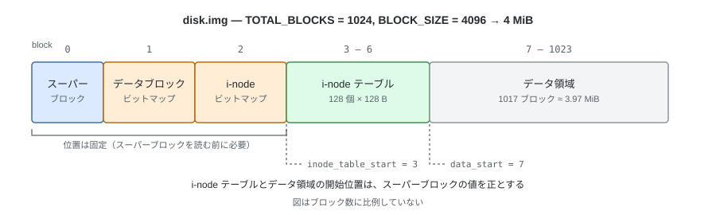
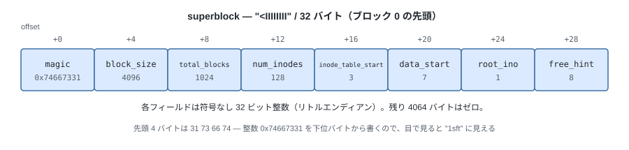
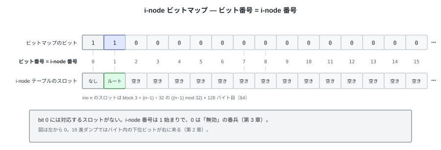

# 05. 地図を描く — レイアウトの確定


ビットマップ (第 2 章)、i-node (第 3 章)、ディレクトリ (第 4 章) と部品が揃った。

第 3 章の図では、データブロック・ビットマップ、i-node ビットマップ、i-node テーブルが
どういう順で並び、それぞれ何ブロック使うかまでを示した。
ブロック番号を振らなかったのは、先頭に置くものがまだ決まっていなかったため。
この章でそれを決めて、各部品の位置を確定させる。

決めるのは次の 2 点。

- 4 MiB のディスクを、どの部品にどれだけ割り当てるか（レイアウト）
- その割り当て自体をディスク上のどこに記録するか（スーパーブロック）

---

## 1. 全体像

`TOTAL_BLOCKS = 1024`（= 8192 セクタ = 4 MiB）のブロック割り当て。
第 1 章のとおり 1 ブロック = 8 セクタなので、以下はすべてブロック番号で書く。



先頭に来たブロック 0 が**スーパーブロック**。ここまで登場しなかった部品で、
**ファイルシステム自身の情報**を記録する 1 ブロックである。
ブロックサイズ、総ブロック数、i-node の個数、i-node テーブルとデータ領域の開始位置など、
そのイメージがどういう構造になっているかが入る。
イメージを開いたときに最初に読む場所で、ここを起点に残りの部品の位置が分かる。

スーパーブロック自身の位置はどこにも書いておけないので、**ブロック 0 に固定する**。
2 つのビットマップもそれぞれ 1 ブロックずつなので、ブロック 1 と 2 に固定し、
位置はスーパーブロックに書かない（`constants.py` の `BLOCK_BITMAP_BLOCK` / `INODE_BITMAP_BLOCK`）。
i-node テーブルとデータ領域の開始位置は、スーパーブロックの
`inode_table_start` / `data_start` に書いてあるものを正とする。

---

## 2. スーパーブロック（ブロック 0）

ブロック 0 を丸ごと使うが、意味のあるデータは先頭の **32 バイト**だけ。
残り 4064 バイトはゼロで埋める。

中身は符号なし 32 ビット整数が 8 個。

```python
# tiny_fs/constants.py
SUPERBLOCK_FMT = "<IIIIIIII"   # u32 × 8 = 32 バイト
```

```python
# tiny_fs/fs.py
@dataclass
class Superblock:
    """スーパーブロック。ディスク上では 32 バイト（ブロック 0 の先頭）。"""

    magic: int              # u32  0x74667331 固定
    block_size: int         # u32  4096
    total_blocks: int       # u32  このイメージのブロック総数
    num_inodes: int         # u32  i-node の個数
    inode_table_start: int  # u32  i-node テーブルの先頭ブロック番号
    data_start: int         # u32  データ領域の先頭ブロック番号
    root_ino: int           # u32  ルートディレクトリの i-node 番号
    free_hint: int          # u32  次に空きブロックを探し始めるブロック番号
```

| メンバー | 意味 |
|---|---|
| `magic` | tiny-fs のイメージであることを示す固定値。合わなければマウントを拒否する |
| `block_size` | ブロックの大きさ。この実装は 4096 に固定 |
| `total_blocks` | イメージ全体のブロック数。データブロック・ビットマップが管理する範囲でもある |
| `num_inodes` | i-node の個数。i-node テーブルの大きさと、i-node ビットマップの範囲を決める |
| `inode_table_start` | i-node テーブルの先頭ブロック番号。3 |
| `data_start` | データ領域の先頭ブロック番号。7。ここより前がメタデータ |
| `root_ino` | ルートディレクトリの i-node 番号。常に 1 |
| `free_hint` | 次に空きブロックを探し始める位置のヒント（後述） |



mkfs 直後の実バイト列:

```
00000000  31 73 66 74 00 10 00 00 00 04 00 00 80 00 00 00  |1sft............|
00000010  03 00 00 00 07 00 00 00 01 00 00 00 08 00 00 00  |................|
           ^^^^^^^^^^^ ^^^^^^^^^^^ ^^^^^^^^^^^ ^^^^^^^^^^^
           table=3      data=7      root=1      hint=8
```

先頭 4 バイトの `31 73 66 74` が `MAGIC`。ASCII の `"tfs1"`（末尾の 1 がレイアウトの版）
をそのまま 32 ビット整数にした `0x74667331` で、リトルエンディアンで書くので
ダンプでは下位バイトから並んで `1sft` と読める。`hexdump` ではこれを目印に探す。

### 検証

イメージを開くたびに、`fs.py` が次を確認して、合わなければ明確な例外で落とす。

- `magic == MAGIC` — 違えば「tiny-fs のイメージではない」か「バージョンが違う」
- `block_size`、`total_blocks`、`num_inodes`、`inode_table_start`、`data_start`、`root_ino`
  が `constants.py` の値と一致すること

レイアウトは固定なので、検証は**定数との照合**で済む。

一方で、実際に位置を求めるときは定数ではなく**スーパーブロックから読んだ値**を使う
（`fs.py`、第 7 章 §2）。

レイアウトを変更したら `MAGIC` を `"tfs2"` (`0x74667332`) に上げる。

### `free_hint`

「次はこのブロック番号から空きを探すと速い」という**ヒントにすぎない**。
壊れていても正しさには影響しない（探索がやり直しになるだけ）。

i-node の側も、動いているあいだは同じヒントを持つ。
ただしスーパーブロックに記録するのはデータブロックの側だけなので、
i-node のヒントはマウントのたびに先頭に戻る。

---

## 3. ビットマップ（ブロック 1, 2）

ビットマップブロックは 2 つある。

| ブロック | 名前 | 1 ビットが表すもの | ビット数 |
|---|---|---|---|
| 1 | データブロック・ビットマップ | 1 個のブロック | `TOTAL_BLOCKS` = 1024 |
| 2 | i-node ビットマップ | 1 個の i-node | `NUM_INODES + 1` = 129 |

どちらも形式は同じで、ビットが 0 なら空き、1 なら使用中。ビット順は LSB first。
ここまでは第 2 章のとおり。

残っているのは、**それぞれのビットを何番から数え始めるか**の取り決め。

### データブロック・ビットマップは「全ブロック」を管理する

データ領域だけでなく、スーパーブロックやビットマップ自身を含む**イメージ全体**を
対象にする。つまり `ビット番号 == ブロック番号` がそのまま成り立つ。
mkfs はメタデータのブロック 0〜6 を最初から使用中にしておく。


mkfs 直後（ルートディレクトリのデータブロック 7 も割り当て済み）:

```
block bitmap (block 1)
00000000  ff 00 00 00 00 00 00 00 ...   ブロック 0-7 が使用中、8 以降は空き
```

### 余りビットの扱い

ビットマップブロックは 32768 ビットぶんあるが、管理するのは `TOTAL_BLOCKS = 1024` 個なので、
使うのは先頭 128 バイトだけ。残りは 0 のままで、アロケータが `total_blocks` で走査を
打ち切るので割り当てられることはない（第 2 章の `capacity`）。

### i-node ビットマップ（ブロック 2）



同じ形式。ただし**ビット番号 = i-node 番号**とする（1 始まりのズレを入れない）。
結果として**ビット 0 は永久に使われない**ので、mkfs で 1（使用中）にしておく。
「i-node 0 は無効」という規約が、ビットマップ上でもそのまま表現される。

mkfs が終わった時点では bit 1 も立っている。ルートディレクトリの i-node
(`ROOT_INO` = 1) を作るからで、ルートが無いイメージはマウントできない（§5）。

```python
# mkfs — i-node ビットマップの初期化
#
# 扱うのは bit 0 .. bit NUM_INODES の NUM_INODES + 1 個。
# NUM_INODES にすると走査範囲が 0..127 になり、ino 128 が永久に割り当てられない。
inode_bitmap = Bitmap(buf, capacity=NUM_INODES + 1)
inode_bitmap.mark_used(0)          # 無効番号。空きとして選ばれないようにする
```

```
inode bitmap (block 2)
00000000  03 00 00 00 ...   bit0 = 予約(無効番号), bit1 = ルートディレクトリ
```

`03` = `0b00000011` で、下位 2 ビットが立っている。

---

## 4. i-node テーブル（ブロック 3 - 6）

i-node 1 個の中身は第 3 章で決めた 128 バイトの構造体。
`NUM_INODES = 128` で固定。1 ブロックに 32 個入るので、テーブルは 4 ブロック。
スーパーブロックと 2 つのビットマップの次に置くので、**ブロック 3 から始まり、6 で終わる**。
この開始位置がスーパーブロックの `inode_table_start`、
その次のブロックが `data_start` になる。

mkfs 直後、この中で埋まっているのはルートディレクトリの i-node ただ 1 つ。
その実バイト列:

```
00000000  ed 41 02 00 00 00 00 00 00 00 00 00 00 10 00 00  |.A..............|
          ^^^^^ ^^^^^ ^^^^^^^^^^^ ^^^^^^^^^^^ ^^^^^^^^^^^
          mode  nlink uid=0       gid=0       size 前半（= 4096）
00000010  00 00 00 00 c0 10 b5 6a 00 00 00 00 c0 10 b5 6a  |.......j.......j|
          ^^^^^^^^^^^ ^^^^^^^^^^^^^^^^^^^^^^^ ^^^^^^^^^^^
          size 後半  mtime = 0x6ab510c0      ctime 前半
00000020  00 00 00 00 07 00 00 00 00 00 00 00 00 00 00 00  |................|
          ^^^^^^^^^^^ ^^^^^^^^^^^ ^^^^^^^^^^^^^^^^^^^^^^^
          ctime 後半 direct[0]=7   direct[1..]=0（未割り当て）
00000030  ... 以降 128 バイトまでゼロ ...
```

- `mode = 0x41ed = 0o040755` — 種別の `0o040000`（`S_IFDIR` = ディレクトリ）と
  パーミッションの `0o755`（`rwxr-xr-x`）を足した値（第 3 章）
- `nlink = 2` — ルートを指す dirent は `.` と、自分自身の `..`。親がないので 2
- `size = 4096` — データブロック 1 個ぶん。
  **128 スロットを確保していて、そのうち 2 つ（`.` と `..`）が埋まっている**

### i-node 番号 → 位置

i-node 番号は **1 始まり**。0 は「無効 / 未使用」を表す番兵として予約する。

```python
# ino は 1 始まりなので、テーブル先頭からの通し番号は (ino - 1)
INODES_PER_BLOCK = BLOCK_SIZE // INODE_SIZE          # = 32
block_no = inode_table_start + (ino - 1) // INODES_PER_BLOCK
offset = ((ino - 1) % INODES_PER_BLOCK) * INODE_SIZE
```

| ino | ブロック | ブロック内オフセット |
|---|---|---|
| 1 (ルート) | 3 | 0 |
| 32 | 3 | 3968 |
| 33 | 4 | 0 |
| 128 | 6 | 3968 |

`direct[i] == 0` を「未割り当て」の番兵として使えるのも、レイアウトのおかげ。
ブロック 0 はスーパーブロックなので、データブロック番号として 0 が現れることはない。

---

## 5. ルートディレクトリ（データ領域の先頭）

ディレクトリは `mkdir` で作る。**ただしルートディレクトリだけは例外で、mkfs が作る。**

`mkdir` は親ディレクトリにエントリを足す操作なので、親のないルートはこの手順で作れない。
そこで **mkfs が、イメージを初期化する時点でルートディレクトリを完成させる**。
マウントした時点で木が必ず 1 個は存在している、という状態を作る。

mkfs がルートのために行うことは 3 つ。

| 手順 | 結果 |
|---|---|
| i-node を 1 個確保する | **ino = 1**。ルートは常にこの番号（スーパーブロックの `root_ino`） |
| データブロックを 1 個確保する | データ領域の先頭なので**ブロック 7** |
| そこに `.` と `..` を書く | どちらも ino 1 を指す。`..` が自分自身なのはルートだけ |

mkfs 直後のルートのデータブロック（ブロック 7）:

```
00000000  01 00 00 00 2e 00 00 00 00 00 00 00 00 00 00 00  |................|
          ino=1       "."  ← 残りは NUL 埋め
00000010  00 00 00 00 00 00 00 00 00 00 00 00 00 00 00 00  |................|
00000020  01 00 00 00 2e 2e 00 00 00 00 00 00 00 00 00 00  |................|
          ino=1       ".." ← ルートの親はルート自身
00000030  00 00 00 00 00 00 00 00 00 00 00 00 00 00 00 00  |................|
00000040  ... 以降ブロック末尾までゼロ = ino が 0 の空きスロットが 126 個 ...
```

ルートの `..` が自分自身を指すので、tiny-fs のパス解決では `/..` が `/` になる（第 6 章）。

---

## 6. mkfs 直後のイメージ全景

| ブロック | 中身 | 状態 |
|---|---|---|
| 0 | スーパーブロック | `magic`, サイズ, `root_ino = 1`, `free_hint = 8` |
| 1 | データブロック・ビットマップ | `ff 00 00 ...` (0-7 使用中) |
| 2 | i-node ビットマップ | `03 00 00 ...` (0 予約, 1 = ルート) |
| 3 | i-node テーブル (1-32) | ino 1 にルートディレクトリ、他はゼロ |
| 4-6 | i-node テーブル (33-128) | すべてゼロ |
| 7 | ルートのデータブロック | `.` と `..` |
| 8-1023 | データ領域 | すべてゼロ、未使用 |

この時点で使用中は 8 ブロック、空きは 1016 ブロック。
第 9 章の `dump` は、この表をイメージから機械的に再構成して表示する。

---

## 7. 定数

ここまでに出てきた数値を、`tiny_fs/constants.py` の 1 ファイルにまとめる。
**ここ以外に数値を書かない。**

| 定数 | 値 | 導出 / 意味 |
|---|---|---|
| `SECTOR_SIZE` | 512 | 装置が決めた最小単位（第 1 章）。ファイルシステムは直接扱わない |
| `SECTORS_PER_BLOCK` | 8 | 4096 ÷ 512 |
| `BLOCK_SIZE` | 4096 | FS が扱う単位。Linux のページサイズに合わせた |
| `TOTAL_BLOCKS` | 1024 | 4096 × 1024 = 4 MiB = 8192 セクタ。固定 |
| `INODE_SIZE` | 128 | 4096 ÷ 128 = **32 個 / ブロック**（割り切れることが重要） |
| `NUM_INODES` | 128 | 128 ÷ 32 = i-node テーブル **4 ブロック**。固定 |
| `NDIRECT` | 12 | i-node が持つ直接ポインタの数 |
| `MAX_FILE_SIZE` | 49152 | 12 × 4096 = 48 KiB。**間接参照がないのでこれが上限** |
| `DIRENT_SIZE` | 32 | 4096 ÷ 32 = **128 エントリ / ブロック** |
| `MAX_NAME_LEN` | 27 | 32 − 4 (ino) − 1 (詰め物) |
| `MAGIC` | `0x74667331` | ASCII で `"tfs1"`。末尾の `1` がレイアウトのバージョン |

`INODE_SIZE` も `DIRENT_SIZE` も `BLOCK_SIZE` の約数にしてあるので、
**構造体がブロック境界をまたぐことがない**。

ディスクに書く構造体は 3 つ（スーパーブロック、i-node、dirent）。
フォーマット文字列はいずれも `<` で始める。
第 3 章のとおり、リトルエンディアン固定と詰め物なしの両方がこの 1 文字で決まる。

```python
SUPERBLOCK_FMT = "<IIIIIIII"    # この章
INODE_FMT      = "<HHIIQQQ12I"  # 第 3 章
DIRENT_FMT     = "<I27sx"       # 第 4 章
```

---

## 8. 容量の算数

1024 ブロック / 128 i-node での上限。**すべてレイアウトから決まる。**

| 項目 | 値 | 導出 |
|---|---|---|
| イメージサイズ | 4 MiB | 4096 × 1024 |
| メタデータ | 28 KiB | 7 ブロック |
| データ領域 | 1017 ブロック ≈ 3.97 MiB | 1024 − 7 |
| 1 ファイルの最大サイズ | **48 KiB** | `NDIRECT` × `BLOCK_SIZE` |
| 最大ファイル / ディレクトリ数 | **127** | `NUM_INODES` − 1（ルート） |
| 1 ディレクトリの最大エントリ数 | **1536** | 12 ブロック × 128 エントリ（`.` `..` 含む） |
| 名前の最大長 | 27 バイト | マルチバイト文字なら UTF-8 で 27 バイト以内 |

小さいファイルを並べれば i-node が先に尽き、大きいファイルを並べれば
データ領域が先に尽きる。どちらも `ENOSPC` になる。

---

## 試す

```bash
tiny-fs mkfs disk.img
tiny-fs dump disk.img                      # この章の図と同じ配置が出る
tiny-fs dump disk.img --raw 0 --length 32  # スーパーブロックの 32 バイト
tiny-fs dump disk.img --raw 7 --length 64  # ルートの "." と ".."
```

---

これで第 I 部は終わり。装置しかなかったところから、
空き管理・ファイルの表現・名前・配置まで、部品が全部揃った。
第 II 部では、これらを `fs.py` の 1 つの API にまとめて、
`/docs/a.txt` のようなパスで読み書きできるようにする。
