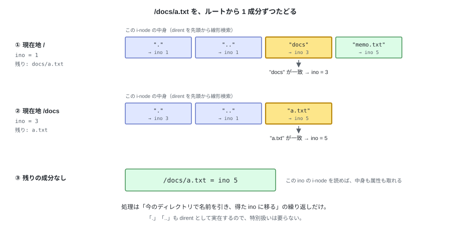

# 第 II 部　ファイルシステムとして動かす

---

# 06. パス解決


第 5 章までで、部品とその配置が決まった。
ただし i-node を指定する手段は番号だけで、`/docs/a.txt` のようなパスから
i-node 番号を得る手順はまだない。この章でその手順を定める。

パス解決は `fs.py` (L5) の仕事である。
この層は**スーパーブロックを読んでレイアウトを知っている**唯一の層で、
下の層（`bitmap` / `inode` / `directory`）へ位置を渡す側になる。
この章では手順を決めるところまでを扱い、コードは次章で書く。

---

## 1. ルートから 1 成分ずつ降りる

パスを `/` で区切って成分に分け、**ルートから順に、1 成分ずつディレクトリの中から名前を引く**。
ルートの i-node 番号は常に 1（スーパーブロックの `root_ino`）なので、出発点は常に決まっている。
この FS を OS のツリーに貼ったときも、出発点はこのルートのままになる（第 12 章）。



1 成分ぶんの処理は 2 段階。

1. いまの i-node を読み、**ディレクトリであることを確かめる**（違えば `ENOTDIR`）
2. その中身から名前を引いて、次の i-node 番号を得る（無ければ `ENOENT`）

これを成分がなくなるまで繰り返した結果が、目的の i-node 番号になる。
この手続きを、UNIX の伝統的な呼び名で **namei**（name to inode）という。

`.` と `..` は第 4 章で実体のある dirent として作ってあるので、
**特別扱いのコードは要らない**。`/docs/..` は「`docs` を引く → その中で `..` を引く」
という同じ手順で ino 1 に戻る。ルートの `..` はルート自身なので、`/..` も `/` になる。

---

## 2. パスの決まりごと

| 入力 | 扱い |
|---|---|
| `/` で始まらない | `EINVAL`。tiny-fs は**絶対パスだけ**を受け取る |
| `/` | 成分が 0 個。ルートの ino 1 を返す |
| `//docs///a.txt` | 空の成分は無視する。`/docs/a.txt` と同じ |
| `/docs/` | 末尾の空成分も無視する。`/docs` と同じ |
| 途中の成分がディレクトリでない | `ENOTDIR`（例: `/memo.txt/x`） |
| 成分が見つからない | `ENOENT` |

カレントディレクトリは持たない。
FUSE はカーネル側で解決した絶対パスを渡してくるので、この層で相対パスを扱う必要がない。

---

## 3. 親ディレクトリと最終成分に分ける

ファイルを作る・消す・名前を変える操作では、
**目的の i-node ではなく「親ディレクトリの i-node」と「最終成分の名前」が要る**。
最終成分の名前とは、`create` なら作るファイル名、`mkdir` ならディレクトリ名のこと。
`create("/docs/a.txt")` の時点で `a.txt` はまだ存在しないので、
パス全体を引こうとすると `ENOENT` になる。

```
/docs/a.txt  →  親 = /docs (ino 3),  名前 = "a.txt"
```

そこでパス解決の関数を 2 種類用意する。

| 関数 | 返すもの | 呼び出し側 |
|---|---|---|
| `lookup(path)` | パスが指す i-node 番号 | `open` / `stat` / `readdir` |
| `lookup_parent(path)` | (親ディレクトリの ino, 最終成分の名前) | `create` / `mkdir` / `unlink` / `rmdir` / `rename` |

`lookup_parent("/")` は最終成分が無いので `EINVAL` にする。
ルート自身を作ったり消したりする操作は存在しない。

---

## 試す

```bash
tiny-fs mkfs disk.img
tiny-fs mkdir disk.img /docs

tiny-fs ls disk.img /docs/..      # ルートの中身が出る
tiny-fs ls disk.img /..           # ルートの親はルート自身
tiny-fs ls disk.img //docs///     # 空の成分は無視される
tiny-fs ls disk.img /nothing      # ENOENT
```

---

ここまでが「パスから i-node 番号を得る」手順。
次章では `fs.py` を実装し、この手順とファイル操作をつなぐ。
