# 07. `fs.py` を実装する — イメージを開いてファイルを操作する


ここまでに、ディスク上の構造（第 1〜5 章）と、パスをたどる手順（第 6 章）が決まった。
この章ではそれらを `fs.py` の 1 枚の API にまとめ、
**ファイルを作り、読み書きし、消す**までを実装する。

`fs.py` は 2 つの役割を持つ。

- **レイアウトを知っている唯一の層。** スーパーブロックを読み、
  ino やブロック番号から実際の位置を計算する
- **手順をまとめる層。** 下の層（`bitmap` / `inode` / `directory`）を呼び分けて、
  1 つの操作として成立させる

---

## 1. イメージを開く（マウント）

`disk.img` を開いて、読み書きできる状態にする。
具体的には、スーパーブロックを読んで構造を把握し、検証し、
2 つのビットマップをメモリ上に読み込む。ここまでが準備である。

この準備を**マウント**という。ここで作るのはメモリ上の `FileSystem` インスタンス 1 個で、
OS のディレクトリツリーに組み込む本来のマウントは第 12 章（FUSE）で扱う。

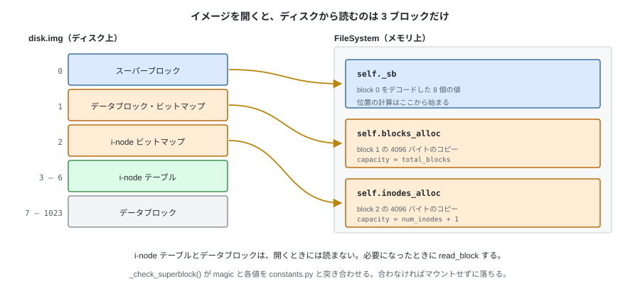

```python
class FileSystem:
    """開いているファイルシステム 1 個。"""

    def __init__(self, blocks: BlockDevice) -> None:
        self._blocks = blocks
        self._sb = Superblock.decode(blocks.read_block(SUPERBLOCK_BLOCK))
        self._check_superblock()     # マジックと、各値が constants.py と一致するか

        # ビットマップはブロックごとメモリに持つ（どちらも 1 ブロック = 4096 バイト）
        self.blocks_alloc = _Allocator(
            bytearray(blocks.read_block(BLOCK_BITMAP_BLOCK)),
            blocks, BLOCK_BITMAP_BLOCK, capacity=self._sb.total_blocks,
            hint=self._sb.free_hint)     # 前回の続きから探す
        self.inodes_alloc = _Allocator(
            bytearray(blocks.read_block(INODE_BITMAP_BLOCK)),
            blocks, INODE_BITMAP_BLOCK, capacity=self._sb.num_inodes + 1)
```

### 書き戻しの規則

この FS はキャッシュを持たない。第 1 章で決めたとおり、
`write_block` を呼んだ時点でディスクに届く。
メモリ上に置くのはビットマップの 2 ブロックだけなので、決めることは 1 つ。

> **ビットマップを変更したら、その場でブロックごと書き戻す。**

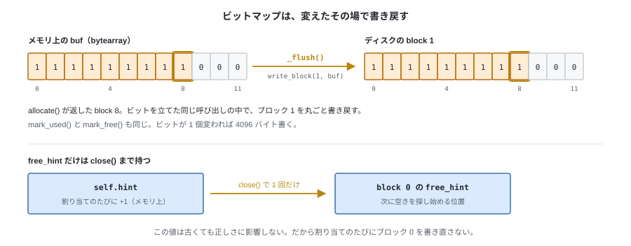

この規則を守るために、`Bitmap` を薄いラッパで包む。
メソッド名は `Bitmap` と同じなので、上の層から見れば「`Bitmap` に書き戻しが付いたもの」でしかない。

```python
class _Allocator:
    """ビットマップ 1 枚を、変更したらすぐ書き戻す形で包む。"""

    def allocate(self, hint: int | None = None) -> int:
        # ヒントはこのクラスが保持する。下の層（inode.py）は引数なしで呼ぶだけ
        index = self._bitmap.allocate(self.hint if hint is None else hint)
        self.hint = (index + 1) % self._bitmap.capacity
        self._flush()
        return index

    def count_free(self) -> int:
        return self._bitmap.count_free()     # 読むだけなので書き戻しは要らない

    def _flush(self) -> None:
        self._blocks.write_block(self._block_no, self._bitmap.buf)
```

`mark_used` / `mark_free` も同じ形で、`Bitmap` に委譲して `_flush` を呼ぶだけ。
`free_hint` だけはメモリ上で更新し、`close()` でスーパーブロックに書き戻す
（第 5 章のとおり、この値は古くても正しさに影響しない）。

---

## 2. i-node テーブルの読み書き

**ino から位置を計算するのはこの層だけ。** 第 5 章で決めた式をこの層で実装する。

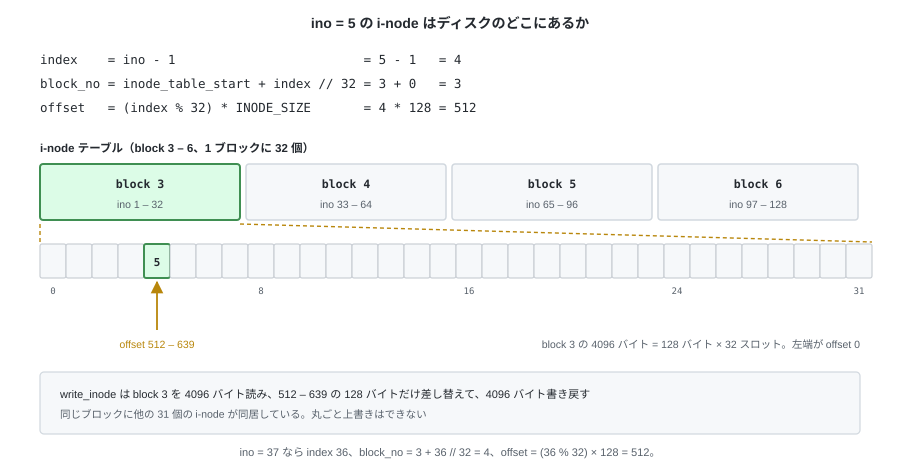

```python
    def _inode_pos(self, ino: int) -> tuple[int, int]:
        # ino は 1 始まり。0 と範囲外はイメージが壊れている
        if not 1 <= ino <= self._sb.num_inodes:
            raise CorruptionError(f"bad inode number: {ino}")
        index = ino - 1
        block_no = self._sb.inode_table_start + index // INODES_PER_BLOCK
        offset = (index % INODES_PER_BLOCK) * INODE_SIZE
        return block_no, offset

    def read_inode(self, ino: int) -> Inode:
        block_no, offset = self._inode_pos(ino)
        raw = self._blocks.read_block(block_no)
        return Inode.decode(raw[offset:offset + INODE_SIZE])

    def write_inode(self, ino: int, inode: Inode) -> None:
        # 1 ブロックに 32 個ぶん詰まっているので read-modify-write になる
        block_no, offset = self._inode_pos(ino)
        buf = bytearray(self._blocks.read_block(block_no))
        buf[offset:offset + INODE_SIZE] = inode.encode()
        self._blocks.write_block(block_no, buf)
```

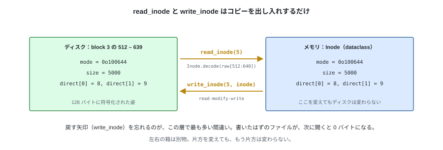

`read_inode` が返す `Inode` は**メモリ上のコピー**。
`size` や `direct[]` を変えても、`write_inode` を呼ぶまでディスクには何も起きない。

---

## 3. パス解決

第 6 章の手順をそのままコードにする。まずパスを成分に分ける。

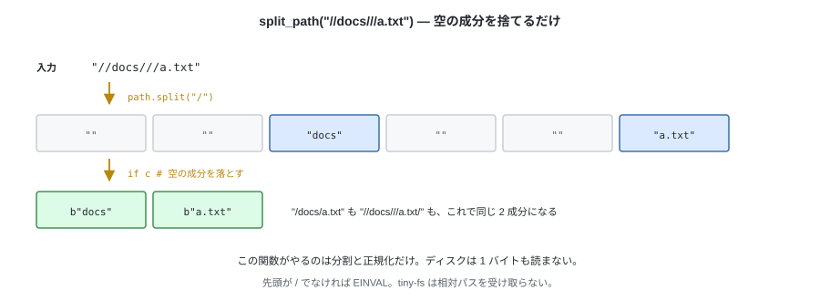

```python
def split_path(path: str) -> list[bytes]:
    """パスを成分に分ける。空の成分は除外する。"""
    if not path.startswith("/"):
        raise InvalidArgumentError("path must be absolute")
    # "//docs///a.txt" も "/docs/" も、これだけで正規化される
    return [c.encode() for c in path.split("/") if c]
```

分けた成分を、どこまでたどるか。入口となる関数が 2 つある。

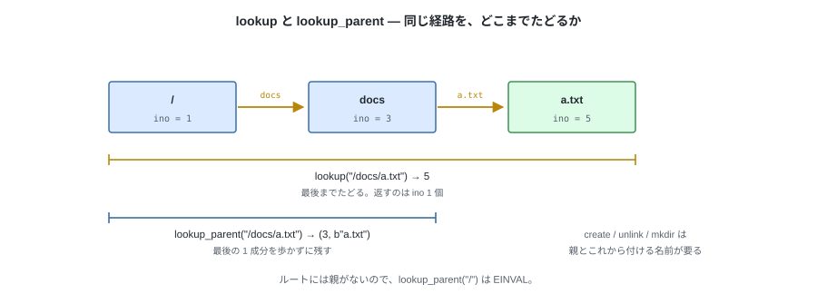

```python
    def _walk(self, components: list[bytes], path: str) -> int:
        ino = self._sb.root_ino                  # 出発点は常にルート
        for name in components:
            inode = self.read_inode(ino)
            if not stat.S_ISDIR(inode.mode):
                raise NotADirectoryError(path)   # ENOTDIR
            ino = self._lookup_in(inode, name, path)   # 無ければ ENOENT
        return ino

    def lookup(self, path: str) -> int:
        return self._walk(split_path(path), path)

    def lookup_parent(self, path: str) -> tuple[int, bytes]:
        components = split_path(path)
        if not components:
            raise InvalidArgumentError("root has no parent")
        return self._walk(components[:-1], path), components[-1]
```

下の層は成分 1 個しか知らないので、その例外をそのまま投げると
`ENOENT: a.txt` のように成分 1 個の名前しか出ない。どの `a.txt` か分からない。
呼び出し元が渡したパスを添えるのはこの層の仕事である。

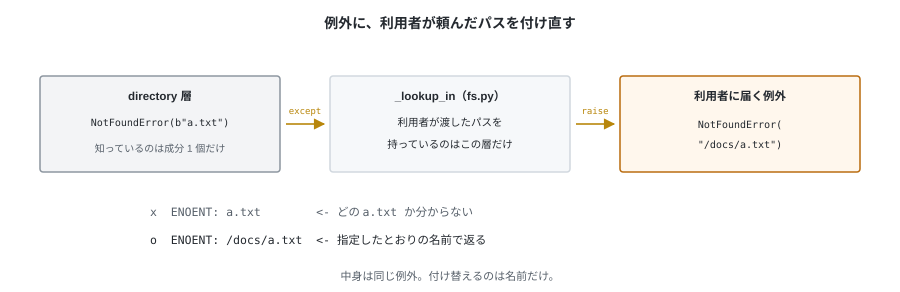

```python
    def _lookup_in(self, dir_inode: Inode, name: bytes, path: str) -> int:
        try:
            return directory.lookup(dir_inode, self._blocks, name)
        except NotFoundError:
            raise NotFoundError(path) from None     # エラーメッセージを /docs/a.txt に差し替える
```

---

## 4. ファイルを作る

`create` は 4 つの手順に分かれる。どこに何を書くかを先に見ておく。

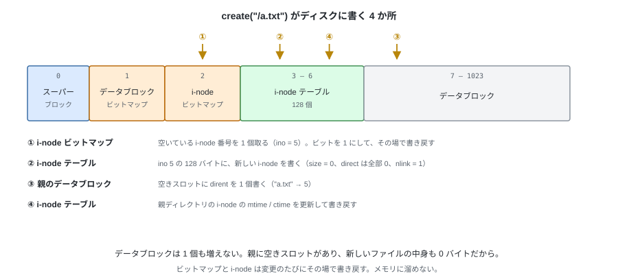

```python
    def create(self, path: str, mode: int = stat.S_IFREG | 0o644) -> int:
        parent_ino, name = self.lookup_parent(path)
        parent = self.read_inode(parent_ino)

        # ① i-node を 1 個割り当て、② テーブルに書く
        ino, inode = inode_mod.allocate_inode(self.inodes_alloc, mode, now())
        inode.nlink = 1                      # これから名前を 1 つ付ける
        self.write_inode(ino, inode)

        try:
            # ③ 親に名前を足す。重複は add_entry が EEXIST で弾く
            self._add_entry(parent, name, ino, path)
        except FSError:
            # 名前を付けられなかったので、割り当てた i-node を解放する
            self.write_inode(ino, Inode.empty())
            self.inodes_alloc.mark_free(ino)
            raise

        # ④ 親の時刻を更新。エントリ追加で size が増えていることもある
        parent.mtime = parent.ctime = now()
        self.write_inode(parent_ino, parent)
        return ino
```

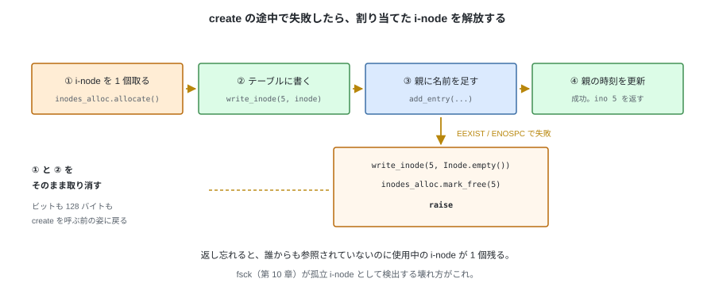

`add_entry` が失敗したときに i-node を解放しておくのが要点になる。
解放し忘れると、**誰からも参照されていないのに使用中の i-node** が 1 個残る。
`fsck`（第 10 章）が検出する典型的な壊れ方である。

---

## 5. 読み書き

どちらも「パスを解決する → i-node を読む → `inode` 層に渡す → 書き戻す」の形になる。

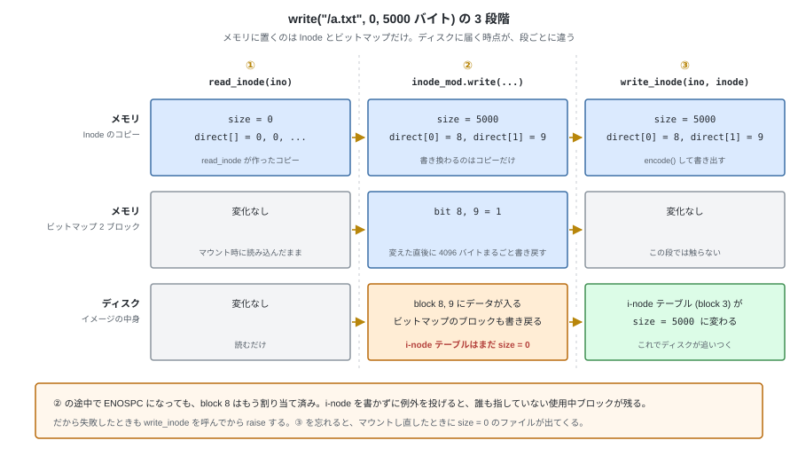

```python
    def read(self, path: str, offset: int, length: int) -> bytes:
        inode = self.read_inode(self.lookup(path))
        if stat.S_ISDIR(inode.mode):
            raise IsADirectoryError(path)    # EISDIR
        return inode_mod.read(inode, self._blocks, offset, length)

    def write(self, path: str, offset: int, data: bytes) -> int:
        ino = self.lookup(path)
        inode = self.read_inode(ino)
        if stat.S_ISDIR(inode.mode):
            raise IsADirectoryError(path)
        # ブロックが足りなければ blocks_alloc から割り当てられ、direct[] と size が変わる
        try:
            inode_mod.write(inode, self._blocks, self.blocks_alloc, offset, data)
        except FSError as e:
            # 途中で ENOSPC になった場合も、そこまでに割り当てたブロックは
            # direct[] に入っている。先に i-node を書き戻してから失敗を報告する
            self.write_inode(ino, inode)
            # inode.py はパスを知らないので、ここで付け直す（§2 の _lookup_in と同じ）
            raise type(e)(path) from None
        inode.mtime = inode.ctime = now()
        self.write_inode(ino, inode)         # ← これを忘れると書き込みが消える
        return len(data)

    def truncate(self, path: str, new_size: int) -> None:
        ino = self.lookup(path)
        inode = self.read_inode(ino)
        if stat.S_ISDIR(inode.mode):
            raise IsADirectoryError(path)
        try:
            inode_mod.truncate(inode, self._blocks, self.blocks_alloc, new_size)
        except FSError:
            self.write_inode(ino, inode)     # write と同じ理由
            raise
        inode.mtime = inode.ctime = now()
        self.write_inode(ino, inode)
```

例外を投げる前に i-node を書いておけば、失敗した書き込みのあとでも
イメージは整合した状態に保たれる（`fsck` が leak を報告しない）。

`read` は `size` を超えて読まない（第 3 章）。
ディレクトリを `read` しようとしたら `EISDIR` で拒む。中身を見るのは `readdir`（第 8 章）。

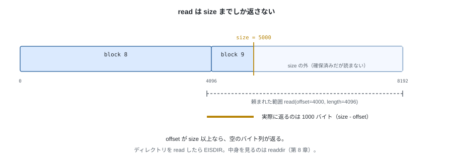

`truncate` はファイルのサイズを指定した値に変更する。伸長か縮小かで、下の層の処理が変わる。

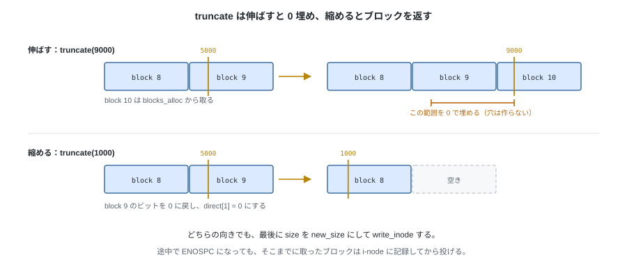

---

## 6. 消す

`unlink` は名前を消す操作であって、必ずしも実体を消す操作ではない。
消えた名前のぶん `nlink` を 1 減らし、**0 になったときだけ**実体を解放する。

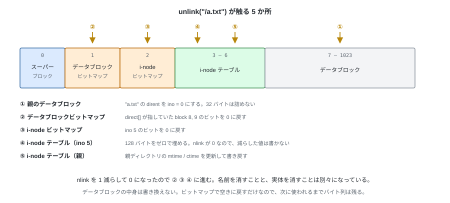

```python
    def unlink(self, path: str) -> None:
        parent_ino, name = self.lookup_parent(path)
        parent = self.read_inode(parent_ino)
        ino = self._lookup_in(parent, name, path)            # 無ければ ENOENT

        inode = self.read_inode(ino)
        if stat.S_ISDIR(inode.mode):
            raise IsADirectoryError(path)    # ディレクトリは rmdir（第 8 章）

        directory.remove_entry(parent, self._blocks, self.blocks_alloc, name)
        inode.nlink -= 1

        if inode.nlink == 0:
            # データブロックを解放し、i-node 番号も空きに戻す（第 3 章）
            inode_mod.free_inode(inode, self._blocks, self.blocks_alloc,
                                 self.inodes_alloc, ino)
            # テーブルの 128 バイトはゼロで埋めておく。dump の出力で「未使用」と判別できる
            self.write_inode(ino, Inode.empty())
        else:
            self.write_inode(ino, inode)

        parent.mtime = parent.ctime = now()
        self.write_inode(parent_ino, parent)
```


tiny-fs では `link()` を実装しないので `nlink` が 2 以上になるのは
ディレクトリだけだが、判定はこの形にしておく。
第 8 章の `rmdir` が同じ手順を使う。

---

## 7. テスト

ここからは**イメージ全体を使ったテスト**になる。
`tmp_path` に mkfs して `FileSystem` を作り、操作して、最後に `fsck` を通す。

```python
def test_create_then_read_back(tmp_path):
    # 作って書いて読むと、同じバイト列が返る

def test_written_data_survives_remount(tmp_path):
    # 書いたあと FileSystem を作り直しても読める
    # （write_inode の呼び忘れは、ここで初めて見つかる）

def test_create_existing_name_raises_eexist(tmp_path):

def test_create_rollback_on_failure(tmp_path):
    # add_entry が失敗したとき、割り当てた i-node が解放されていること
    # （空き i-node 数が操作前と同じ）

def test_write_grows_size_and_allocates_blocks(tmp_path):
    # 5000 バイト書いたら size = 5000、使用ブロックが 2 個増える

def test_unlink_frees_blocks_and_inode(tmp_path):
    # 消したら空きブロック数と空き i-node 数が元に戻る

def test_unlink_missing_raises_enoent(tmp_path):

def test_read_directory_raises_eisdir(tmp_path):

def test_disk_full_raises_enospc(tmp_path):
    # データブロックを使い切るまで書くと ENOSPC

def test_inodes_exhausted_raises_enospc(tmp_path):
    # 127 個作れて、128 個目で ENOSPC
```

`test_written_data_survives_remount` が第 II 部で最も効果の高いテストになる。
**同じ `FileSystem` インスタンスで読み書きしている限り、
`write_inode` を呼び忘れていても気づけない**（メモリ上の `Inode` が正しいため）。
マウントし直して初めてディスクの内容が問われる。

---

## 試す

```bash
tiny-fs mkfs disk.img
tiny-fs dump disk.img > before.txt

# 5000 バイトのサンプルファイル（第 3 章・第 5 章と同じ大きさ）
python -c "open('sample.txt','w').write('x' * 5000)"
tiny-fs put disk.img ./sample.txt /a.txt
tiny-fs dump disk.img > after.txt

diff before.txt after.txt          # 5 か所が変わる（内訳は第 9 章）
tiny-fs fsck disk.img
```

---

次章で `mkdir` / `rmdir` / `rename` / `readdir` を実装すれば、
FUSE なしで全操作がそろう。
