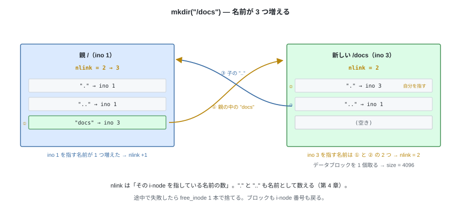
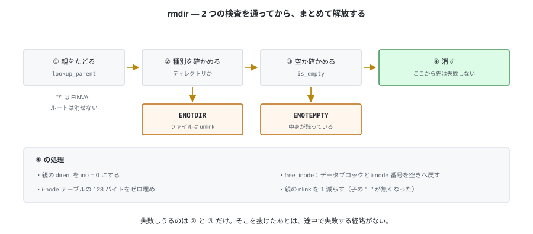
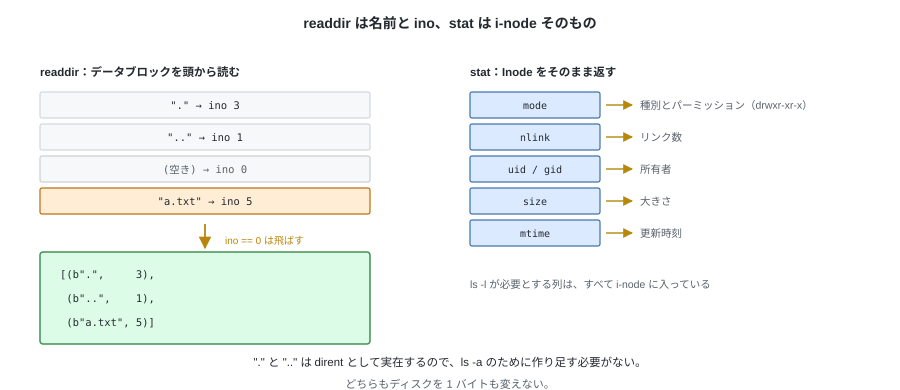
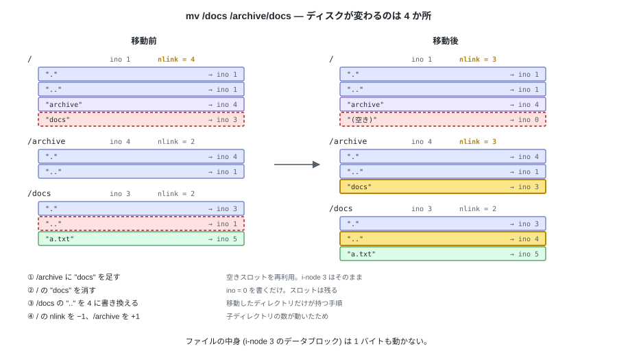
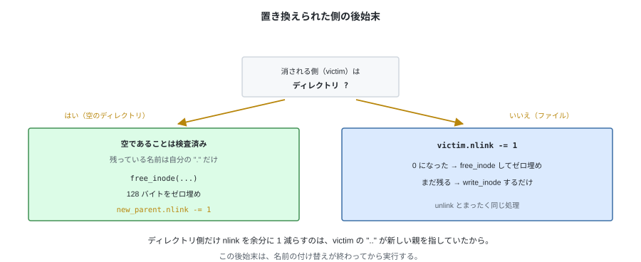
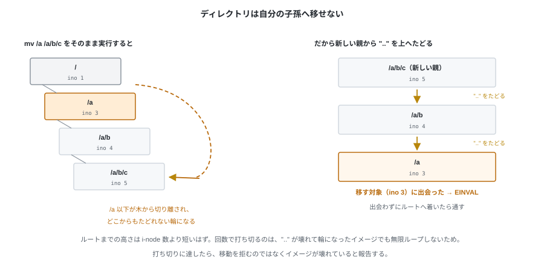

# 08. ディレクトリ操作


前章でファイルが作れるようになった。残っているのはディレクトリ側の操作
— 作成、削除、一覧の取得、名前の変更。

どれも `fs.py` に実装する。第 4 章で決めた規約
（`.` と `..` を先頭 2 エントリに持つ、`nlink` は「自分を指す名前の数」）が、
ここで具体的なコードになる。

---

## 1. mkdir

ディレクトリを作る手順は `create` とほぼ同じで、違うのは 2 点。
**中身に `.` と `..` を書く**ことと、**`nlink` を更新する**こと。



```python
    def mkdir(self, path: str, mode: int = stat.S_IFDIR | 0o755) -> int:
        parent_ino, name = self.lookup_parent(path)
        parent = self.read_inode(parent_ino)

        ino, inode = inode_mod.allocate_inode(self.inodes_alloc, mode, now())
        inode.nlink = 2                 # 親の中の自分の名前 + 自分の "."
        try:
            # ここでデータブロックが 1 個割り当てられ、size = 4096 になる
            directory.init_directory(inode, self._blocks, self.blocks_alloc,
                                     ino, parent_ino)
            self._add_entry(parent, name, ino, path)
        except FSError:
            # 作成途中の i-node を解放する。ブロックも i-node 番号も空きに戻る（第 3 章）
            inode_mod.free_inode(inode, self._blocks, self.blocks_alloc,
                                 self.inodes_alloc, ino)
            raise

        self.write_inode(ino, inode)
        parent.nlink += 1               # 子の ".." が親を指すようになった
        parent.mtime = parent.ctime = now()
        self.write_inode(parent_ino, parent)
        return ino
```

失敗時の後始末が `free_inode` 1 つで済んでいる。
**作成途中のディレクトリを解放する処理は、削除する処理と同じもの**になる。

`nlink` の値はこうなる。第 4 章の「`nlink` = 2 + 子ディレクトリの数」がそのまま出る。

| 時点 | 新しいディレクトリの `nlink` | 親ディレクトリの `nlink` |
|---|---|---|
| `mkdir` の前 | — | n |
| `mkdir` の後 | **2**（`.` と、親の中の自分の名前） | **n + 1**（子の `..` が増えた） |

---

## 2. rmdir

消す前に**空であることを確かめる**。空とは、
`.` と `..` 以外に有効なエントリが 1 つもないこと。


この判定だけは `directory.py` に置く。dirent を見るだけで、パスもレイアウトも要らないため。

```python
# tiny_fs/directory.py
def is_empty(dir_inode, blocks) -> bool:
    for _slot, entry in iter_entries(dir_inode, blocks):
        if entry.name not in (b".", b".."):
            return False       # 有効なエントリが 1 個でもあれば空ではない
    return True
```

`iter_entries` は `ino == 0` のスロットを飛ばすので（第 4 章）、
**消した跡地がいくつ残っていても空と判定される**。



```python
    def rmdir(self, path: str) -> None:
        parent_ino, name = self.lookup_parent(path)   # "/" は EINVAL なのでルートは消せない
        parent = self.read_inode(parent_ino)
        ino = self._lookup_in(parent, name, path)

        inode = self.read_inode(ino)
        if not stat.S_ISDIR(inode.mode):
            raise NotADirectoryError(path)     # ENOTDIR。ファイルは unlink
        if not directory.is_empty(inode, self._blocks):
            raise NotEmptyError(path)          # ENOTEMPTY

        directory.remove_entry(parent, self._blocks, self.blocks_alloc, name)
        # 残っている名前は自分の "." だけ。データブロックごと解放する
        inode_mod.free_inode(inode, self._blocks, self.blocks_alloc,
                             self.inodes_alloc, ino)
        self.write_inode(ino, Inode.empty())

        parent.nlink -= 1                      # 子の ".." が無くなった
        parent.mtime = parent.ctime = now()
        self.write_inode(parent_ino, parent)
```

ルートは `lookup_parent("/")` が `EINVAL` で失敗するので、削除できない。

---

## 3. readdir と stat

どちらもディスクを変えない。



```python
    def readdir(self, path: str) -> list[tuple[bytes, int]]:
        inode = self.read_inode(self.lookup(path))
        if not stat.S_ISDIR(inode.mode):
            raise NotADirectoryError(path)
        return [(e.name, e.ino)
                for _slot, e in directory.iter_entries(inode, self._blocks)]

    def stat(self, path: str) -> Inode:
        return self.read_inode(self.lookup(path))
```

返ってくる一覧には `.` と `..` が**最初から入っている**。
第 4 章で実体のある dirent として作ったので、ここで追加する必要がない
（`ls -a` がそのまま成立し、第 12 章の FUSE でもそのまま使える）。

`stat` が返すのは `Inode` そのもの。`ls -l` が必要とするもの
（種別とパーミッション、`nlink`、所有者、`size`、時刻）はすべてここに入っている。

---

## 4. rename

名前を変える操作は、**dirent を 1 個消して 1 個足す**だけで済む。
i-node もデータブロックも移動しない。



```python
    def rename(self, old_path: str, new_path: str) -> None:
        old_parent_ino, old_name = self.lookup_parent(old_path)
        new_parent_ino, new_name = self.lookup_parent(new_path)

        old_parent = self.read_inode(old_parent_ino)
        ino = self._lookup_in(old_parent, old_name, old_path)
        inode = self.read_inode(ino)

        same_parent = old_parent_ino == new_parent_ino
        if same_parent and old_name == new_name:
            return                                 # 何もしない
        # 同じディレクトリなら Inode のコピーは 1 個だけ持つ。
        # 2 個読むと、片方への変更がもう片方の write_inode で消える
        new_parent = old_parent if same_parent else self.read_inode(new_parent_ino)

        # 宛先にエントリが既にあれば、それを置き換える。先にその有無を確認する
        found = directory.find(new_parent, self._blocks, new_name)
        victim_ino = None if found is None else found[1].ino
        if victim_ino is not None:
            self._check_can_replace(inode, victim_ino, new_path)
        if stat.S_ISDIR(inode.mode):
            self._check_not_descendant(ino, new_parent_ino)

        # 失敗しうる検査はここまで。以降は途中で失敗しない
        if victim_ino is None:
            # 先に新しい名前を足す。ここで失敗しても、元の名前はまだ無事
            self._add_entry(new_parent, new_name, ino, new_path)
        else:
            # 既にあるエントリの ino を差し替える。32 バイトの書き込み 1 回で、
            # 空きスロットを必要としないので失敗しない
            directory.set_entry(new_parent, self._blocks, self.blocks_alloc,
                                new_name, ino)
        directory.remove_entry(old_parent, self._blocks, self.blocks_alloc,
                               old_name)

        stamp = now()
        if victim_ino is not None:
            self._drop_replaced(victim_ino, new_parent)
        # 親が変わったなら、ディレクトリの ".." と両親の nlink を直す
        if not same_parent and stat.S_ISDIR(inode.mode):
            directory.set_entry(inode, self._blocks, self.blocks_alloc,
                                b"..", new_parent_ino)
            inode.ctime = stamp
            self.write_inode(ino, inode)
            new_parent.nlink += 1
            old_parent.nlink -= 1

        old_parent.mtime = old_parent.ctime = stamp
        self.write_inode(old_parent_ino, old_parent)
        if not same_parent:
            new_parent.mtime = new_parent.ctime = stamp
            self.write_inode(new_parent_ino, new_parent)
```


仕様として決めたことが 3 つある。

**宛先が既にあれば置き換える。** `mv a b` で `b` が存在する場合、
`b` は消えて `a` がその名前を引き継ぐ。`rename(2)` の規定がそうなっている。
置き換えられるのは同じ種別どうしだけで、組み合わせによって返す errno が変わる。


```python
    def _check_can_replace(self, inode, victim_ino: int, new_path: str) -> None:
        victim = self.read_inode(victim_ino)
        if stat.S_ISDIR(inode.mode):
            if not stat.S_ISDIR(victim.mode):
                raise NotADirectoryError(new_path)    # ENOTDIR
            if not directory.is_empty(victim, self._blocks):
                raise NotEmptyError(new_path)         # ENOTEMPTY
        elif stat.S_ISDIR(victim.mode):
            raise IsADirectoryError(new_path)         # EISDIR
```

`mv a b` で置き換えられた側、つまり**元の `b` が指していた i-node** は、
`b` という名前を失う。あとは `unlink` と同じ後始末になる。



```python
    def _drop_replaced(self, victim_ino: int, new_parent: Inode) -> None:
        victim = self.read_inode(victim_ino)
        if stat.S_ISDIR(victim.mode):
            # 空のディレクトリなので、残る名前は自分の "." だけ。丸ごと解放し、
            # 親は自分を指していた ".." を 1 つ失う
            new_parent.nlink -= 1
            inode_mod.free_inode(victim, self._blocks, self.blocks_alloc,
                                 self.inodes_alloc, victim_ino)
            self.write_inode(victim_ino, Inode.empty())
            return

        victim.nlink -= 1
        if victim.nlink == 0:
            inode_mod.free_inode(victim, self._blocks, self.blocks_alloc,
                                 self.inodes_alloc, victim_ino)
            self.write_inode(victim_ino, Inode.empty())
        else:
            self.write_inode(victim_ino, victim)
```

**新しい名前を足してから、古い名前を消す。** 逆順にすると、
`add_entry` が `ENOSPC` で失敗したときに
**名前が 1 つもない i-node** が残る。追加を先に行っておけば、失敗しても元の状態のまま。
置き換えのときは足す必要がないので、`set_entry` の 1 回の書き込みで名前が移る。

**ディレクトリを自分の子孫へ移せない。** `/a` を `/a/b/c` の下へ移すと、
`/a` 以下が木から切り離されて、どこからもたどれない輪になる。
新しい親から `..` をたどってルートまで上がり、途中に対象が現れたら `EINVAL` で拒む。



```python
    def _check_not_descendant(self, ino: int, new_parent_ino: int) -> None:
        cur = new_parent_ino
        # ".." が壊れて輪になっているイメージでも無限ループしないよう、回数で打ち切る
        for _step in range(self._sb.num_inodes + 1):
            if cur == ino:
                raise InvalidArgumentError("cannot move a directory into itself")
            if cur == self._sb.root_ino:
                return
            cur = directory.lookup(self.read_inode(cur), self._blocks, b"..")
        raise CorruptionError("'..' chain does not reach the root")
```

---

## 5. テスト

```python
def test_mkdir_has_dot_and_dotdot(tmp_path):
    # 作った直後の中身が . と .. の 2 つ、size = 4096

def test_mkdir_updates_nlink(tmp_path):
    # 新ディレクトリは 2、親は +1

def test_rmdir_restores_nlink_and_frees(tmp_path):
    # 消すと親の nlink が戻り、空きブロック・空き i-node も戻る

def test_rmdir_non_empty_raises_enotempty(tmp_path):

def test_rmdir_after_emptying_succeeds(tmp_path):
    # 中身を作って全部消したディレクトリは、跡地が残っていても消せる

def test_rmdir_on_file_raises_enotdir(tmp_path):
def test_unlink_on_directory_raises_eisdir(tmp_path):

def test_rename_within_same_directory(tmp_path):
    # ino が変わらないこと。中身も変わらないこと

def test_rename_across_directories_fixes_dotdot(tmp_path):
    # 移動後に ".." が新しい親を指し、両親の nlink が ±1 されている

def test_rename_into_descendant_raises_einval(tmp_path):
    # /a を /a/b の下へは移せない

def test_rename_replaces_an_existing_file(tmp_path):
    # 宛先のファイルが消え、その i-node とブロックが返っていること

def test_rename_replaces_an_empty_directory(tmp_path):
    # 親の nlink が 1 減り、移したディレクトリの ".." が正しいこと

def test_rename_over_a_non_empty_directory_raises_enotempty(tmp_path):
def test_rename_a_file_over_a_directory_raises_eisdir(tmp_path):
def test_rename_a_directory_over_a_file_raises_enotdir(tmp_path):

def test_a_refused_rename_changes_nothing(tmp_path):
    # 拒まれたとき、空きブロック数・空き i-node 数・両方の名前が元のまま
```

`test_rmdir_after_emptying_succeeds` が第 4 章の「削除は詰めない」と対になる。
`size` が縮まないので、**空に見えるディレクトリでも `size` は 4096 のまま**。
`is_empty` が `size` ではなく有効エントリの有無で判定していることを、ここで確かめる。


`test_rename_across_directories_fixes_dotdot` は `..` の付け替えを忘れると通らない。
忘れたまま動かすと、移動したディレクトリから `cd ..` したときに
**移動前の親に戻ってしまう**。

置き換えに関する 5 つのテストは、`sed -i` や多くのエディタの保存手順をそのまま支えている
（一時ファイルに書いて、元の名前へ `rename` で被せる）。
`test_a_refused_rename_changes_nothing` は、置き換えで**失敗する経路が増えた**ぶんを担保するもので、
拒んだときに何も変わっていないことを確認する。

---

## 試す

```bash
tiny-fs mkfs disk.img
tiny-fs mkdir disk.img /docs
tiny-fs mkdir disk.img /archive

tiny-fs ls -l disk.img /           # ルートの nlink が 4（2 + 子 2 つ）
tiny-fs mv disk.img /docs /archive/docs
tiny-fs ls -l disk.img /           # 3 に戻る
tiny-fs ls disk.img /archive/docs/..   # archive の中身が出る（".." が付け替わった）
```

---

## 第 II 部の到達点

これで揃った。

| 操作 | 実装した章 |
|---|---|
| `mkfs` | 第 5 章 |
| `lookup` / `lookup_parent` | 第 7 章 |
| `create` / `read` / `write` / `truncate` / `unlink` | 第 7 章 |
| `mkdir` / `rmdir` / `readdir` / `stat` / `rename` | この章 |

**FUSE を一切使わずに、ファイルシステムとして必要な操作がすべてできる状態**になった。
次の第 III 部では、この状態を外から確かめる道具を作る
— イメージを人間に読める形で見せる `dump` と、壊れていないことを検査する `fsck`。
