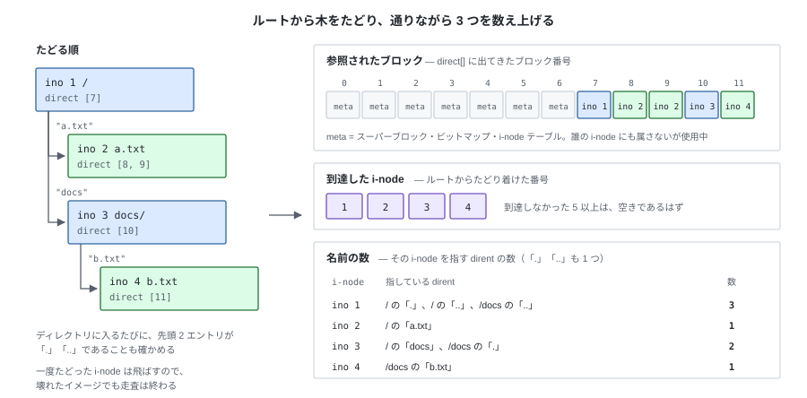

# 10. 壊れていないことを確かめる — fsck


`dump` は「いまディスクに何が書かれているか」を見せる道具だった。
この章で作るのは、それが**辻褄の合った状態かどうか**を判定する道具になる。

---

## 1. 何を検査するのか

検査ができるのは、**同じ情報がディスク上の 2 か所に記録されているから**。
2 か所に記録された内容が一致しなければ、そのファイルシステムは壊れている。

| 情報 | 記録① | 記録② |
|---|---|---|
| どのブロックが使用中か | データブロック・ビットマップ | 各 i-node の `direct[]` |
| どの i-node が使用中か | i-node ビットマップ | ディレクトリの dirent |
| ある i-node を指す名前（ファイル名・ディレクトリ名）の数 | i-node の `nlink` | その ino を指す dirent の数（`.` と `..` も数える） |

`fsck` の処理は 1 つだけ。**①をそのまま読み、②から再計算して、突き合わせる。**


---

## 2. 期待値を作る

②の側は、**ルートから木をたどって数え上げる**。
ルートの i-node から始めて、ディレクトリなら中の dirent を読み、その先の i-node へ降りる。
たどりながら、①と突き合わせる相手になる 3 つを集める。



図は、ルートに `a.txt` と `docs/` があり、`docs/` の中に `b.txt` がある状態。

`.` と `..` も dirent なので、名前の数え上げに**含める**。
第 4 章で決めた「`nlink` = 2 + 子ディレクトリの数」は、この数え方の結果として出る
（`ino 1` が 3 なのは、`/` の `.` と `..`、それに `/docs` の `..` が指しているため）。
ただし、その先へは降りない。`.` と `..` をたどると同じ所を回り続ける。

---

## 3. 突き合わせる

§1 の表の 3 行が、そのまま 3 つの比較になる。

| 比べるもの | 食い違いの意味 |
|---|---|
| ブロック・ビットマップ ⇔ `direct[]` の参照 | 参照なしで使用中 = **leak**（空き容量が徐々に減る）、参照ありで空き = **未割り当てブロックの使用**（いずれ二重に割り当てられる）、2 つ以上から参照 = **二重参照**（片方を消すともう片方が壊れる） |
| i-node ビットマップ ⇔ ルートから到達できた i-node | 使用中なのに到達できない = **orphan**。作りかけで残った i-node（第 7 章の `create` が後始末を終えていない形） |
| `inode.nlink` ⇔ 数え上げた名前の数 | 0 にならず解放されない、または早すぎる解放 |

これ以外に、ブロック番号が `data_start` 以上 `total_blocks` 未満か、
ディレクトリの先頭 2 エントリが `.` と `..` か、ビットマップの余りビットが 0 のままか
（第 5 章）、スーパーブロックの数値が互いに整合しているかも見る。
どれも比較ではなく、値そのものが成り立つかの確認である。
最後の 1 つが壊れていると i-node の位置計算が成立しないので、そこだけを報告して打ち切る。

---

## 4. 報告する

**`fsck` は直さない。検出して報告するだけ。**

```
$ tiny-fs fsck disk.img
fsck: 3 problems found

  block 9 is referenced by inode 2 but marked free in the block bitmap
  block 12 is marked used but referenced by nothing (leak)
  inode 5 has nlink=2 but 1 name points to it

$ echo $?
1
```

問題がなければ 1 行だけ出して 0 で終わる。

```
$ tiny-fs fsck disk.img
fsck: clean (10 blocks used, 2 inodes used)
$ echo $?
0
```

終了ステータスを分けておくと、テストから使いやすくなる。
**すべてのテストの最後に `fsck` を通す**、という運用ができる（第 7 章以降のテストがこの形になっている）。

---

## 5. 実装 — `fsck.py`

`dump` と同じく `BlockDevice` から直接読み、`FileSystem` は使わない。
検査の対象を、検査される側の API を通して読むわけにはいかないため。

§2 の数え上げは、そのまま木の走査になる。

```python
def _collect(blocks, sb):
    """ルートから木をたどり、期待値を作る。"""
    block_refs = {}            # ブロック番号 → 参照している i-node の一覧
    seen_inodes = set()
    nlink_count = Counter()    # i-node 番号 → それを指す dirent の数

    # メタデータのブロックは、誰の i-node にも属さないが使用中
    for block_no in range(sb.data_start):
        block_refs.setdefault(block_no, []).append(METADATA)

    stack = [sb.root_ino]
    while stack:
        ino = stack.pop()
        if ino in seen_inodes:
            continue                       # 2 度目は飛ばす。循環していても終わる
        seen_inodes.add(ino)

        inode = read_inode(blocks, sb, ino)
        for block_no in inode.direct:
            if block_no != 0:
                block_refs.setdefault(block_no, []).append(ino)

        if stat.S_ISDIR(inode.mode):
            for _slot, entry in _entries(blocks, sb, inode):
                nlink_count[entry.ino] += 1          # "." と ".." も 1 つの名前
                if entry.name not in (DOT, DOTDOT):
                    stack.append(entry.ino)          # その先へは降りない
    return block_refs, seen_inodes, nlink_count
```

> **Python tips** — `block_refs` は**辞書の値がリスト**という形で、
> 「ブロック番号 → そのブロックを参照している i-node 番号の一覧」を表す。
> 値をリストにしておくと、1 ブロックが 2 か所から参照されたときに 2 個並ぶので、
> **二重参照がそのまま見える**（§3 の 1 行目）。
>
> `setdefault(k, [])` は「キー `k` があればその値を返し、無ければ `[]` を入れてから返す」。
> 返ってきたリストに `.append(...)` するので、次の 3 行が 1 行で書ける。
>
> ```python
> if block_no not in block_refs:
>     block_refs[block_no] = []
> block_refs[block_no].append(METADATA)
> ```
>
> 同じコードの `nlink_count` は `collections.Counter` で、
> 無いキーを 0 として扱うので、`nlink_count[ino] += 1` を初期化なしで書ける。

実物はこれに加えて、先頭 2 エントリの検査と、範囲外の i-node 番号を指す dirent の検査を
同じ走査の中で行い、見つけた問題も一緒に返す。

`fsck(blocks)` は問題の一覧を返す（空リストなら健全）。
①をビットマップから読み、②をこの数え上げから作って、ブロック番号ごとに突き合わせる。

```python
    for block_no in range(sb.total_blocks):
        refs = block_refs.get(block_no, [])        # ②: 参照している i-node
        used = block_bitmap.is_used(block_no)      # ①: ビットマップ
        if len(refs) > 1:
            problems.append(f"block {block_no} is referenced by "
                            f"{_refs_str(refs)} (double use)")
        elif refs and not used:
            problems.append(f"block {block_no} is referenced by inode {refs[0]} "
                            f"but marked free in the block bitmap")
        elif not refs and used:
            problems.append(f"block {block_no} is marked used but referenced "
                            f"by nothing (leak)")
```

i-node の側も同じ形で、ビットマップのビットと「ルートから到達できたか」を比べ、
`nlink` と数え上げた名前の数を比べる。
すべての検査が「集合を 2 つ作って比べる」形になっている。

---

## 6. テスト

`fsck` のテストは、**意図的に壊したイメージを用意できるか**にかかる。
`BlockDevice` を直接使えば、どのバイトでも書き換えられる。

```python
def test_fsck_clean_after_mkfs(tmp_path):
def test_fsck_clean_after_many_operations(tmp_path):
    # 作る・書く・消すを一通り実行したあとでも健全であること

def test_detects_leaked_block(tmp_path):
    # ビットマップのビットを立てるだけで、参照のないブロックができる

def test_detects_double_reference(tmp_path):
    # 2 つの i-node の direct[0] を同じブロック番号にする

def test_detects_orphan_inode(tmp_path):
    # i-node ビットマップのビットを立てるだけで、到達できない i-node を作る

def test_detects_wrong_nlink(tmp_path):
    # i-node の nlink を +1 する

def test_survives_a_cycle_in_dotdot(tmp_path):
    # ".." を子自身に向けても、fsck が無限ループに陥らず報告すること

def test_create_and_delete_returns_to_clean(tmp_path):
    # 100 回作って消しても、空きブロック数と空き i-node 数が元に戻る
```

`test_create_and_delete_returns_to_clean` が、第 III 部で最も重要になる。
**解放漏れは 1 回の操作では検出できない**。操作を繰り返して初めて、空きブロック数の減少が現れる。

---

## 試す

```bash
tiny-fs mkfs disk.img
tiny-fs fsck disk.img && echo clean

# ビットマップを 1 バイト壊す（ブロック 16 を使用中に見せかける）
python - <<'PY'
from tiny_fs.device import SectorDevice
from tiny_fs.disk import BlockDevice
blocks = BlockDevice(SectorDevice("disk.img"))
buf = bytearray(blocks.read_block(1))
buf[2] |= 0x01
blocks.write_block(1, buf)
PY

tiny-fs fsck disk.img; echo "exit=$?"     # leak として検出され、1 で終わる
```

---

第 III 部の残りは、ここまでの機能をコマンドとして束ねる作業になる。
次章で `tiny-fs` コマンドを作れば、ファイルシステムとして普通に使えるようになる。
