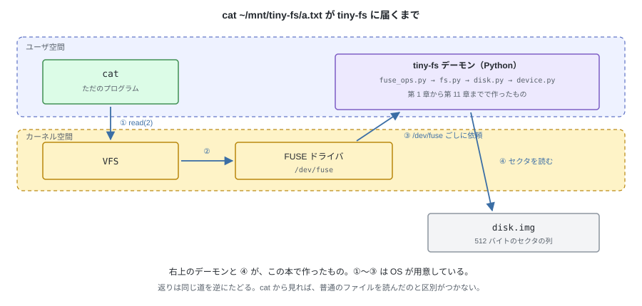
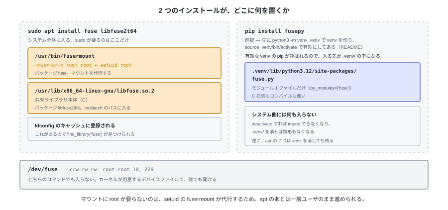
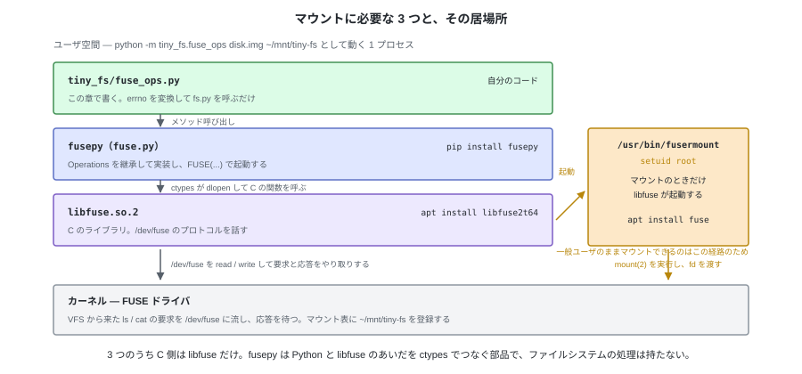

# 12. FUSE でマウントする


第 11 章で、tiny-fs はファイルシステムとして完成した。
ただし触れるのは `tiny-fs` コマンドからだけで、
OS から見れば `disk.img` はいまだに**ただのファイル**にすぎない。

最後の 1 歩は、これを OS につなぐこと。
`~/mnt/tiny-fs` という空のディレクトリを選び、そこに tiny-fs を**マウント**する。
これ以降、そのディレクトリが **tiny-fs のルート (`/`)** になり、
`~/mnt/tiny-fs/docs/a.txt` は tiny-fs の中の `/docs/a.txt` を指す。
本物の `ls` や `cat` やエディタから触れるのは、この対応があるため。

---

## 1. FUSE とは何か

ファイルシステムは普通カーネルの中にある。
**FUSE** (Filesystem in Userspace) は、その処理を**ユーザ空間のプロセスに委ねる**仕組み。
カーネルの FUSE ドライバが `/dev/fuse` を介して、
「このパスを読みたい」という要求をこちらのプロセスに渡し、応答を待つ。



`cat` の側からは、通常のファイルの読み出しと区別がつかない。
カーネルモジュールを書かなくても、**Python のプロセス 1 個がファイルシステムになれる**。

ここで初めて「マウント」が本物になる。第 7 章の `FileSystem` の生成は
プロセス内のメモリに状態を作るだけで、OS は関与しなかった。
FUSE では OS のディレクトリツリーに組み込まれる。

---

## 2. 用意する

Linux なら、コンテナも特権も要らない。**一般ユーザのまま**マウントできる。

```bash
sudo apt install fuse libfuse2t64

source .venv/bin/activate      # README の「用意する」で作った venv を有効にする
pip install fusepy             # pip install -e ".[fuse]" でも入る
```

`apt` はシステム全体に入れ、`pip` は有効にした venv の中だけに入れる。
置かれる場所が違うので、片方を消してももう片方は残る。



置かれたものは、呼び出しの連鎖で見るとこうつながる。



マウント (`mount(2)`) は本来 root の操作で、一般ユーザは実行できない。
そこで libfuse は `mount(2)` を自分で呼ばず、**`fusermount` を起動して代行させる**。
このコマンドは setuid root (`-rwsr-xr-x root root`) なので、一般ユーザが起動しても
root 権限で動き、マウントを済ませて `/dev/fuse` の fd を呼び出し元に返す。
**だから sudo が要らない。** `fusermount` が無ければ `Permission denied` で失敗する。
マウント後の読み書きに使う `/dev/fuse` は `crw-rw-rw-` で誰でも開けるので、ここにも特権は要らない。

fusepy は `libfuse.so.2` をビルド時にリンクしない。`import fuse` の時点で
`find_library('fuse')` が soname `libfuse.so.2` を探し、`ctypes.CDLL` で読み込む。
だから `pip install fusepy` に C コンパイラも開発パッケージも要らず、
ライブラリが無ければ `import fuse` が `EnvironmentError: Unable to find libfuse` で落ちる。

パッケージ名は Ubuntu 24.04 のもの。22.04 では `libfuse2t64` が `libfuse2` になる。

---

## 3. 守るべき規約

やることは 3 つ。**メソッドを定義する → 決まった形で返す → `FUSE()` に渡す**。

### ① カーネルから呼ばれるメソッドを定義する

`Operations` を継承したクラスを 1 つ作り、その中に**操作名と同じ名前のメソッド**を書く。

```python
from fuse import FUSE, FuseOSError, Operations

class TinyFSOperations(Operations):
    def getattr(self, path, fh=None): ...
    def readdir(self, path, fh): ...
    def read(self, path, size, offset, fh): ...
    def write(self, path, data, offset, fh): ...
    # 以下、必要な操作だけ並べる
```

対応は**名前で**行われる。`getattr` を `get_attr` と書いたメソッドは呼ばれない。

第 1 引数は、どのメソッドでも**操作対象のパス**になる。渡されるのは
**tiny-fs のルートから見た絶対パス**で、マウントポイントの部分は取り除かれている。
`~/mnt/tiny-fs/docs/a.txt` への操作は `/docs/a.txt` として届く。
カーネルが解決してから渡すので、相対パスもカレントディレクトリも出てこない（第 6 章）。

定義しなかったメソッドは、基底クラス `Operations` の既定が答える。
既定は `getattr` がルートだけを返し（他は `ENOENT`）、`readdir` が `.` と `..` だけを返し、
書き込み系は `EROFS`、`read` は `EIO` を返す。つまり**何も定義しなくてもマウントは成功し、
「ルートだけがある、書き込めない FS」になる**。そこから必要な操作を 1 つずつ置き換えていく。

### ② 引数と戻り値の形を合わせる

| メソッド | 返すもの |
|---|---|
| `getattr(path, fh=None)` | `st_mode` / `st_nlink` / `st_size` / `st_uid` / `st_gid` / `st_mtime` などを持つ辞書 |
| `readdir(path, fh)` | 名前の文字列のリスト（`.` と `..` を含む） |
| `read(path, size, offset, fh)` | `bytes`。`size` バイトを超えて返してはいけない |
| `write(path, data, offset, fh)` | 実際に書いたバイト数 |
| `statfs(path)` | `f_bsize` / `f_blocks` / `f_bfree` などを持つ辞書（`df` が読む） |
| `unlink(path)` / `mkdir(path, mode)` など | `None`（= 成功） |

**失敗は `FuseOSError(errno)` を投げて伝える。** 例外を投げずに戻れば成功とみなされる。
独自の例外をそのまま投げると fusepy の中で落ちるので、境界で errno に変換する（§5）。

### ③ `FUSE()` に渡してマウントする

```python
def mount(image: str, mountpoint: str, foreground: bool = True) -> None:
    FUSE(TinyFSOperations(image), mountpoint, foreground=foreground,
         nothreads=True, fsname="tiny-fs")
```

| 引数 | 値の例 | 意味 |
|---|---|---|
| `image` | `"disk.img"` | **イメージファイルのパス**。`mkfs` 済みのものを `TinyFSOperations` が開く |
| `mountpoint` | `"/home/dev/mnt/tiny-fs"` | **マウントポイント**。すでにある空のディレクトリで、ここが tiny-fs のルートになる。`~/mnt/tiny-fs` と書いた場合はシェルが展開した値が渡る |
| `foreground` | `True` | **フォアグラウンドで動かすか**。端末に留まり、Ctrl-C で終わる。`False` にすると背後に回る |

§6 で実行するのは `python -m tiny_fs.fuse_ops disk.img ~/mnt/tiny-fs -f` で、
受け取った 2 つの引数をそのまま `mount()` に渡している。

この `FUSE(...)` が登録とマウントを兼ねる。`FUSE()` は libfuse のループに入り、
カーネルから届いた操作名を見て、渡したインスタンスの同名メソッドを呼ぶ。
戻ってくるのはアンマウントされたとき。

`nothreads=True` は省略できない。既定ではカーネルからの要求が並行して届くが、
`fs.py` はロックを持たないので、2 つの操作が同時に走るとイメージが壊れる。
`fsname` は `df` や `mount` の表示に出る名前。

---

## 4. 呼び出しの対応

FUSE から来る操作は、`fs.py` の API とほぼ 1 対 1 に対応する。

| FUSE | `fs.py` | 備考 |
|---|---|---|
| `getattr` | `stat` | `st_*` の辞書に詰め替える |
| `readdir` | `readdir` | `.` と `..` は実体があるのでそのまま返る |
| `read` | `read` | |
| `write` | `write` | |
| `create` | `create` | |
| `truncate` | `truncate` | |
| `unlink` / `mkdir` / `rmdir` / `rename` | 同名 | |
| `statfs` | ビットマップの空き数 | `df` が読む |
| `chmod` / `chown` / `utimens` | 同名 | `cp` やエディタが保存の最後に呼ぶ。実装しないとそこで失敗する |
| `destroy` | `close` | アンマウント時。`free_hint` がここで書き戻る |
| `flush` / `fsync` | **何もしない** | tiny-fs 側に溜めているものが無いので、ここで送るものが無い（ホストから先は付録 D） |
| `open` / `release` | **何もしない** | パスだけで操作できるので、開いた状態を持たない |

これが 1 対 1 になるのは偶然ではなく、`fs.py` が次の 3 つを満たしているから。

- **パスだけで操作できる。** 開いた状態（ファイルハンドル）を持たないので、
  FUSE から来たパスをそのまま渡せる。`open` / `release` に書くことがない
- **1 回の呼び出しの中で書き戻しまで終える**（第 7 章 §1「書き戻しの規則」）。
  だから `flush` / `fsync` に書くことがない
- **失敗を errno を持つ例外で表す。** `FuseOSError(e.errno)` に 1 行で変換できる（§5）

どれも FUSE に合わせて決めたものではなく、第 II 部で素直に書いた結果である。
この章で足すのは**変換だけ**になる。

---

## 5. 実装 — `fuse_ops.py`

```python
class TinyFSOperations(Operations):
    def __init__(self, image: str) -> None:
        self._fs = FileSystem(BlockDevice(SectorDevice(image)))

    def __call__(self, op: str, *args):
        # 例外を errno に変える場所は、ここ 1 か所だけ
        try:
            return super().__call__(op, *args)
        except FSError as e:
            raise FuseOSError(e.errno)

    def getattr(self, path, fh=None):
        inode = self._fs.stat(path)
        return {
            "st_mode":  inode.mode,
            "st_nlink": inode.nlink,
            "st_size":  inode.size,
            "st_uid":   inode.uid,
            "st_gid":   inode.gid,
            "st_mtime": inode.mtime,
            "st_ctime": inode.ctime,
            "st_atime": inode.mtime,   # atime は持っていないので mtime を返す
        }

    def readdir(self, path, fh):
        return [name.decode() for name, _ino in self._fs.readdir(path)]

    def read(self, path, size, offset, fh):
        return self._fs.read(path, offset, size)

    def write(self, path, data, offset, fh):
        return self._fs.write(path, offset, data)

    def create(self, path, mode, fi=None):
        self._fs.create(path, S_IFREG | (mode & 0o777))
        self._set_owner(path)     # 作った人を所有者にする（§6）
        return 0

    def unlink(self, path):
        self._fs.unlink(path)

    def mkdir(self, path, mode):
        self._fs.mkdir(path, S_IFDIR | (mode & 0o777))

    def destroy(self, path):
        self._fs.close()          # アンマウント。ここで free_hint が書き戻る
```

`__call__` をオーバーライドしているのが要点になる。
これは tiny-fs 独自の仕組みではなく、**fusepy が用意しているフック**で、
基底クラス `Operations` の側はこうなっている。

```python
# fusepy (fuse.py) より
class Operations(object):
    def __call__(self, op, *args):
        if not hasattr(self, op):
            raise FuseOSError(errno.EFAULT)
        return getattr(self, op)(*args)
```

操作名を受け取り、同名のメソッドを探して呼ぶだけのディスパッチャになっている。
カーネルからの呼び出しを受ける `FUSE` クラスの実装は、すべてこの形になっている。

```python
return self.operations('mkdir', path.decode(self.encoding), mode)
return self.operations('unlink', path.decode(self.encoding))
```

> **Python tips** — `__call__` を定義すると、そのクラスのインスタンスを
> **関数のように呼べる**ようになる。
>
> ```python
> class Greeter:
>     def __call__(self, name):
>         return f"hello {name}"
>
> g = Greeter()
> g("world")                    # 'hello world' — インスタンスを関数として呼ぶ
> Greeter.__call__(g, "world")  # 上の行はこれに展開される
> callable(g)                   # True。__call__ が無いと呼んだ時点で TypeError
> ```
>
> fusepy が `self.operations('mkdir', path, mode)` と書けるのはこの仕組みで、
> `self.operations` は `Operations` のインスタンスである。
>
> オーバーライドした `__call__` の中で `super().__call__(...)` を呼ぶと、
> 基底クラスの振り分けはそのまま行われ、自分のコードはその前後に足すだけで済む。
> 呼ばなければ振り分け自体が起きないので、どのメソッドも呼ばれなくなる。
> `TinyFSOperations.__call__` は例外変換だけを足し、振り分けは基底に任せている。
>
> ```python
> class Loud(Greeter):
>     def __call__(self, *args):
>         print("呼ばれた")               # 前に処理を挟む
>         return super().__call__(*args)  # 振り分けは基底に任せる
> ```

`self.operations.mkdir(...)` と直接呼ぶ箇所は 1 つもなく、
**すべての操作が `__call__` を通る**。だから全操作に共通の処理を挟みたいときは、
`__call__` をオーバーライドするのが fusepy での定型になる。
fusepy 自身、全操作をログに出す `LoggingMixIn` をこのやり方で書いている。

tiny-fs は `__call__` にログではなく例外変換を置いた。結果として
**独自例外 → `FuseOSError` の変換が 1 か所に集まる**。
各メソッドに `try` を書く必要がない。

メソッドの中身はどれも 1〜2 行。この層が持つのは
**errno への変換と `fs.py` の呼び出しだけ**で、ファイルシステムの処理は 1 行も書かない。
第 1 章で示した層構造「各層は自分より下の層だけを呼ぶ」が、最上段の L6 でも維持されている。

マウントは 1 行。

```python
FUSE(TinyFSOperations(image), mountpoint, foreground=True,
     nothreads=True, fsname="tiny-fs")
```

`nothreads=True` を必ず付ける。
`fs.py` はロックを持たないので、同時に 2 つの操作が走ると壊れる。
`fsname` は `df` や `mount` の Filesystem 欄に出る名前で、
省くとクラス名がそのまま表示される。

---

## 6. マウントして触る

```
$ tiny-fs mkfs disk.img
created disk.img: 1024 blocks (4 MiB), 128 inodes

$ mkdir -p ~/mnt/tiny-fs
$ python -m tiny_fs.fuse_ops disk.img ~/mnt/tiny-fs -f &

$ ls -la ~/mnt/tiny-fs
total 4
drwxr-xr-x 2 root root 4096 Sep 30 06:46 .
drwxrwxr-x 3 dev  dev  4096 Sep 30 06:46 ..

$ echo hello > ~/mnt/tiny-fs/a.txt
$ cat ~/mnt/tiny-fs/a.txt
hello

$ mkdir ~/mnt/tiny-fs/docs
$ cp /etc/hostname ~/mnt/tiny-fs/docs/
$ ls -l ~/mnt/tiny-fs/docs
total 0
-rw-r--r-- 1 dev dev 13 Sep 30 06:46 hostname

$ df -h ~/mnt/tiny-fs
Filesystem      Size  Used Avail Use% Mounted on
tiny-fs         4.0M   44K  4.0M   2% /home/dev/mnt/tiny-fs

$ fusermount -u ~/mnt/tiny-fs
```

**`echo` も `cat` も `cp` も `ls` も、tiny-fs のことを何も知らない。**
これらは普通のシステムコールを呼んでいるだけで、
その先がユーザ空間の Python だとは気づいていない。

`hostname` の所有者が `dev` になっているのは、`create` の中で
`fuse_get_context()` が返した uid / gid を i-node に書いているから。
一方 `.`（ルートディレクトリ）が `root` なのは、それを作ったのが `mkfs` で、
uid 0 をそのまま書いているため（第 5 章のダンプのとおり）。

アンマウントしてから、同じイメージを CLI で読む。

```
$ tiny-fs ls disk.img /
.
..
a.txt
docs

$ tiny-fs cat disk.img /a.txt
hello

$ tiny-fs fsck disk.img
fsck: clean (11 blocks used, 4 inodes used)
```

FUSE 経由で書いたものが、CLI からそのまま読める。
どちらも同じ `fs.py` を通っているので、当然そうなる。
**FUSE を外しても全機能が使える**、という層の分け方がここで証明される。

---

## 7. 失敗しやすい点

| 症状 | 原因 |
|---|---|
| `import fuse` が `EnvironmentError: Unable to find libfuse` で落ちる | `libfuse2t64` が入っていない |
| マウントできない（Permission denied） | `fuse` が入っていない（`fusermount` が無い） |
| 作ったファイルの所有者が root になる | `create` で `fuse_get_context()` の uid を書いていない |
| 大きいファイルの `cp` が途中で失敗する | 48 KiB の上限（`EFBIG`）。仕様どおり |
| `ls -l` が遅い | エントリごとに `getattr` が呼ばれる。1 回ごとにパスを解決し直している |
| 開いたままのファイルを消すと壊れる | `nlink` が 0 になった時点で解放してしまう。オープン数を数えていない |
| ときどき結果が壊れる | `nothreads=True` を付け忘れている |

`atime` は持っていないので `mtime` を返している。
`ls -lu` は `ls -l` と同じ結果になる。

### テスト

実際にマウントして、シェル経由で書き、アンマウントしてから
CLI と `fsck` で中身を確かめる。第 1 章から層を分けてきたので、
このテストだけが FUSE を必要とする。

```python
pytest.importorskip("fuse")

pytestmark = [
    pytest.mark.fuse,
    pytest.mark.skipif(not os.path.exists("/dev/fuse"),
                       reason="no /dev/fuse on this machine"),
]


@pytest.mark.fuse
def test_mount_write_unmount(tmp_path):
    ...
```

`fusepy` か `/dev/fuse` が無い環境では、このテストだけが自分でスキップする。
マーカーを付けてあるので `pytest -m fuse` で 1 本だけ実行することも、
`pytest -m "not fuse"` で外すこともできる。

---

これで当初の目標に到達した。
512 バイトのセクタしか読み書きできない装置から始めて、
自分で設計したバイト列の上に、本物の `ls` と `cat` が動いている。

次章で、作ったものと、その限界と、次の一歩を整理する。
