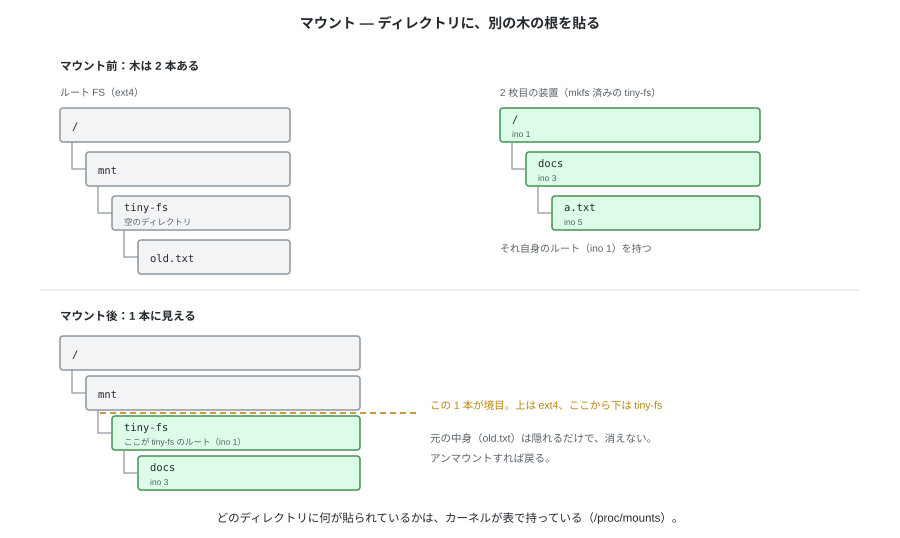
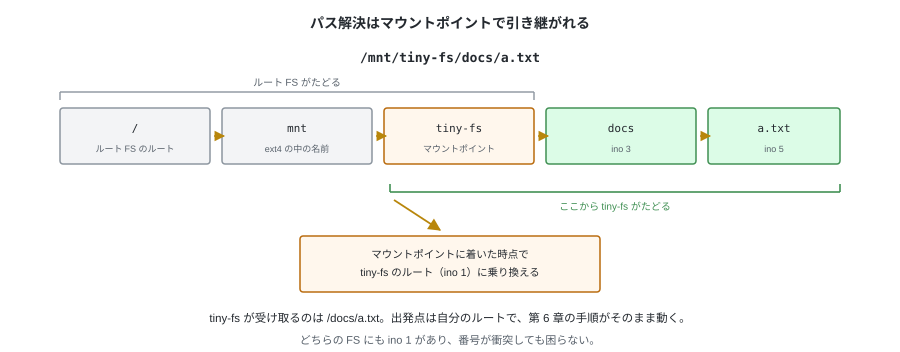
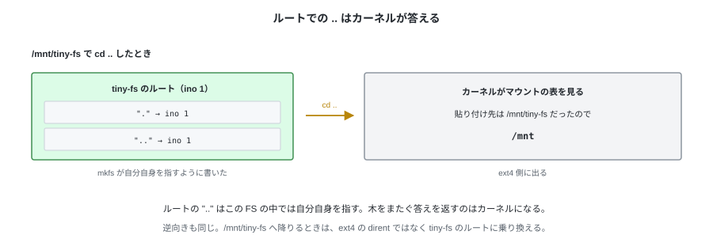

# 第 IV 部　カーネルにつなぐ

---

# 12. マウント


第 11 章まで、tiny-fs のイメージに触れるのは `tiny-fs` コマンドだけだった。
イメージの中の木はコマンドの引数（`tiny-fs ls disk.img /docs`）で指定するもので、
OS のディレクトリツリーとは別のところにある。

次章でこれを OS につなぐ。その前に、**つなぐとは何をすることか**をこの章で決める。
`/mnt/tiny-fs/docs/a.txt` のようなパスが、どこで ext4 の話から tiny-fs の話に変わるのか。

---

## 1. 装置ごとに木がある

`mkfs` した tiny-fs のイメージは、それ自体で完結した木を持つ。
ルートは ino 1 で、その下に `docs` や `a.txt` が下がっている。
ルート FS（この例では ext4）も同じように、自分のルートから始まる木を持っている。

**i-node 番号は、その FS の中でだけ意味がある。** どちらの FS にも ino 1 があり、
ino 3 もある。番号だけ渡されても、どちらの装置の話かは決まらない。

---

## 2. マウントは、ディレクトリに別の木の根を貼る



マウントは、**既にあるディレクトリ 1 個を選び、そこに別の FS のルートを対応づける**操作になる。
選んだディレクトリを**マウントポイント**という。

```bash
mount /dev/sdb1 /mnt/tiny-fs
```

これで `/mnt/tiny-fs` は、ext4 の中のディレクトリでありながら、
たどると 2 枚目の FS のルートに出る場所になる。
元々そこに入っていたファイルは隠れるだけで、消えない。アンマウントすれば戻る。

どのディレクトリに何が貼られているかは、どちらの FS にも書かれていない。
**カーネルがメモリ上の表で持っている**（`/proc/mounts` に見える）。
イメージ側は、自分がどこに貼られたかを知らないまま動く。

---

## 3. パス解決はマウントポイントで引き継がれる



`/mnt/tiny-fs/docs/a.txt` を開くとき、カーネルは第 6 章と同じように
**1 成分ずつ**たどる。違うのは、成分を 1 つ進めるたびに
「いま着いたディレクトリはマウントポイントか」を表に当てることだけ。

1. `/` から `mnt`、`tiny-fs` までは ext4 がたどる
2. `tiny-fs` がマウントポイントだったので、**そこで 2 枚目の FS のルート（ino 1）に乗り換える**
3. 残りの `docs`、`a.txt` は 2 枚目の FS がたどる

乗り換えたあとは、第 6 章の手順がそのまま動く。
tiny-fs 側から見れば、**受け取るパスは `/docs/a.txt`** で、出発点は常に自分のルートになる。
マウントポイントより上のことは知らないし、知る必要もない。

### どうやってマウントポイントだと分かるのか

パス解決中のカーネルが持っているのは、**(いまどのマウントの中か, いまどのディレクトリか)
の組**になる。ディレクトリのほうは `dentry`（ディレクトリ 1 個ぶんのカーネル内の記録）で
表され、**そこに「ここに別の木が貼られている」目印**が立つ。目印を立てるのが
`mount` コマンドの仕事で、消すのが `umount` になる。

だから成分ごとに表を検索する必要はない。**着いた `dentry` の目印を見るだけ**で、
ほとんどのディレクトリは素通りする。目印が立っていたときだけマウントの表を引き、
**(貼られている FS, そのルートの `dentry`)** を取り出して、持っている組をそれに差し替える。
これが「乗り換え」の実体になる。

差し替えたあとは、名前を引く処理もその FS のものが呼ばれる。
ext4 ならディスクのディレクトリを読む処理、tiny-fs なら `/dev/fuse` 越しに
`fuse_ops.py` の `readdir` が呼ばれる（第 13 章）。

---

## 4. ルートでの `..` はカーネルが答える

`/mnt/tiny-fs` で `cd ..` すると `/mnt` に出る。
ところが、tiny-fs のルートが持っている `..` は**自分自身（ino 1）を指している**。
`mkfs` がそう書いた（第 5 章）。



鍵は、マウントの記録が**どこに貼ったかも覚えている**ことにある。
ルートに居るあいだの `..` は、tiny-fs に聞かずにこの記録だけで答えが出る。

ディスクに書いた `..` を実際に引くのは tiny-fs 自身で、
第 6 章のパス解決と第 10 章の数え上げがそれにあたる。

---

## 5. 番号が一意になるのは FS の中だけ

ino 1 がどちらの FS にもある以上、ファイルを 1 個に決めるには
**どの FS かを添える**必要がある。`stat` が `st_dev`（装置）と `st_ino`（i-node 番号）を
並べて返すのはこのためで、2 つ合わせて初めて一意になる。

ここから、FS をまたぐ操作に制限が出る。

- **ハードリンクは FS をまたげない。** dirent が持つのは i-node 番号だけで、
  他の FS の番号を書いても意味がない
- **`rename` も FS をまたげない。** `mv` が別の FS を相手にしたときは、
  中身をコピーしてから元を消す動きに切り替わる（`rename(2)` は `EXDEV` を返す）

第 8 章の `rename` が「dirent を 1 個消して 1 個足すだけ」で済んでいたのは、
相手が同じ FS の中にいたからになる。

---

## 試す

マウントの表と、番号が FS ごとであることは、手元でそのまま見える。

```bash
findmnt                                  # どこに何が貼られているか
stat -c '%d %i %n' / /dev/shm            # 装置番号が違い、i-node 番号は別々に振られている
stat -c '%d %i %n' /dev/shm /dev/shm/..  # マウントポイントの親は、もう別の装置
```

3 行目が §4 になる。`/dev/shm` のルートから `..` へ 1 歩で、装置番号が変わる。

---

次章で tiny-fs を実際にマウントする。
ここまでに決めた乗り換えを、FUSE がカーネルとの間で引き受ける。
