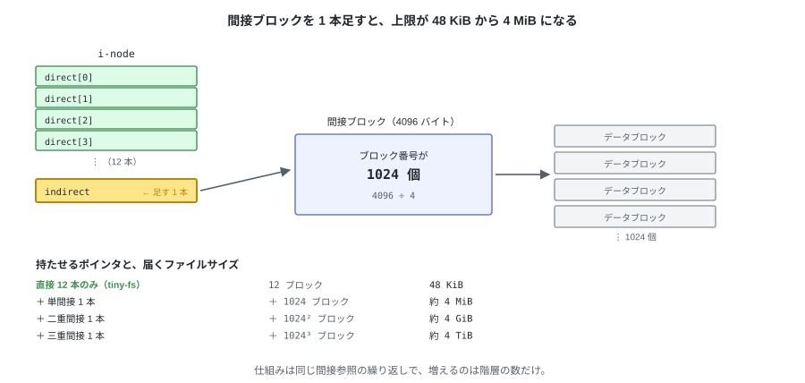

# 13. まとめと、次の一歩

512 バイトのセクタしか読み書きできない装置から始めて、
本物の `ls` と `cat` が動くところまで到達した。

---

## 1. 作ったもの

| 層 | モジュール | 受け持つもの |
|---|---|---|
| L0 | `device.py` | 512 バイトのセクタの読み書き |
| L1 | `disk.py` | 8 セクタ = 1 ブロック |
| L2 | `bitmap.py` | 空きの管理 |
| L3 | `inode.py` | ファイルの中身とメタデータ |
| L4 | `directory.py` | 名前と木構造 |
| L5 | `fs.py` | レイアウトの把握、パス解決、FS API |
| L6 | `fuse_ops.py` | OS との接続（errno の変換だけ） |

これに `dump.py`（覗く）、`fsck.py`（検査する）、`cli.py`（コマンド）が付く。

**下の層は上の層を知らない**という規則を守ってきたので、
`fuse_ops.py` を外しても、第 11 章までの機能はそのまま動く。

---

## 2. 分かっている制限

仕様として受け入れたもの。どれも「そう決めた」結果で、バグではない。

| 制限 | 値 | 由来 |
|---|---|---|
| 1 ファイルの大きさ | 48 KiB | `direct[]` が 12 本しかない |
| ファイルの個数 | 127 個 | i-node を 128 個で固定した |
| イメージの大きさ | 4 MiB（構造上は 128 MiB まで） | ビットマップが 1 枚ずつ |
| クラッシュ | 途中の状態が残る | 複数の書き込みにまたがる操作が原子的でない |
| 同時アクセス | 1 プロセスのみ | ロックを持たない |

4 行目だけは少し説明が要る。
第 7 章で見たとおり `create` はディスクの 4 か所を書き換えるので、
その途中で電源が落ちると、**名前のない i-node** が残ることがある。
第 10 章の `fsck` はそれを検出できるが、直しはしない。

---

## 3. 次に足すなら

この順に足すのが素直になる。前のものが後のものの土台になる。

| 順 | 足すもの | 解けること | 触る層 |
|---|---|---|---|
| 1 | 単間接ブロック | 48 KiB → 4 MiB | `inode.py` だけ |
| 2 | `link()` / シンボリックリンク | `ln` が使える | `fs.py`（`nlink` は既にある） |
| 3 | オープン数の管理 | 開いたままのファイルを消せる | `fs.py` + `fuse_ops.py` |
| 4 | `fsck --repair` | 壊れたイメージを直せる | `fsck.py` |
| 5 | ブロックグループ | 128 MiB の天井が外れる | レイアウト全体（`MAGIC` を上げる） |
| 6 | ジャーナリング | クラッシュしても壊れない | 全層 |

1 番目が一番手軽で、効果も大きい。
i-node に `indirect` を 1 本足し、その先のブロックにブロック番号を 1024 個並べるだけ。



変わるのは `offset → ブロック番号` の変換だけになる。

```python
if index < NDIRECT:
    block_no = inode.direct[index]
else:
    table = blocks.read_block(inode.indirect)       # ブロックを 1 枚余計に読む
    block_no = struct.unpack_from("<I", table, (index - NDIRECT) * 4)[0]
```

---

## 4. ここから先へ

ファイルシステムが何をしているか、その最も単純な形を一通り見終えた。
ブロックの空きを管理し、ファイルの中身を i-node で表し、名前をディレクトリに置き、
それらをディスク上の決まった位置に配置する。

実用的なファイルシステムも、やっていることの骨格はここと変わらない。
大きなファイルを扱い、クラッシュに耐え、速く動くための仕掛けが積み重なっているだけで、
土台にあるのは同じ考え方になる。

その土台を自分で組み立てた状態なので、ここから先は実際のファイルシステムを
そのまま読み進められる。
