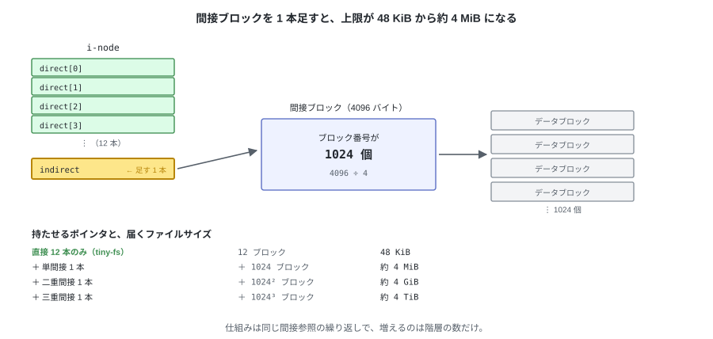

# 14. まとめと、次の一歩

512 バイトのセクタしか読み書きできない装置から始めて、
本物の `ls` と `cat` が動くところまで到達した。

---

## 1. 作ったもの

第 1 章で示した層が、そのまま全部埋まった。


**下の層は上の層を知らない**という規則を守ってきたので、
`fuse_ops.py` を外しても、第 11 章までの機能はそのまま動く。

---

## 2. 分かっている制限

仕様として受け入れたもの。どれも「そう決めた」結果で、バグではない。

| 制限 | 値 | 由来 |
|---|---|---|
| 1 ファイルの大きさ | 48 KiB | `direct[]` が 12 本しかない |
| ファイルの個数 | 127 個 | i-node を 128 個で固定した |
| イメージの大きさ | 4 MiB（構造上は 128 MiB まで） | ビットマップが 1 枚ずつ |
| クラッシュ | 途中の状態が残る | 複数の書き込みにまたがる操作が原子的でない |
| 同時アクセス | 1 プロセスのみ | ロックを持たない |

「クラッシュ」の行だけは少し説明が要る。
第 7 章で見たとおり `create` はディスクの 4 か所を書き換えるので、
その途中で電源が落ちると、**名前のない i-node** が残ることがある。
第 10 章の `fsck` はそれを検出できるが、直しはしない。

---

## 3. 次に足すなら

前のものが後のものの土台になるので、この順に追加していく。

| 順 | 追加するもの | 解決すること | 変更する層 |
|---|---|---|---|
| 1 | 単間接ブロック | 48 KiB → 約 4 MiB | `inode.py` と `constants.py`（`INODE_FMT`）、`fsck.py` / `dump.py` の走査、`MAGIC` |
| 2 | `link()` / シンボリックリンク | `ln` が使える | `fs.py`（`nlink` は既にある） |
| 3 | オープン数の管理 | 開いたままのファイルを消せる | `fs.py` + `fuse_ops.py` |
| 4 | `fsck --repair` | 壊れたイメージを直せる | `fsck.py` |
| 5 | ブロックグループ | 128 MiB の天井が外れる | レイアウト全体（`MAGIC` を上げる） |
| 6 | ジャーナリング | クラッシュしても壊れない | 全層 |

単間接ブロックが一番手軽で、効果も大きい。
i-node に `indirect` を 1 本足し、その先のブロックにブロック番号を 1024 個並べる。
上限の 4 MiB は i-node が指せる量で、イメージのデータ領域は
1017 ブロック（約 3.97 MiB）しかない。



変わるのは `offset → ブロック番号` の変換だけである。

```python
if index < NDIRECT:
    block_no = inode.direct[index]
else:
    table = blocks.read_block(inode.indirect)       # ブロックを 1 枚多く読む
    block_no = struct.unpack_from("<I", table, (index - NDIRECT) * 4)[0]
```

---

## 4. ここから先へ

ブロックの空きを管理し、ファイルの中身を i-node で表し、名前をディレクトリに置き、
それらをディスク上の決まった位置に配置する。
実用的なファイルシステムも、処理の骨格はここと変わらない。
大きなファイルを扱い、クラッシュに耐え、速く動くための仕組みが積み重なっているだけで、
土台にあるのは同じ考え方である。

その土台を自分で実装した状態なので、ここから先は実際のファイルシステムを
そのまま読み進められる。
