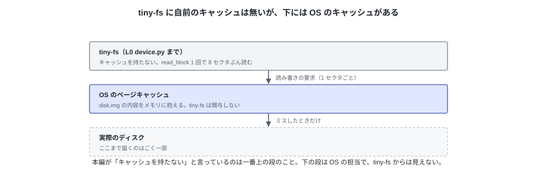
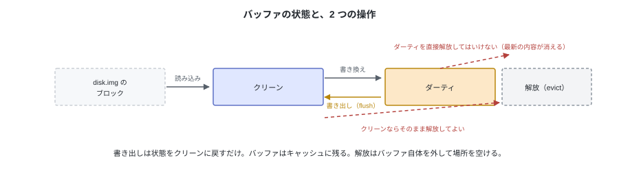
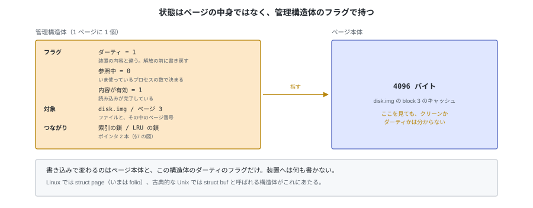
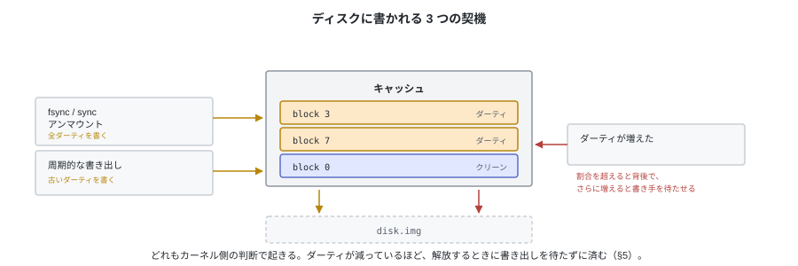
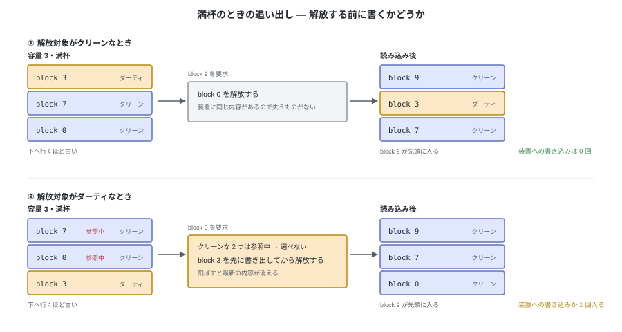
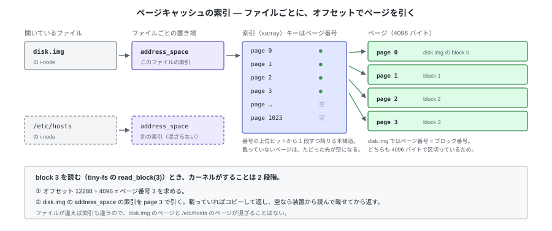
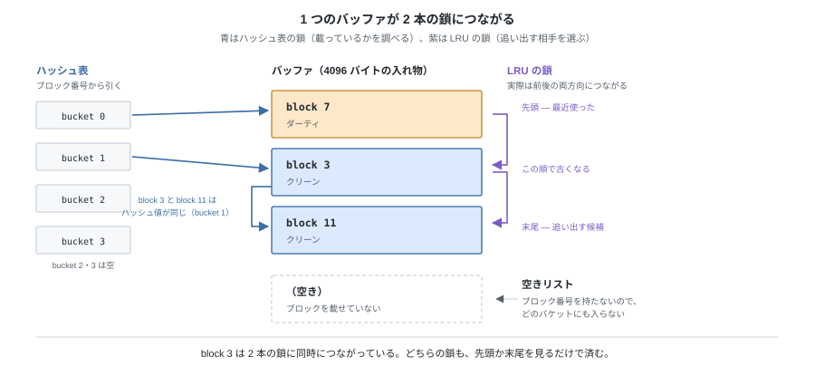
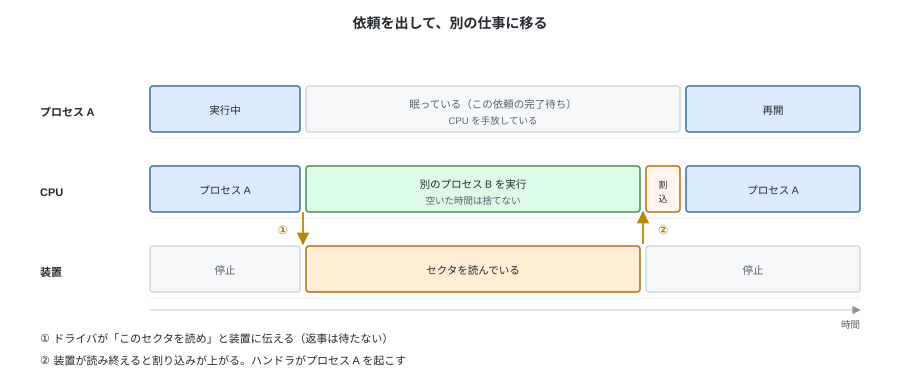
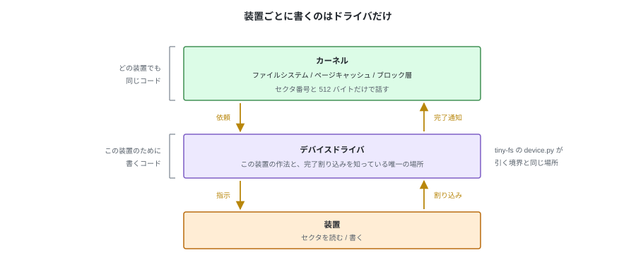

# C. tiny-fs の下で起きていること（参考）


第 1 章では、装置を「読め」と言えばその場で 512 バイトが返るものとして書いた。
`read_sector` は呼べば値を返し、`write_sector` は戻ってきた時点で書き終わっている。
実際には、この読み書きのほとんどは装置に届いていない。

この付録は、tiny-fs のすぐ下から順に降りて、何が起きているかを追う。
メモリ上のキャッシュ、その管理、キャッシュに無かったときの装置とのやり取り、という順になる。
本編の理解には必要ない。tiny-fs に手を入れる話もしない
（どれもカーネルの仕事で、tiny-fs は上に乗るだけ）。
正確な仕様ではなく、**何が起きているかが腑に落ちる程度**にまとめている。

---

## 1. カーネルは、ブロック単位のキャッシュを持っている

tiny-fs はキャッシュを持たない。`write_block` を呼べばその場で書き出し、
`read_block` は毎回 OS に読みに行く。本編はこの前提で書かれている。
`device.py` は `open(path, "r+b", buffering=0)` でイメージを開くので、
`read_sector` 1 回がそのまま OS への読み出し 1 回になる
（`seek` してから `read` するので、syscall としては 2 回）。
tiny-fs はこの回数を減らす工夫をしていない。



**それでも、この読み書きのほとんどはディスク装置に届かない。**
`disk.img` はホストの普通のファイルなので、読み書きの相手は
OS がメモリ上に持っているキャッシュ（**ページキャッシュ**）である。
単位は 4096 バイトの**ページ**で、tiny-fs のブロックとちょうど同じ大きさになる。

このキャッシュは、**装置のブロックの中身がそのままメモリに見えている**ものとして扱える。
だから tiny-fs も、その上の `cat` や `cp` も、装置の遅さを意識せずに
メモリを読み書きする感覚のまま書ける。

以降は、このキャッシュが**どう作られ、いつ装置に書き戻され、いつ解放されるか**を順に追う。

---

## 2. 読み — 読み込んでも、装置から読むとは限らない

`tiny-fs dump disk.img` を 2 回続けて流すと、2 回目のほうが速い。
tiny-fs は何も覚えていない。同じ読み出しを同じ回数出していて、行き先が変わっている。


1 回目はキャッシュに無い（**ミス**）。カーネルが装置から 4096 バイト読み、
**それをメモリに残したまま**呼び出し元へコピーする。
2 回目はキャッシュにある（**ヒット**）ので、装置には触らずコピーだけで終わる。

キャッシュに「入れる」操作は無い。**読んだものがそのまま残る**だけである。
だから tiny-fs が何度も block 3 を読み直しても、装置が何度も動くわけではない。

---

## 3. 先読み — 連続読みは先回りされる

もう 1 つ速さに効くのが**先読み (read-ahead)** である。
カーネルは読まれた位置を見て、連続読みだと判断すると、
まだ要求されていない先のページまで読んでおく。

`cat` や `cp` のように頭から終わりまで読む処理では、これでほとんどの待ちが消える。
逆にランダムアクセスでは当たらず、読んだページが無駄になる。

tiny-fs の `dump` はイメージを先頭から順に読むので、先読みが効く側である。

---

## 4. 書き — 書き込んでも、装置に書かれたとは限らない

書き込みも同じキャッシュに当たる。カーネルはメモリ上のページを書き換え、
**「このページは装置の内容と違う」という印を付けるだけで、呼び出し元に戻る。**
この印が付いたページを**ダーティ**という。



印が付いていないページは**クリーン**で、装置と同じ内容なので解放しても失うものがない。
ダーティなページは、解放する前に装置へ書き戻す必要がある。

これとは**別の軸**として、「いま誰かが参照しているか」がある。参照中（ピン）のあいだは、
クリーンでもダーティでも解放の対象にしない。**ダーティかつ参照中**のページは普通にある。

どちらの印も、ページの中身とは別の場所に持つ。**1 ページごとに管理構造体があり、
そこのフラグが立っているかどうかで決まる。**



**書き込みが速いのは、装置を待っていないから**である。
`tiny-fs put` が終わって `tiny-fs cat` で読めても、それはキャッシュを読んでいるだけで、
装置に届いているとは限らない。

---

## 5. いつ装置に書き戻されるか

書き戻すきっかけは 3 つある。どれもカーネル側の判断で、ファイルシステムは関与しない。



| きっかけ | 中身 |
|---|---|
| ダーティが増えた | ある割合を超えると、背後で書き始める。さらに増えると、書いているプロセス自身を待たせる |
| 時間が経った | 古くなったダーティを装置に書き込む。既定はおよそ 30 秒 |
| 明示的に言われた | `fsync` はそのファイルのダーティを書き終わるまで戻らない。`sync` は全体に対して同じことをする。アンマウントでも書く |

tiny-fs は `fsync` を呼んでいない。つまり**停電でイメージの一部が失われうる**。
`tiny-fs put` が成功しても、装置の上にあるとは限らない。
この「順序と到達をどう保証するか」が付録 D（ジャーナリング）の話になる。

自分でキャッシュを持つプログラム（データベースなど）は、この仕組みを避けて
`O_DIRECT` で開く。ただしこれはページキャッシュを迂回するだけで、
装置に届いたことまでは保証しない（それには `fsync` が要る）。

---

## 6. 容量は限られている — いつ解放されるか

キャッシュが置けるのはメモリの中だけなので、装置ぜんぶは載らない。
いずれ**どれを残し、どれを捨てるか**を決めることになる。

ページキャッシュは**余っているメモリを使うだけ**で、上限を取り置いてはいない。
`free -h` で `buff/cache` が大きくても、それは「使われている」のではなく
「空きを遊ばせずにキャッシュを置いてある」状態である。
プログラムがメモリを要求すれば、カーネルはキャッシュを解放して渡す。



解放する相手は、長く使われていないページから選ぶ。手順は状態で分かれる。

- **クリーン** なら、そのまま解放する。装置に同じ内容があるので失うものがない
- **ダーティ** なら、**先に装置へ書き戻してから**解放する
- **参照中** のページは選ばない。読み込みや書き戻しの I/O が走っている最中、
  装置が直接書き込む先として固定されている（DMA）、`mmap` でプロセスに使われている、
  といったページがこれにあたる。

§5 の書き出しが効いていれば、解放する時点ではたいていクリーンになっている。

### ページング（スワップ）との違い

ファイルのキャッシュとプロセスの匿名メモリは、Linux では同じ仕組みで管理され、同じ回収処理で
選ばれる。だからよく似て見えるが、違いは**元データがどこにあるか**である。
ファイルのキャッシュは装置の上に元があるので、クリーンならそのまま解放できる。
匿名メモリはどこにも元が無いので、**swap 領域へ書いてからでないと解放できない**。


---

## 7. どこに載っているのか（補足）

キャッシュ全体をひとつの索引で引くのではなく、**ファイル（その i-node）ごとに索引を 1 つ**持つ。
ページはそのファイルの索引に登録される。
1 つのファイルに対する索引は 1 つしかないので、別のプロセスが同じファイルを開いても
同じ索引を引くことになり、一方が読み込んだページが他方にもそのまま効く。
索引のキーはファイルの先頭から数えたページ番号で、`read_block(3)` なら
「オフセット 12288 ÷ 4096 = ページ 3」を引くことになる。



`disk.img` を開いても `/dev/sda` を開いても同じ仕組みに乗る。

Linux ではこの置き場を `address_space`、索引を xarray（かつての基数木）と呼ぶ。
古い文献にある「バッファキャッシュ」と「ページキャッシュ」は統合されていて、
いまは 1 つの仕組みに載っている。

### 索引と並び順の実装（さらに補足）

数十万ページが載るので、要求のたびに全部を走査するわけにはいかない。
実用的な実装は、**役割の違う索引を分けて持つ**。

| したいこと | 使うもの |
|---|---|
| そのページが載っているか調べる | ファイルごとの索引（xarray。古典的な実装ではハッシュ表） |
| 新しいページを載せる場所を取る | 空きページの管理 |
| 解放する相手を選ぶ | 長く使われていない順に並べたリスト |


結果として、**1 つのページが複数の鎖に同時につながる。** 索引の鎖と、並び順の鎖である。



---

## 8. キャッシュに無いものは、装置から取るしかない

追い出されたページ、まだ一度も読んでいないブロック、そしてダーティを書き戻すとき。
このときだけ装置が動く。そして装置は、メモリとは**桁が違う**。


装置はメモリより 3〜5 桁遅い。3 GHz の CPU は 1 ns に 3 クロック進むので、
HDD への 1 回の読み出しを待つあいだに 3000 万クロックが過ぎる。

CPU がこの完了をその場で待つ形にすると、その間ずっと何もしないことになる。
**装置への依頼は、呼んだら結果が返る形にはできない。**

---

## 9. 依頼を出して、完了は割り込みで受け取る



カーネルは「このセクタを読め」と装置に伝えるところまでをやって、すぐ戻る。
読み出しを頼んだプロセスはそこで眠り、CPU は別のプロセスを実行する。

装置が読み終えると、**割り込み**が上がる。CPU は実行中の命令の切れ目でプロセス B を中断し、
あらかじめ登録されたハンドラへ飛ぶ。ハンドラはその依頼が終わったことを記録し、
待っていたプロセス A を起こしてから、中断したところへ戻る。

**待っているのはプロセスであって、CPU ではない。**
プロセス A から見れば `read_sector` が返ってきただけだが、
その裏では依頼・割り込み・起床の 3 つが起きている。

---

## 10. デバイスドライバがするのはこれだけ



この受け渡しを担当するのが**デバイスドライバ**で、やることは 2 つしかない。

- カーネルから受け取ったセクタ番号とバッファを、その装置の作法で装置に伝える
- 完了の割り込みを受け取り、終わったことをカーネルに知らせる

装置ごとに違うのは作法の部分だけになる。NVMe なら送信キューに依頼を積んで
doorbell レジスタを叩き、ATA ならレジスタに LBA とセクタ数を書いてコマンドを発行する。

ここが**汎用コードと装置固有コードの境目**になる。
ファイルシステムも、ブロック層も、次の付録で見るバッファキャッシュも、
装置の種類を知らないまま動く。

tiny-fs の `device.py` が `read_sector` / `write_sector` しか持たないのは、
この境界に合わせてある。

---

## 11. 手元で確かめる

Ubuntu なら、キャッシュの量とダーティの量はそのまま見える。

```bash
free -h                       # buff/cache 列がキャッシュの量
grep -E 'Cached|Dirty|Writeback' /proc/meminfo
vmstat 1                      # bi / bo が装置との実際の I/O。キャッシュに当たれば増えない
```

キャッシュを捨ててから 2 回流すと、§2 の差と §9 の割り込みが同時に見える。

```bash
sync; echo 3 | sudo tee /proc/sys/vm/drop_caches   # キャッシュを破棄する（root が要る）
grep -iE 'nvme|ahci|virtio' /proc/interrupts       # 割り込みの回数を控えておく

time tiny-fs dump disk.img > /dev/null             # 1 回目: 装置から読む
grep -iE 'nvme|ahci|virtio' /proc/interrupts       # 増えている

time tiny-fs dump disk.img > /dev/null             # 2 回目: キャッシュに当たる
grep -iE 'nvme|ahci|virtio' /proc/interrupts       # ほとんど増えない
```

2 回目は装置が動いていないので、知らせるべき完了も起きていない。

---

## 12. tiny-fs にとっての意味

| 見え方 | 実際に起きていること |
|---|---|
| `read_sector` は呼べば値を返す | キャッシュにあればコピーだけ。無ければ装置を待つあいだプロセスは眠り、CPU は他を進める |
| `write_block` は戻った時点で書き終わっている | 書き換えたのはメモリ上のキャッシュ。装置に届くのはカーネルが決めた時点（§5） |
| ブロック I/O の回数 = 装置が動いた回数 | 違う。OS に出した回数でしかなく、速度の評価には使えない |
| 自前のキャッシュが要る | 要らない。その役はホストの OS が負っている |
| 正常終了すればイメージは安全 | `fsync` を呼んでいないので、装置に届いているとは限らない（付録 D） |

キャッシュを持つのはカーネルの仕事で、tiny-fs はその上に乗っているから何もしなくて済む。
**カーネル内のファイルシステムも、自分でキャッシュを作るわけではない。**
ページキャッシュに接続する形で書く。
