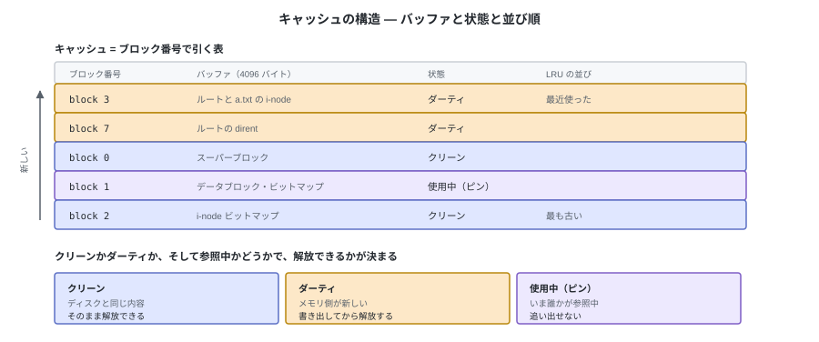
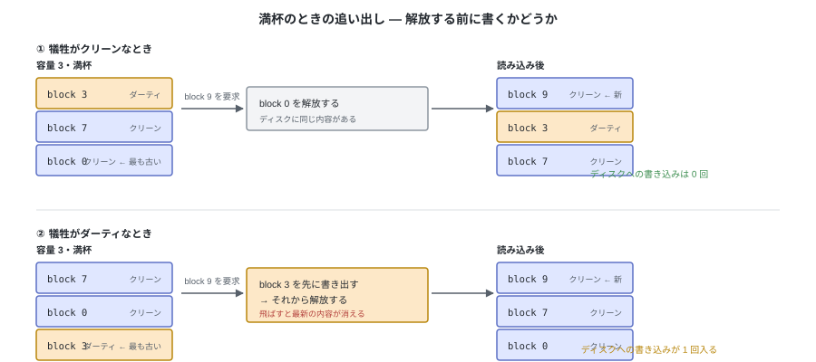
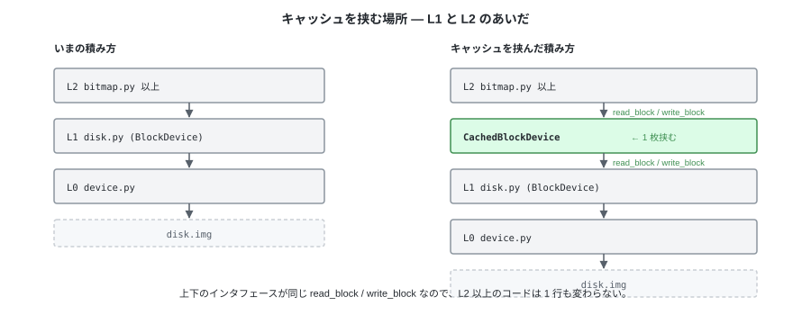
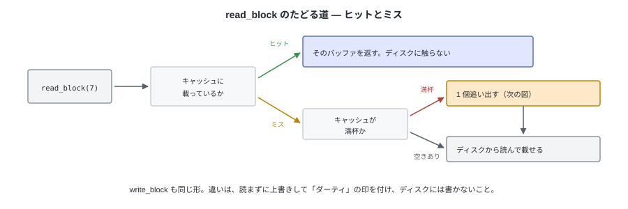

# D. バッファキャッシュ（参考）

tiny-fs はキャッシュを持たない。`write_block` を呼んだ時点でディスクに届き、
`read_block` は毎回ディスクを読む。本編はこの前提で書かれている。

この付録は、その前提を外した場合に何が起きるかを記録しておくもの。
本編の理解には必要ない。

---

## 1. いま何回読み書きしているか

`device.py` は `open(path, "r+b", buffering=0)` でイメージを開く。
Python 側のバッファを通さないので、**`read_sector` 1 回がそのまま `pread` 1 回**になる。
`read_block` は 8 セクタぶんなので、1 ブロック読むたびに 8 回の syscall が出る。

mkfs してから 5000 バイトのファイルを 1 個作り、読み返して `fsck` を通すと、こうなる。

| 段階 | `read_block` | `write_block` | `read_sector` | `write_sector` |
|---|---|---|---|---|
| `mkfs` | 9 | 10 | 72 | 80 |
| `create` + 5000 バイト書き込み | 13 | 9 | 104 | 72 |
| 5000 バイト読み出し | 5 | 0 | 40 | 0 |
| `fsck` | 14 | 1 | 112 | 8 |
| **合計** | **41** | **20** | **328** | **160** |

注目すべきは内訳のほう。**`read_block` 41 回のうち、異なるブロックは 7 個しかない。**
残り 34 回（83 %）は、直前に読んだのと同じブロックの読み直しである。

| ブロック | 読んだ回数 | 中身 |
|---|---|---|
| block 3 | 15 | i-node テーブルの先頭（ルートと `a.txt` の i-node が同居している） |
| block 7 | 11 | ルートディレクトリの dirent |
| block 0 | 5 | スーパーブロック |
| block 1 / 2 | 4 / 4 | 2 つのビットマップ |

書き込みも同様で、20 回のうち異なるブロックは 7 個。`i-node` を 1 個更新するたびに
block 3 を丸ごと読んで丸ごと書く（第 7 章の `write_inode`）ので、同じ 4096 バイトが
何度も往復する。

自分で数えるには、下の 2 層を数えるだけのクラスで包めばよい。

```python
class Counting(SectorDevice):
    def read_sector(self, n):
        counts["read_sector"] += 1
        return super().read_sector(n)
```


**ディスクが 328 回動くわけではない。** `disk.img` はホストの普通のファイルなので、
この `pread` はほぼすべて OS のページキャッシュに当たる。
tiny-fs に無いのは「自前のキャッシュ」であって、キャッシュそのものは下にいる。

---

## 2. キャッシュの構造

キャッシュは**ブロック番号で引く表**である。1 エントリが 1 ブロック分のバッファ
（4096 バイト）と、その状態を持つ。



状態のほかに、**どれが古いか**の順序を持つ。追い出す相手を選ぶために要る情報で、
最も単純な方針が LRU（最後に使ってから一番長いものを選ぶ）。

バッファがとる経路は 3 本だけ。


**書き出し（flush）と解放（evict）は別の操作**である。書き出しはダーティを
クリーンに戻すだけでバッファはキャッシュに残り、解放はバッファそのものを
キャッシュから外して場所を空ける。両者が混ざるのは、満杯のときに解放したい相手が
ダーティだった場合だけ。

---

## 3. ディスクに書かれる契機は 3 つ


`fsync` / `sync` / アンマウントと、周期的な書き出しが**自発的な**書き出しで、
ダーティを減らしておく働きをする。
3 つ目は受け身で、**新しいブロックを載せる場所がないときにだけ**起きる。
自発的な書き出しが効いていれば、追い出しの時点で犠牲がすでにクリーンになっていて、
書き出しを待たずに解放できる。これが周期的な書き出しの目的である。

容量が足りないときの手順は次の順序になる。

1. 古い順に候補を見て、**ピンされていないもの**を 1 つ選ぶ
2. クリーンなら、そのまま捨てる（ディスクに同じ内容があるので失うものがない）
3. ダーティなら、**先にディスクへ書く**。ここを飛ばすと最新の内容がどこにも残らない
4. バッファをキャッシュから外す。空いた場所に、要求されたブロックを読み込む



犠牲がクリーンかダーティかで、ディスクへの書き込みが 0 回か 1 回かが変わる。
これが、自発的な書き出しでダーティを減らしておく意味である。

---

## 4. tiny-fs に足すとしたらどこか

層の構造（第 1 章の図）でいうと、**L1 と L2 のあいだに 1 枚挟む**。
`read_block` / `write_block` という同じインタフェースを持たせれば、
**上の層は 1 行も変わらない**。



```python
class CachedBlockDevice:
    """read_block / write_block は BlockDevice と同じ。中でキャッシュする。

    _cache は OrderedDict。先頭が最近使ったもの、末尾が最も古いもの。
    """

    def read_block(self, block_no):
        if block_no in self._cache:              # ヒット
            self._cache.move_to_end(block_no, last=False)
            return self._cache[block_no]
        if len(self._cache) >= self._capacity:    # 満杯なら 1 個分空ける
            self._evict_one()
        data = self._blocks.read_block(block_no)  # ミス → 読んで載せる
        self._cache[block_no] = data
        self._cache.move_to_end(block_no, last=False)
        return data

    def write_block(self, block_no, data):
        if block_no not in self._cache and len(self._cache) >= self._capacity:
            self._evict_one()
        self._cache[block_no] = bytes(data)
        self._cache.move_to_end(block_no, last=False)
        self._dirty.add(block_no)                 # ディスクにはまだ書かない

    def _evict_one(self):
        # 古い順に見る。ピンされているバッファは参照中なので飛ばす
        for block_no in reversed(self._cache):
            if block_no in self._pinned:
                continue
            if block_no in self._dirty:
                # ダーティなら、解放する前に必ず書き出す
                self._blocks.write_block(block_no, self._cache[block_no])
                self._dirty.discard(block_no)
            del self._cache[block_no]             # ここで初めて場所が空く
            return
        raise RuntimeError("解放できるバッファがない")

    def flush(self):
        # 自発的な書き出し。バッファはキャッシュに残したまま、ダーティを消す
        for block_no in sorted(self._dirty):
            self._blocks.write_block(block_no, self._cache[block_no])
        self._dirty.clear()
```



このまま動かすと、効きが数字で出る。§1 と同じ作業のうち `mkfs` の後の部分
（イメージを開く → `create` → 5000 バイト書き込み → 読み返し → `fsck` → 閉じる）を、
容量だけ変えて通した結果。

| キャッシュの容量 | `read_block` | `write_block` |
|---|---|---|
| なし | 32 | 10 |
| 2 ブロック | 18 | 8 |
| 3 ブロック | 15 | 8 |
| 7 ブロック | **5** | **7** |
| 32 ブロック | 5 | 7 |

7 ブロックと 32 ブロックで同じなのは、この作業で同時に触るブロックが 5〜7 個しかないため。
容量がそれを下回ると、追い出した block 3 や block 7 をすぐに読み直すことになり、
効果が急に落ちる。**キャッシュの効きは、容量と作業集合（同時に触るブロックの数）の
関係で決まる。**

書き込みが 10 回から 7 回に減るのは、同じブロックへの繰り返しの書き込みが
`flush` までまとまるため。どの容量でも、閉じたあとのイメージは `fsck` を通る。

こう決めた瞬間に、次が必要になる。

- `close` で必ず `flush`。忘れると書いたはずのデータが消える
- `fsync` / `flush`（FUSE の操作）を本当に実装する。第 12 章の「何もしない」が成り立たなくなる
- 第 7 章の「ビットマップを変更したら、その場で書き戻す」という規則が不要になる。
  ビットマップの 2 ブロックをメモリに置いているのは、キャッシュがないことの代わりだった

---

## 5. 代償

本編がキャッシュを持たないのは、速度よりも**ディスク上のバイト列をいつでも説明できる状態**を
選んだため。キャッシュを入れると、次の 3 つが同時に崩れる。

| 崩れるもの | 理由 |
|---|---|
| 第 9 章の `dump` | 「いま書いたものがイメージに見える」とは言えなくなる。`flush` 前なら古いバイトが見える |
| 第 10 章の `fsck` | イメージを真実として検査する前提が、メモリ上のダーティなバッファによって揺らぐ |
| クラッシュ時の整合性 | ダーティなバッファがどの順で書かれるか保証が要る。ここからジャーナリングの話になる（付録 E） |

3 つ目が最も重い。追い出しは**キャッシュの都合で起きる**ので、書き出しの順序は
ファイルシステムの操作の順序と一致しない。「i-node は書かれたが、それが指すデータブロックは
まだ書かれていない」状態でクラッシュしうる。これを防ぐ仕組みがジャーナリングで、
**キャッシュは単体で足せる機能ではなく、ジャーナリングと一緒にやってくる**（付録 E）。
