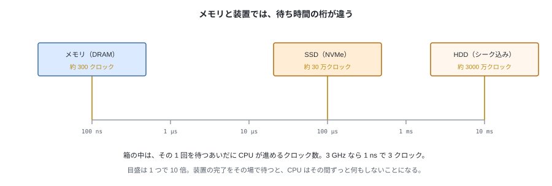
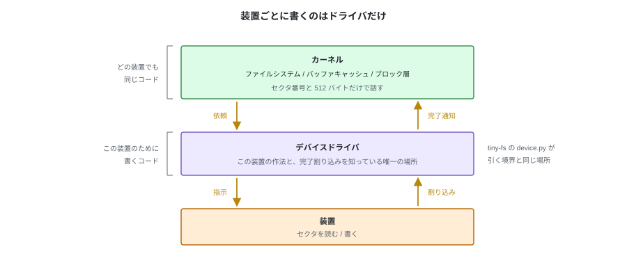

# D. 割り込みとデバイスドライバ（参考）

第 1 章では、装置を「読め」と言えばその場で 512 バイトが返るものとして書いた。
`read_sector` は呼べば値を返し、`write_sector` は戻ってきた時点で書き終わっている。
実際の装置はそうなっていない。

この付録は、その間に入っているものを追う。本編の理解には必要ない。

---

## 1. 装置はとんでもなく遅い



メモリは 100 ns 前後で返る。SSD はその 1000 倍、HDD はシークを含めて 10 万倍かかる。
3 GHz の CPU は 1 ns に 3 クロック進むので、HDD への 1 回の読み出しを待つあいだに
3000 万クロックが過ぎる。

CPU がこの完了をその場で待つ形にすると、その間ずっと何もしないことになる。
**装置への依頼は、呼んだら結果が返る形にはできない。**

---

## 2. 依頼を出して、完了は割り込みで受け取る


カーネルは「このセクタを読め」と装置に伝えるところまでをやって、すぐ戻る。
読み出しを頼んだプロセスはそこで眠り、CPU は別のプロセスを実行する。

装置が読み終えると、**割り込み**が上がる。CPU は実行中の命令の切れ目でプロセス B を中断し、
あらかじめ登録されたハンドラへ飛ぶ。ハンドラはその依頼が終わったことを記録し、
待っていたプロセス A を起こしてから、中断したところへ戻る。

**待っているのはプロセスであって、CPU ではない。**
プロセス A から見れば `read_sector` が返ってきただけだが、
その裏では依頼・割り込み・起床の 3 つが起きている。

---

## 3. デバイスドライバがするのはこれだけ



この受け渡しを担当するのが**デバイスドライバ**で、やることは 2 つしかない。

- カーネルから受け取ったセクタ番号とバッファを、その装置の作法で装置に伝える
- 完了の割り込みを受け取り、終わったことをカーネルに知らせる

装置ごとに違うのは作法の部分だけになる。NVMe なら送信キューに依頼を積んで
doorbell レジスタを叩き、ATA ならレジスタに LBA とセクタ数を書いてコマンドを発行する。

ここが**汎用コードと装置固有コードの境目**になる。
ファイルシステムも、ブロック層も、次の付録で見るバッファキャッシュも、
装置の種類を知らないまま動く。**装置ごとに書くのはドライバだけ**で、
割り込みの処理もそこに閉じている。

tiny-fs の `device.py` が `read_sector` / `write_sector` しか持たないのは、
この境界に合わせてある。

---

## 4. tiny-fs ではどう見えているか

`read_sector` の中身は `seek` と `read` の 2 回のシステムコールで、
`disk.img` は普通のファイルだから、この依頼はまず OS が持っている写しに当たる（付録 E）。
写しがなければブロック層とドライバを通って装置が動き、割り込みで完了が返り、
プロセスが起こされてからデータが届く。

| 見え方 | 実際に起きていること |
|---|---|
| `read_sector` は呼べば値を返す | 返るまでのあいだ、このプロセスは眠っている |
| 遅いのは装置のせい | CPU はその間ほかのプロセスを進めている |
| セクタ 1 個ずつ装置に頼んでいる | 多くは写しに当たり、装置までは届かない（付録 E） |

---

## 5. 手元で確かめる

割り込みの回数は数えられている。

```bash
grep -iE 'nvme|ahci|virtio' /proc/interrupts       # CPU ごとの回数

sync; echo 3 | sudo tee /proc/sys/vm/drop_caches   # 写しを捨てる
tiny-fs dump disk.img > /dev/null                  # 装置から読ませる

grep -iE 'nvme|ahci|virtio' /proc/interrupts       # 増えている
```

写しを捨てずに 2 回目を流すと、ほとんど増えない。
装置が動いていないので、知らせるべき完了も起きていない。

その写しを持っているのが、汎用コードの側にあるバッファキャッシュになる（付録 E）。
