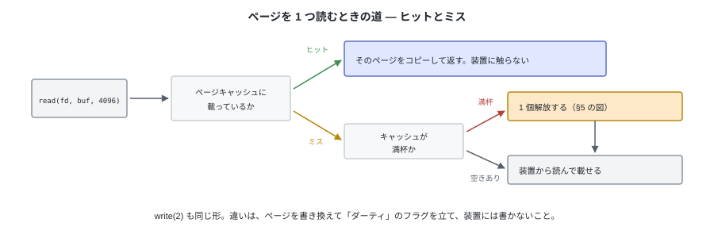
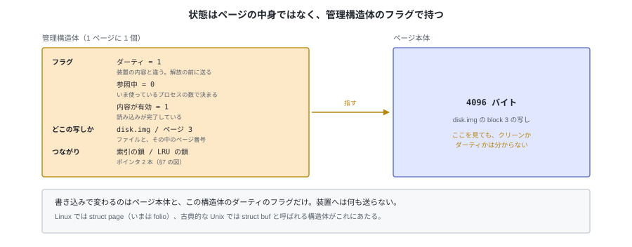
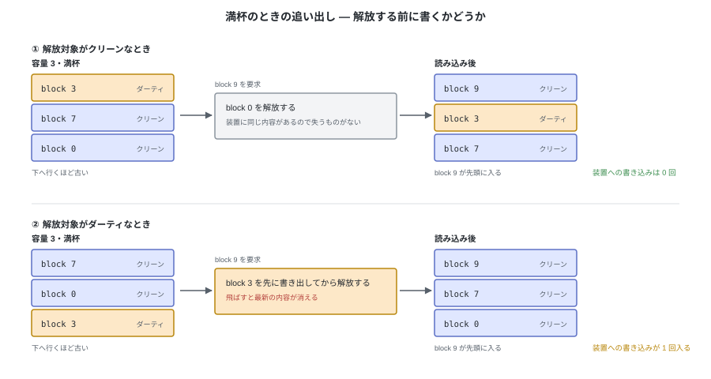
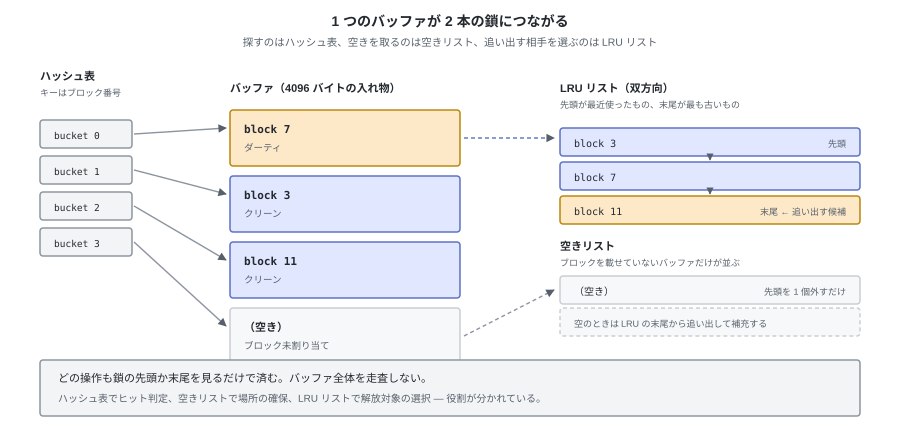

# E. バッファキャッシュ（参考）

tiny-fs はキャッシュを持たない。`write_block` を呼べばその場で書き出し、
`read_block` は毎回 OS に読みに行く。本編はこの前提で書かれている。

それでも、この FS は**キャッシュの上で動いている**。
バッファキャッシュはファイルシステムの機能ではなく、**OS がブロック装置への I/O を
減らすために持っている層**で、tiny-fs が何もしなくてもその下に入っている。
置かれているのはドライバより上、どの装置でも同じコードが動く側である（付録 D）。

この付録は、その OS 側の動きを追うもの。本編の理解には必要ない。
tiny-fs に自前のキャッシュを足す話はしない（OS のものがあるので要らない）。
正確な仕様ではなく、**何が起きているかが腑に落ちる程度**にまとめている。

---

## 1. tiny-fs の下にいるもの

`device.py` は `open(path, "r+b", buffering=0)` でイメージを開く。
Python 側のバッファを通さないので、`read_sector` 1 回がそのまま OS への読み出し
1 回になる（`seek` してから `read` するので、syscall としては 2 回）。
`read_block` は 8 セクタぶん、それを繰り返す。
tiny-fs はこの回数を減らす工夫をしていない。


**それでも、この読み書きの多くはディスク装置に届かない。**
`disk.img` はホストの普通のファイルなので、読み書きの相手は
OS が持っているメモリ上の写し（**ページキャッシュ**）である。

装置が動くのは 2 つの場合だけで、呼び出し側から見た重さが違う。

- **写しに無いところを読むとき。** このときは読み出しの呼び出しの中で装置を待つ
- **書き換えた写しを装置へ送るとき。** これはカーネルが後で行うので、
  書き込みの呼び出しは待たずに戻る

以降は、この写しが**どう作られ、いつ装置に送られ、いつ解放されるか**を順に追う。
単位は 4096 バイトの**ページ**で、tiny-fs のブロックとちょうど同じ大きさである。

---

## 2. 読み — 読み込んでも、装置から読むとは限らない

`tiny-fs dump disk.img` を 2 回続けて流すと、2 回目のほうが速い。
tiny-fs は何も覚えていない。同じ読み出しを同じ回数出していて、行き先が変わっている。



1 回目は写しが無い（**ミス**）。カーネルが装置から 4096 バイト読み、
**それをメモリに残したまま**呼び出し元へコピーする。
2 回目は写しがある（**ヒット**）ので、装置には触らずコピーだけで終わる。

キャッシュに「入れる」操作は無い。**読んだものがそのまま残る**だけである。
だから tiny-fs が何度も block 3 を読み直しても、装置が何度も動くわけではない。

---

## 3. 書き — 書き込んでも、装置に書かれたとは限らない

書き込みも同じ写しに当たる。カーネルはメモリ上のページを書き換え、
**「このページは装置の内容と違う」という印を付けるだけで、呼び出し元に戻る。**
この印が付いたページを**ダーティ**という。


装置の内容と一致しているかどうかは、2 つのうちどちらかである。

| 状態 | 意味 |
|---|---|
| クリーン | 装置と同じ内容。解放しても失うものがない |
| ダーティ | メモリ側が新しい。解放する前に送る必要がある |

これとは**別の軸**として、「いま誰かが参照しているか」がある。参照中（ピン）のあいだは、
クリーンでもダーティでも解放の対象にしない。**ダーティかつ参照中**のページは普通にある。

状態はページの中身とは別に持つ。**1 ページごとに管理構造体があり、
そこのフラグが立っているかどうかで決まる。**



**書き込みが速いのは、装置を待っていないから**である。
`tiny-fs put` が終わって `tiny-fs cat` で読めても、それはメモリの写しを読んでいるだけで、
装置に届いているとは限らない。

---

## 4. いつ装置に送られるか

送るきっかけは 3 つある。どれもカーネル側の判断で、ファイルシステムは関与しない。


| きっかけ | 中身 |
|---|---|
| ダーティが増えた | ある割合を超えると、背後で送り始める。さらに増えると、書いているプロセス自身を待たせる |
| 時間が経った | 古くなったダーティを送る。既定はおよそ 30 秒 |
| 明示的に言われた | `fsync` はそのファイルのダーティを送り終わるまで戻らない。`sync` は全体に対して同じことをする。アンマウントでも送る |

tiny-fs は `fsync` を呼んでいない。つまり**停電でイメージの一部が失われうる**。
`tiny-fs put` が成功しても、装置の上にあるとは限らない。
この「順序と到達をどう保証するか」が付録 F（ジャーナリング）の話になる。

自分でキャッシュを持つプログラム（データベースなど）は、この仕組みを避けて
`O_DIRECT` で開く。ただしこれはページキャッシュを迂回するだけで、
装置に届いたことまでは保証しない（それには `fsync` が要る）。

---

## 5. いつ解放されるか

ページキャッシュは**余っているメモリを使うだけ**で、上限を取り置いてはいない。
`free -h` で `buff/cache` が大きくても、それは「使われている」のではなく
「空きを遊ばせずに写しを置いてある」状態である。
プログラムがメモリを要求すれば、カーネルは写しを解放して渡す。



解放する相手は、長く使われていないページから選ぶ。手順は状態で分かれる。

- **クリーン** なら、そのまま解放する。装置に同じ内容があるので失うものがない
- **ダーティ** なら、**先に装置へ送ってから**解放する
- **参照中** のページは選ばない

§4 の書き出しが効いていれば、解放する時点ではたいていクリーンになっている。
ダーティを早めに減らしておく意味はここにある。

### ページング（スワップ）との違い

ここまでの管理構造体と回収の話は、**ページングと同じ土台**に乗っている。
Linux では、ファイルの写しもプロセスのメモリも同じページ記述子で管理され、
同じ回収処理で選ばれる（並ぶリストはファイル用と匿名メモリ用に分かれていて、
どちらから回収するかは `swappiness` で釣り合いを取る）。だからよく似て見える。

違いは**元データがどこにあるか**である。

| | ファイルの写し（この付録の話） | プロセスの匿名メモリ |
|---|---|---|
| 元データ | 装置の上にある | どこにも無い |
| 解放するには | クリーンなら破棄、ダーティなら書き戻す | **swap 領域へ書いてからでないと破棄できない** |
| 目的 | 装置への I/O を減らす | 物理メモリより大きいメモリを使う |

この付録が扱うのは左の列だけである。

---

## 6. 先読み — 連続読みは先回りされる

もう 1 つ速さに効くのが**先読み (read-ahead)** である。
カーネルは読まれた位置を見て、連続読みだと判断すると、
まだ要求されていない先のページまで読んでおく。

`cat` や `cp` のように頭から終わりまで読む処理では、これでほとんどの待ちが消える。
逆にランダムアクセスでは当たらず、読んだページが無駄になる。

tiny-fs の `dump` はイメージを先頭から順に読むので、先読みが効く側である。

---

## 7. どこに載っているのか（補足）

写しはひとつの大きな置き場にまとめられているのではなく、**ファイル（その i-node）ごと**に
分かれてぶら下がる。同じファイルを別のプロセスが開いても、ぶら下がる先は同じ 1 つで、
だからこそキャッシュが効く。キーはファイルの先頭から数えたページ番号で、
`read_block(3)` なら「オフセット 12288 ÷ 4096 = ページ 3」を引くことになる。


`disk.img` を開いても `/dev/sda` を開いても同じ仕組みに乗る。
ファイルが違えば索引も違うので、ページが混ざることはない。

Linux ではこの置き場を `address_space`、索引を xarray（かつての基数木）と呼ぶ。
古い文献にある「バッファキャッシュ」と「ページキャッシュ」は統合されていて、
いまは 1 つの仕組みに載っている。

### 索引と並び順の実装（さらに補足）

数十万ページが載るので、要求のたびに全部を走査するわけにはいかない。
実用的な実装は、**役割の違う索引を分けて持つ**。

| したいこと | 使うもの |
|---|---|
| そのページが載っているか調べる | ファイルごとの索引（xarray。古典的な実装ではハッシュ表） |
| 新しいページを載せる場所を取る | 空きページの管理 |
| 解放する相手を選ぶ | 長く使われていない順に並べたリスト |


結果として、**1 つのページが複数の鎖に同時につながる。** 索引の鎖と、並び順の鎖である。
Unix 系のバッファキャッシュは古くからこの形で、バッファの管理構造体が
ハッシュの鎖と空き / LRU の鎖の両方につながっていた。



---

## 8. 手元で確かめる

Ubuntu なら、写しの量とダーティの量はそのまま見える。

```bash
free -h                       # buff/cache 列が写しの量
grep -E 'Cached|Dirty|Writeback' /proc/meminfo
vmstat 1                      # bi / bo が装置との実際の I/O。写しに当たれば増えない
```

tiny-fs で §2 の差を見るなら、キャッシュを落としてから 2 回流す。

```bash
sync; echo 3 | sudo tee /proc/sys/vm/drop_caches   # 写しを破棄する（root が要る）
time tiny-fs dump disk.img > /dev/null             # 1 回目: 装置から読む
time tiny-fs dump disk.img > /dev/null             # 2 回目: 写しに当たる
```

---

## 9. tiny-fs にとっての意味

| 事実 | 影響 |
|---|---|
| 自前のキャッシュを持たない | その役はホストの OS が負っている。実装するものではない |
| ブロック I/O の回数 = OS に出した読み書きの回数 | 速度の評価には使えない。装置が動いた回数ではない |
| `fsync` を呼んでいない | 正常終了しても、イメージが装置に届いているとは限らない（付録 F） |
| `disk.img` が普通のファイル | 写しの恩恵をそのまま受ける。4 MiB なので、ほぼ全部が載る |

キャッシュを持つのはカーネルの仕事で、tiny-fs はその上に乗っているから何もしなくて済む。
**カーネル内のファイルシステムも、自分でキャッシュを作るわけではない。**
ページキャッシュに接続する形（読み出し・書き出しのフックを実装する形）で書く。
自前のキャッシュを持つのは、ページキャッシュを通さない（`O_DIRECT` を使う）
データベースのようなプログラムである。
