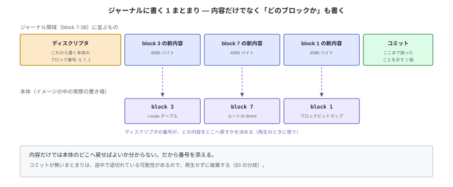

# E. ジャーナリング（参考）


tiny-fs はシステムが突然クラッシュすることを考えていない。`write_block` は呼ばれた順に
ディスクへ届き、途中で止まればその時点までの書き込みが残る、という前提で本編は書かれている。

この付録は、その前提を外した場合に何が起きるかを記録しておくもの。
本編の理解には必要ない。付録 D（バッファキャッシュ）と対になる。

---

## 1. 突然システムがクラッシュすると何が起きるか

1 つの操作は、複数回の `write_block` に分かれる。`create("/a.txt")` が 4 回、
5000 バイトの書き込みが 5 回で、合わせて 9 回。
**i-node を書き終える前にクラッシュすれば、ファイルシステムの整合性は壊れる。**

実測もできる。ここでは**書いた順に装置へ届く**ものとして、N 回目の `write_block` で止めて
`fsck` にかけると、9 回のうち 6 回が不整合として報告される。
ただし**壊れ方は 2 種類しかない。**

| 壊れ方 | クラッシュする位置 | 残るもの |
|---|---|---|
| **orphan** | i-node を確保したあと、親ディレクトリに名前を書く前 | 使用中なのに、ルートからたどり着くパスが無い i-node |
| **leak** | データブロックを確保したあと、i-node の `direct[]` に記録する前 | 使用中なのに、どの i-node からも参照されていないブロック |

どちらも第 10 章の `fsck` が見つけられる「余った資源」で、失われたデータではない。

これは書く順序をそう選んだ結果である（`unlink` は名前を先に消し、`create` は
i-node を先に書く。逆にすると、解放済みのブロックを指す名前が残りうる）。
つまり**順序の工夫でできるのは「壊れ方を選ぶ」ことまでで、「壊れないこと」ではない。**

---

## 2. 順序だけでは足りない

さらに言えば、**その順序は tiny-fs が決められない。**
`write_block` が届くのは OS のページキャッシュで（付録 D）、そこから装置へ送る順序と
時刻はカーネルが決める。`fsync` を呼ばないかぎり、「データブロック → i-node」と
書いたつもりの順序は、装置の上では守られていない。

順序が崩れれば、壊れ方も §1 の 2 種類では済まなくなる。

ジャーナリングが解くのはこの問題である。順序を工夫するのではなく、
**操作の途中の状態がディスクに残らないようにする。**

---

## 3. 仕組み — 先に書いて、あとで再生する

本体（i-node、ビットマップ、データ）を書き換える前に、**これから行う変更をジャーナル領域に
書いておく**。これを先行書き込み (write-ahead) という。

書くのは内容だけではない。**どの本体ブロックへ戻すのか**が分からなければ再生できないので、
対象のブロック番号を並べたメタデータ（ディスクリプタ）を先に置く。
1 つの操作で変更するブロックをすべて並べ、最後にコミットを書く。




分岐点は**コミットレコードの書き込み 1 個**だけである。これが残っていれば
「変更内容はすべてジャーナルに揃っている」と言えるので、本体への書き込みは
何度でもやり直せる。残っていなければジャーナルを破棄し、本体は操作前のまま。

| クラッシュした位置 | 再起動後 |
|---|---|
| ①の途中 | コミットがない → ジャーナルを破棄する。操作は**なかったことになる** |
| ②の直後 | コミットがある → 再生して、操作は**完了したことになる** |
| ③の途中 | 同上。同じ内容を上書きするだけなので、2 回適用しても結果は同じ |

③ を何度適用しても同じ結果になること（冪等）が、再生の前提である。
「ブロック 8 の内容はこれ」という形で記録してあれば満たされる。
「カウンタを 1 増やす」のような記録にすると、再生のたびに増えてしまう。

もう 1 つ必要なものがある。**①がディスクに届く前に②が届いてはいけない。**
ディスク自身も書き込みを並べ替えるので、ここでは順序を強制する命令
（キャッシュのフラッシュ、書き込みの完了待ち）を使う。
ジャーナリングは「書き込みの順序を 1 か所だけ厳密に守る」仕組みだと言える。

---

## 4. 何を守るか

ジャーナルに何を記録するかで、守れる範囲と書き込み量が変わる。

| 記録するもの | 守れること | 代償 |
|---|---|---|
| メタデータだけ | ファイルシステムの構造は必ず整合する。leak も orphan も残らない | ファイルの**中身**は保証されない。i-node が指すブロックに古い内容が残りうる |
| メタデータ＋データ | 中身まで含めて、操作前か操作後のどちらかになる | すべてのデータを 2 回書く。書き込み量が倍になる |

中間の方針として、「メタデータをコミットする前に、そのメタデータが指すデータブロックだけは
本体へ書き終えておく」という形も取れる。データを 2 回書かずに §2 の問題だけを
避けられるので、実用的なファイルシステムの既定はここに置かれることが多い。

---

## 5. tiny-fs に足すとしたらどこか

まずレイアウトが変わる。ジャーナル領域は固定の場所に要る。


スーパーブロックに `journal_start` と `journal_blocks` を足し、`data_start` を後ろへ動かす。
オンディスク形式が変わるので、第 5 章の規則どおり `MAGIC` を `"tfs2"` に上げる。

次に、**操作の境界**を決める必要がある。いまの `fs.py` の各メソッドは
「ブロックを何回か書く」だけで、どこからどこまでが 1 つの操作かを宣言していない。

```python
def create(self, path, mode=stat.S_IFREG | 0o644):
    with self._journal.transaction():     # ここから
        ...                               # 中身はいまの create と同じ
    # with を抜けた時点で、コミットレコードが書き終わっている
```

`transaction()` の中で `write_block` を呼ぶと、本体ではなくジャーナルに溜まる。
抜けるときに、コミットレコードの書き込み → 本体への書き込み → ジャーナルの解放（図の②③④）を行う。
**L5 より下の層は変わらない**のがこの形の利点で、
`inode.py` や `directory.py` は自分がトランザクションの中にいることを知らない。

ジャーナルを入れるなら、**到達を待つ処理**も要る。ページキャッシュに預けただけでは
順序が保証されないので（付録 D）、①の書き込みのあとと②のコミットのあとで
`fsync` を呼び、装置に届いたことを確かめてから次へ進む。
この 2 回の待ちが、ジャーナリングの速度上の代償になる。

最後に `fsck` の役割が変わる。マウントの手順が「検証 → **再生** → 使用開始」になり、
`fsck` は再生のあとに走る検査になる。再生で直るものを `fsck` が直す必要はなくなる。

---

## 6. 代償

| 失うもの | 内容 |
|---|---|
| 書き込み量 | メタデータは必ず 2 回書く。データも守るなら全体が 2 回 |
| イメージの読みやすさ | 第 9 章の `dump` が、本体とジャーナルの 2 か所を読む必要が出る。「このバイトがいま何を表しているか」に「再生前か後か」という条件が付く |
| 説明の軸 | トランザクション境界、冪等性、順序の強制という 3 つの概念が、ファイルシステムの構造の説明に混ざる |

本編がジャーナリングを持たないのは、説明の軸が増えることが重いからである。
第 10 章の `fsck` は「同じ情報を 2 通りに求めて突き合わせる」ことを見せる章だが、
ジャーナルがあると、突き合わせる前に再生が入る。
**壊れたイメージを直接観察できる状態**は、教材としてはそれ自体に価値がある。
