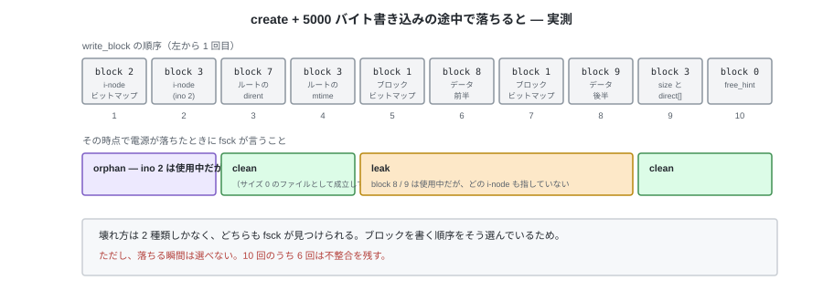
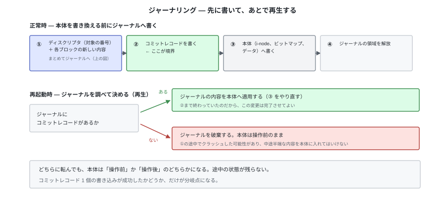

# E. ジャーナリング（参考）

tiny-fs は電源が落ちることを考えていない。`write_block` は呼ばれた順にディスクへ届き、
途中で止まればその時点までが残る。本編はこの前提で書かれている。

この付録は、その前提を外した場合に何が起きるかを記録しておくもの。
本編の理解には必要ない。付録 D（バッファキャッシュ）と対になる。

---

## 1. いま落ちると何が起きるか

測れる。`write_block` を数えて、N 回目で例外を投げるようにしたブロックデバイスで
包めばよい。

```python
class CrashAfter(BlockDevice):
    """N 回書いたあと、次の write_block で電源が落ちたことにする。"""

    def write_block(self, block_no, data):
        if self._left == 0:
            raise Crash()
        self._left -= 1
        return super().write_block(block_no, data)
```

これで `create("/a.txt")` と 5000 バイトの書き込みを通すと、`write_block` は 10 回。
N を 0 から 10 まで動かし、落ちたイメージを毎回 `fsck` にかけた結果が次になる。



| 落ちた時点 | `fsck` の出力 |
|---|---|
| 0 回 | clean |
| 1〜2 回 | `inode 2 is marked used but cannot be reached from the root (orphan)` |
| 3〜4 回 | clean |
| 5〜8 回 | `block 8 is marked used but referenced by nothing (leak)`（7 回以降は block 9 も） |
| 9〜10 回 | clean |

`unlink` でも同じことをすると、`write_block` は 7 回で、壊れ方は 2 種類の組み合わせになる。

| 落ちた時点 | `fsck` の出力 |
|---|---|
| 1 回 | block 8 / block 9 が leak、`inode 2` が orphan |
| 2 回 | block 9 が leak、`inode 2` が orphan |
| 3 回 | `inode 2` が orphan |
| 4 回以降 | clean |

分かることが 2 つある。

**壊れ方は 2 種類しかない。** 使用中なのに誰も参照していないブロック（leak）と、
使用中なのにどの名前からも届かない i-node（orphan）。どちらも第 10 章の `fsck` が
そのまま見つけられる。**どちらも「余った資源」の形で、失われたデータではない。**

これは偶然ではなく、書く順序をそう選んだ結果である。たとえば `unlink` は
**名前を消してからブロックを解放する**。逆にすると、解放済みのブロックを指す dirent が
一瞬できて、そこで落ちると**他のファイルに割り当て直されたブロックを指す名前**が残る。
`create` も同じで、i-node を書いてから名前を付ける。

**それでも、落ちる瞬間は選べない。** 10 回のうち 6 回は不整合を残す。
順序の工夫でできるのは「壊れ方を選ぶ」ことまでで、「壊れないこと」ではない。

---

## 2. 順序だけでは足りない

順序が守れる前提そのものが、付録 D のキャッシュを入れると崩れる。

キャッシュは**キャッシュ自身の都合**でブロックを書き出す。追い出しは容量が足りないときに
起き、周期的な書き出しは時間で起きる。どちらもファイルシステムの操作の順序とは無関係なので、
`write` が決めた「データブロック → i-node」という順序は保証されなくなる。

これが起きると、壊れ方の種類が変わる。

| 届いた順 | 落ちたあとの状態 |
|---|---|
| データ → i-node（tiny-fs のいまの順） | leak。データブロックは余るが、ファイルは元のサイズのまま |
| i-node → データ | **`size` が伸びた i-node が、書かれていないブロックを指す** |

後者は「余った資源」ではない。そのファイルを読むと、**そのブロックを前に使っていた
誰かのデータが見える**。`fsck` はビットマップと参照の対応しか見ないので、これを
不整合として検出できない。

ジャーナリングが解くのはこの問題である。順序を工夫するのではなく、
**操作の途中の状態がディスクに残らないようにする。**

---

## 3. 仕組み — 先に書いて、あとで再生する

本体（i-node、ビットマップ、データ）を触る前に、**これから行う変更をジャーナル領域に
書いておく**。これを先行書き込み (write-ahead) という。



分岐点は**コミットレコードの書き込み 1 個**だけになる。これが残っていれば
「変更内容はすべてジャーナルに揃っている」と言えるので、本体への書き込みは
何度でもやり直せる。残っていなければジャーナルを捨てて、本体は操作前のまま。

| 落ちた位置 | 再起動後 |
|---|---|
| ①の途中 | コミットがない → ジャーナルを捨てる。操作は**なかったことになる** |
| ②の直後 | コミットがある → 再生して、操作は**完了したことになる** |
| ③の途中 | 同上。同じ内容を上書きするだけなので、2 回適用しても結果は同じ |

③ を何度やっても同じ結果になること（冪等）が、再生の前提である。
「ブロック 8 の内容はこれ」という形で記録してあれば満たされる。
「カウンタを 1 増やす」のような記録にすると、再生のたびに増えてしまう。

もう 1 つ必要なものがある。**①がディスクに届く前に②が届いてはいけない。**
ディスク自身も書き込みを並べ替えるので、ここでは順序を強制する命令
（キャッシュのフラッシュ、書き込みの完了待ち）を使う。
ジャーナリングは「書き込みの順序を 1 か所だけ本気で守る」仕組みだと言える。

---

## 4. 何を守るか

ジャーナルに何を記録するかで、守れる範囲と書き込み量が変わる。

| 記録するもの | 守れること | 代償 |
|---|---|---|
| メタデータだけ | ファイルシステムの構造は必ず整合する。leak も orphan も残らない | ファイルの**中身**は保証されない。i-node が指すブロックに古い内容が残りうる |
| メタデータ＋データ | 中身まで含めて、操作前か操作後のどちらかになる | すべてのデータを 2 回書く。書き込み量が倍になる |

中間として、「メタデータをコミットする前に、そのメタデータが指すデータブロックだけは
本体へ書き終えておく」という決め方もできる。データを 2 回書かずに §2 の問題だけを
避けられるので、実用的なファイルシステムの既定はここに置かれることが多い。

---

## 5. tiny-fs に足すとしたらどこか

まずレイアウトが変わる。ジャーナル領域は固定の場所に要る。


スーパーブロックに `journal_start` と `journal_blocks` を足し、`data_start` を後ろへ動かす。
オンディスク形式が変わるので、第 5 章の規則どおり `MAGIC` を `"tfs2"` に上げる。

次に、**操作の境界**を決める必要がある。いまの `fs.py` の各メソッドは
「ブロックを何回か書く」だけで、どこからどこまでが 1 つの操作かを宣言していない。

```python
def create(self, path, mode=stat.S_IFREG | 0o644):
    with self._journal.transaction():     # ここから
        ...                               # 中身はいまの create と同じ
    # with を抜けた時点で、コミットレコードが書き終わっている
```

`transaction()` の中で `write_block` を呼ぶと、本体ではなくジャーナルに溜まる。
抜けるときに②③④を行う。**L5 より下の層は変わらない**のがこの形の利点で、
`inode.py` や `directory.py` は自分がトランザクションの中にいることを知らない。

付録 D のキャッシュと組み合わせるなら、キャッシュ側に「このブロックは
コミットが終わるまで書き出してはいけない」という印（ピン）が要る。
**キャッシュとジャーナルが互いを必要とする**のはここで、片方だけ入れても据わりが悪い。

最後に `fsck` の役割が変わる。マウントの手順が「検証 → **再生** → 使用開始」になり、
`fsck` は再生のあとに走る検査になる。再生で直るものを `fsck` が直す必要はなくなる。

---

## 6. 代償

| 失うもの | 内容 |
|---|---|
| 書き込み量 | メタデータは必ず 2 回書く。データも守るなら全体が 2 回 |
| イメージの読みやすさ | 第 9 章の `dump` に、本体とジャーナルの 2 か所を見る必要が出る。「このバイトがいま何を表しているか」に「再生前か後か」という条件が付く |
| 説明の軸 | トランザクション境界、冪等性、順序の強制という 3 つの概念が、ファイルシステムの構造の説明に混ざる |

本編がジャーナリングを持たないのは、3 つ目が重いからである。
第 10 章の `fsck` は「同じ情報を 2 通りに求めて突き合わせる」ことを見せる章だが、
ジャーナルがあると、突き合わせる前に再生が入る。
**壊れたイメージを直接観察できる状態**は、教材としてはそれ自体に価値がある。
